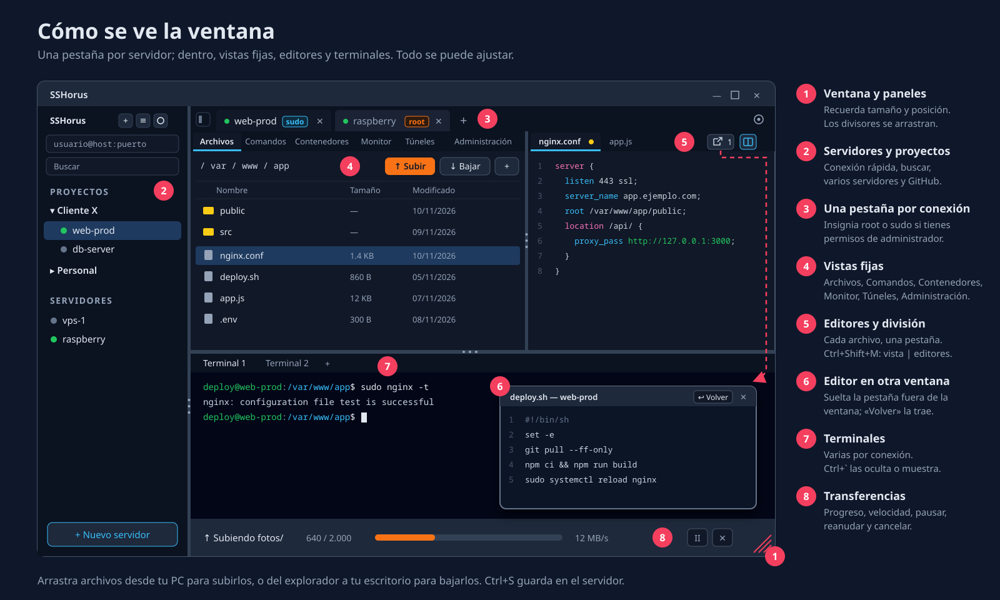

<p align="center">
  
</p>

<h1 align="center">TerView</h1>

<p align="center">
  <strong>Cliente SSH y SFTP de escritorio para Linux y Windows.</strong><br/>
  Conéctate a tus servidores, navega sus carpetas, sube y baja archivos, usa la terminal
  y aplica comandos listos, todo en una sola ventana.
</p>

<p align="center">
  <a href="https://github.com/LeoMael/TerView/releases/latest"></a>
  
  
</p>

<p align="center">
  <a href="#instalación">Instalación</a> ·
  <a href="#primeros-pasos">Primeros pasos</a> ·
  <a href="#atajos-de-teclado">Atajos</a> ·
  <a href="#solución-de-problemas">Problemas</a> ·
  <a href="#desarrollo">Desarrollo</a>
</p>



**[Manual de uso](docs/MANUAL.md)**: cómo usar cada función, paso a paso.

## Qué puedes hacer

- **Conectarte por SSH** con contraseña, llave o agente SSH. Comprueba la huella del servidor
  y acepta códigos de verificación (2FA). Las contraseñas se guardan en el llavero del sistema.
- **Seguir trabajando si se corta la red**: TerView reconecta solo y retoma terminales,
  explorador y transferencias.
- **Usar la terminal**: varias por conexión, con búsqueda, copiar/pegar y enlaces clicables.
- **No perder lo que corre en la terminal**: si el servidor tiene tmux, la terminal sigue viva aunque se
  corte la red o cierres la app, y TerView vuelve a ella.
- **Manejar archivos como en un explorador**: crear, renombrar, cambiar permisos, borrar y
  arrastrar archivos desde tu PC.
- **Transferir miles de archivos**: carpetas completas, varias a la vez, con pausa y reanudación.
  Si se corta, continúa desde donde quedó.
- **Editar archivos del servidor** con el mismo editor de VS Code: cada archivo en su pestaña, junto al explorador
  o en una ventana aparte (arrastra la pestaña fuera, como en el navegador).
- **Aplicar comandos listos** para Podman, Docker, sistema, red, servicios y logs, o guardar los tuyos.
  Incluye un botón **Analizar servidor**.
- **Organizar tus servidores** en proyectos, con carpetas favoritas. Importa y exporta `~/.ssh/config`.
- **Gestionar contenedores** de Podman o Docker sin escribir comandos: levantar, parar, ver logs,
  Compose, y limpiar imágenes que no se usan.
- **Ver el servidor en vivo**: CPU, memoria, discos, red y procesos, con alertas.
- **Administrar usuarios y grupos** si eres root o tienes sudo. TerView lo detecta solo y lo muestra en la pestaña.
- **Abrir túneles** para usar en tu PC una base de datos o un panel del servidor sin abrir puertos.
- **Ver puertos y sitios web** del servidor: qué programa usa cada puerto y los sitios de nginx o Caddy
  con sus dominios y certificados.
- **Ejecutar un comando en varios servidores** a la vez y comparar los resultados.
- **Buscar vulnerabilidades** en el servidor y en sus contenedores, con datos de OSV.dev y de tu distro, y
  el comando para actualizar. Si quieres, una IA te lo explica.
- **Conectar tu cuenta de GitHub**: llaves SSH, clonar, desplegar y sincronizar tu configuración.
- **Proteger tus contraseñas con un PIN**: quedan cifradas y TerView se bloquea al abrirlo y tras un rato sin uso.
- **Dejar que un asistente de IA te ayude** (Claude Code, Claude Desktop…) con tus servidores, sin darle
  tus contraseñas y con tu permiso para cada cambio. Ver [más abajo](#usar-terview-con-un-asistente-de-ia-mcp).
- **Actualizarse sola** cuando sale una versión nueva.
- Tema oscuro o claro y paneles ajustables.

## Instalación

Descarga el instalador de tu sistema en la página de
**[la última versión](https://github.com/LeoMael/TerView/releases/latest)** (sección *Assets*).

| Sistema | Archivo que debes bajar |
|---------|-------------------------|
| Windows 10 / 11 | `…_x64-setup.exe` (recomendado) o `…_x64_es-ES.msi` |
| Fedora, RHEL, Rocky, Alma, openSUSE | `….x86_64.rpm` |
| Debian, Ubuntu, Linux Mint, Pop!_OS | `…_amd64.deb` |
| Cualquier Linux, sin instalar | `…_amd64.AppImage` |

### Windows

1. Ejecuta el archivo `-setup.exe` y sigue los pasos. No pide permisos de administrador.
2. Si aparece **"Windows protegió su PC"**, pulsa *Más información* y luego *Ejecutar de todas formas*.
   Esto sale porque el instalador todavía no está firmado digitalmente.
3. Abre **TerView** desde el menú Inicio.

TerView necesita **Microsoft Edge WebView2**. Ya viene con Windows 10 y 11; si faltara, el
instalador lo descarga solo.

El archivo `.msi` es útil para empresas o instalaciones automáticas (`msiexec /i archivo.msi /quiet`).

### Fedora / RHEL / openSUSE (`.rpm`)

```bash
sudo dnf install ./TerView-*.x86_64.rpm      # Fedora, RHEL, Rocky, Alma
sudo zypper install ./TerView-*.x86_64.rpm   # openSUSE
```

Ábrela desde el menú de aplicaciones o escribiendo `terview` en la terminal.
Para desinstalar: `sudo dnf remove ter-view`.

### Debian / Ubuntu / Mint (`.deb`)

```bash
sudo apt install ./TerView_*_amd64.deb
```

El `./` delante del nombre es importante: así `apt` instala el archivo descargado junto con lo que necesite.
Para desinstalar: `sudo apt remove ter-view`.

### Cualquier Linux (`.AppImage`)

Es un solo archivo que se ejecuta sin instalar nada:

```bash
chmod +x TerView_*_amd64.AppImage
./TerView_*_amd64.AppImage
```

Si da un error de **FUSE**, instala `fuse-libs` (Fedora) o `libfuse2` (Ubuntu 22.04) / `libfuse2t64` (Ubuntu 24.04 o más nuevo).

### macOS

Todavía no hay instalador publicado. Se puede [compilar desde el código](#desarrollo).

## Primeros pasos

1. En la barra lateral pulsa **+ Nuevo → Servidor**. También puedes escribir `usuario@host:puerto`
   en *Conexión rápida*.
2. Elige cómo entrar: **contraseña**, **llave SSH** (por ejemplo `id_ed25519`) o **agente SSH**.
3. Haz **doble clic** en el servidor para conectarte. La primera vez verás la **huella** del
   servidor: confírmala si es el servidor correcto. Si ya está abierto, el doble clic te lleva a
   su pestaña; para abrir otra conexión usa **Ctrl+doble clic**, el clic central o el **+** de las pestañas.
4. Listo: arriba tienes **Archivos** y **Comandos**, abajo la **terminal**. Arrastra archivos
   desde tu PC al explorador para subirlos.

¿Ya tienes servidores en `~/.ssh/config`? Usa **+ Nuevo → Importar de ~/.ssh/config**.
En Windows ese archivo está en `C:\Users\<tu usuario>\.ssh\config`.

## Atajos de teclado

| Atajo | Acción |
|-------|--------|
| `Ctrl+Shift+P` | Paleta de comandos |
| `Ctrl+Tab` / `Ctrl+Shift+Tab` | Siguiente / anterior conexión |
| `Ctrl+W` | Cerrar la conexión actual |
| `Ctrl+B` | Mostrar u ocultar la barra lateral |
| ``Ctrl+` `` | Mostrar u ocultar la terminal |
| `Ctrl+,` | Ajustes |
| `Ctrl+Shift+L` | Bloquear TerView ahora (si usas PIN) |

**En la terminal:** `Ctrl+Shift+C` / `Ctrl+Shift+V` copiar y pegar · `Ctrl+Shift+F` buscar.
Con el foco en la terminal, `Ctrl+W` y `Ctrl+B` van a la shell (borrar palabra, prefijo de tmux).

**En el explorador:** `Enter` abrir · `Backspace` subir de carpeta · `Alt+←` / `Alt+→` atrás y adelante ·
`Ctrl+L` escribir ruta · `Ctrl+F` filtrar · `F2` renombrar · `Supr` eliminar · `F5` actualizar.

**En el editor:** `Ctrl+S` guardar en el servidor · `Ctrl+Shift+M` dividir (explorador | editor) o quitar la división ·
clic central en una pestaña para cerrarla.

Los archivos abiertos son pestañas, como en el navegador: arrastra una pestaña para cambiarla de orden, o
**suéltala fuera de la ventana** (o bastante más abajo de la barra) para abrirla en una ventana aparte. Al cerrar esa
ventana o pulsar «Volver», el archivo vuelve como pestaña. Con clic derecho en la pestaña: «Abrir en ventana aparte»,
«Dividir con Archivos» o «Dividir con Comandos». En Ajustes → Editor eliges cómo se abre un archivo: pestaña (por
defecto), dividido o ventana aparte.

## Seguridad

- Las **contraseñas** (de conexión y de sudo) y frases de llaves se guardan cifradas con tu **PIN**
  (si lo activas) o en el llavero del sistema (GNOME Keyring o KWallet en Linux, Administrador de credenciales en Windows).
  Nunca en archivos sin cifrar.
- Si la **huella** de un servidor cambia, TerView bloquea la conexión y te avisa, igual que `ssh`.
- El editor guarda de forma segura: primero en un archivo temporal y luego lo reemplaza,
  así un corte nunca deja el archivo a medias.

**Dónde se guarda cada cosa**

| Qué | Linux | Windows |
|-----|-------|---------|
| Servidores, proyectos, ajustes y comandos | `~/.config/terview/` | `%APPDATA%\terview\` |
| Contraseñas | Llavero del sistema | Administrador de credenciales |
| Huellas de servidores | `~/.ssh/known_hosts` | `%USERPROFILE%\.ssh\known_hosts` |
| Contraseñas con PIN (bóveda cifrada) | `~/.config/terview/vault.json` | `%APPDATA%\terview\vault.json` |
| Asistentes de IA: ajustes y registro | `~/.config/terview/mcp.json`, `mcp-audit.jsonl` | `%APPDATA%\terview\` |

### PIN y bloqueo

Al abrir TerView por primera vez te ofrece crear un **PIN de 6 números** («Ahora no» lo deja para
después). Lo cambias o bloqueas desde el **candado** de la barra de pestañas o en Ajustes → Seguridad.

- Las contraseñas guardadas y los tokens (GitHub, asistentes de IA e IA de informes) van **cifrados**
  en `vault.json`, con tu PIN **y** una llave de este equipo (en el llavero). Copiar solo el archivo a
  otro PC no sirve.
- TerView se **bloquea** al abrirlo, tras un rato sin uso (15 min por defecto) o con `Ctrl+Shift+L`.
  Las conexiones siguen abiertas; las contraseñas de sudo en memoria se olvidan.
- Tras **5 PIN incorrectos** hay que esperar, cada vez más (hasta 15 min). Nunca se borra nada por fallar.
- No cifra servidores, ajustes ni tus llaves de `~/.ssh`.

**Contraseña de sudo:** en el editor de servidor eliges «Pedir cada vez», «La de la conexión» o
«Guardar» (lo habitual si entras con llave SSH). El botón del ojo muestra la guardada (pide el PIN).

**Si olvidas el PIN:** en la pantalla de bloqueo pulsa **«Olvidé mi PIN»** y escribe `BORRAR`. Pierdes
las contraseñas guardadas y los tokens (GitHub, asistentes de IA e IA de informes); conservas todo lo
demás. El token del MCP se crea de nuevo: vuelve a copiar la configuración en tu asistente.

## Usar TerView con un asistente de IA (MCP)

Un asistente como **Claude Code** o **Claude Desktop** puede revisar y arreglar cosas en tus servidores
a través de TerView. Usa las conexiones que ya tienes y **nunca ve tus contraseñas ni tus llaves**.

1. En TerView: **Ajustes → Asistentes de IA (MCP)** y activa el servidor MCP (viene apagado).
2. En la misma pantalla, elige qué puede tocar en cada servidor: **Sin acceso** (lo normal),
   **Solo lectura** o **Completo**.
3. Copia la configuración que te muestra TerView y pégala en tu asistente. Para Claude Code es un
   comando así (TerView pone el token y la ruta por ti):
   ```bash
   claude mcp add --env TERVIEW_MCP_TOKEN=<token> --transport stdio terview -- /ruta/a/terview-mcp
   ```
   Para Claude Desktop, TerView te da el bloque JSON para `claude_desktop_config.json`.
4. Deja TerView abierto y pide algo al asistente, por ejemplo: «revisa por qué se cayó el contenedor
   web en web-prod».

Qué puede hacer el asistente (siempre dentro del acceso que le diste):

| Herramientas | Qué hacen | Permiso |
|--------------|-----------|---------|
| `list_servers`, `list_projects`, `list_sessions` | Ver tus servidores, proyectos y conexiones (sin contraseñas) | Pasa solo |
| `connect` | Abrir una conexión (aparece como pestaña) | Te pregunta |
| `run_command`, `run_catalog_command`, `list_catalog` | Ejecutar comandos o los de la Biblioteca | Te pregunta (los 📊 de solo lectura pasan solos) |
| `list_dir`, `stat`, `read_file` | Explorar y leer archivos | Pasa solo |
| `write_file`, `upload`, `download`, `transfer_status` | Guardar archivos y transferir | Te pregunta (con las diferencias) |
| `list_ports`, `list_sites`, `list_containers` | Puertos, sitios web y contenedores | Pasa solo |
| `get_vuln_report` | Último análisis de vulnerabilidades guardado, resumido | Pasa solo |
| `scan_vulnerabilities` | Analizar ahora, sin sudo (tarda minutos; consulta OSV.dev desde tu PC) | Te pregunta la primera vez; puedes elegir «Permitir siempre» |

Qué esperar:
- Lo que solo **lee** (listar, leer archivos, ver logs) pasa solo.
- Lo que **cambia algo** abre un aviso en TerView con el comando exacto: **Permitir una vez**,
  **Permitir siempre** o **Denegar**. Si no respondes en 2 minutos, se deniega.
- Lo **peligroso** (`rm -rf`, `sudo`, `reboot`, `prune`…) se pregunta siempre.
- Si TerView está **bloqueado** con el PIN, el asistente no puede hacer nada.
- Todo queda en **Actividad del asistente** (botón del robot en la barra de pestañas) y en
  `mcp-audit.jsonl`, en la carpeta de configuración.

El servidor solo escucha en tu propio equipo (`127.0.0.1`) y pide un token, que puedes regenerar en
Ajustes. Con la AppImage, usa la opción por HTTP que también muestra Ajustes.

## Solución de problemas

| Problema | Qué hacer |
|----------|-----------|
| Lentitud, parpadeos o ventana en blanco en Linux | Con tarjetas NVIDIA, TerView ya aplica el arreglo solo. Si sigue pasando, ábrela con `WEBKIT_DISABLE_COMPOSITING_MODE=1 terview`. |
| "Llavero del sistema no disponible" (Linux) | Instala o activa GNOME Keyring o KWallet. Sin llavero, TerView te pedirá la contraseña en cada conexión (el PIN también necesita el llavero para guardar la llave del equipo). |
| Olvidé el PIN, o "falta la llave de este equipo" | En la pantalla de bloqueo pulsa «Olvidé mi PIN» (ver [PIN y bloqueo](#pin-y-bloqueo)). Pierdes solo las contraseñas guardadas y el token de GitHub. |
| "¡La huella del servidor cambió!" | Si reinstalaste el servidor, es normal: confirma la nueva huella. Si no, **no te conectes**: podría ser un ataque. |
| No conecta con llave | Elige la llave **privada** (el archivo sin `.pub`) y comprueba que la pública está en `~/.ssh/authorized_keys` del servidor. |
| El agente SSH no funciona en Windows | Activa el servicio *Agente de autenticación OpenSSH* (`Get-Service ssh-agent \| Set-Service -StartupType Automatic -PassThru \| Start-Service` en PowerShell como administrador) o abre Pageant. |
| La AppImage no abre | Falta FUSE (ver arriba) o el permiso de ejecución (`chmod +x`). |
| El asistente dice «Abre TerView para usar tus servidores» | TerView tiene que estar abierto. Ábrelo: las herramientas aparecen solas. |
| El asistente dice «TerView está bloqueado» | Escribe tu PIN en TerView y vuelve a pedírselo. |
| El asistente dice «Token incorrecto» | Regeneraste el token: copia otra vez la configuración desde Ajustes → Asistentes de IA. |

## Desarrollo

Hecho con [Tauri 2](https://tauri.app) y Rust (`russh`, `russh-sftp`, `tokio`) para el motor, y
React 19 + TypeScript + Vite para la interfaz, con xterm.js y Monaco.
La arquitectura, con diagramas, está en [`docs/ARQUITECTURA.md`](docs/ARQUITECTURA.md).

### Requisitos

Necesitas **Rust** ([rustup.rs](https://rustup.rs)) y **Node.js 20 o más nuevo**, además de:

<details>
<summary><strong>Fedora</strong></summary>

```bash
sudo dnf install webkit2gtk4.1-devel openssl-devel libappindicator-gtk3-devel \
  librsvg2-devel libxdo-devel dbus-devel
sudo dnf group install c-development
```
</details>

<details>
<summary><strong>Debian / Ubuntu</strong></summary>

```bash
sudo apt install libwebkit2gtk-4.1-dev build-essential curl wget file libxdo-dev \
  libssl-dev libayatana-appindicator3-dev librsvg2-dev libdbus-1-dev
```
</details>

<details>
<summary><strong>Windows</strong></summary>

- [Microsoft C++ Build Tools](https://visualstudio.microsoft.com/visual-cpp-build-tools/) con la carga de trabajo *Desarrollo para el escritorio con C++*.
- WebView2 (ya viene con Windows 10 y 11).
</details>

<details>
<summary><strong>macOS</strong></summary>

```bash
xcode-select --install
```
</details>

### Compilar y ejecutar

```bash
git clone https://github.com/LeoMael/TerView.git
cd TerView
npm install
npm run tauri dev      # modo desarrollo (más lento, se recarga solo)
npm run tauri build    # instaladores en src-tauri/target/release/bundle/
```

El modo desarrollo es bastante más lento que la versión instalada. Para usar TerView en el día a día,
instala un instalador o usa `npm run tauri build`.

### Publicar una versión

Los instaladores los genera GitHub Actions. Sube la versión en `package.json`,
`src-tauri/Cargo.toml` y `src-tauri/tauri.conf.json`, anota los cambios en
[`CHANGELOG.md`](CHANGELOG.md) y crea una etiqueta:

```bash
git tag v0.4.0
git push origin v0.4.0
```

GitHub compila para Linux y Windows y crea un *release* en borrador con los instaladores. Revísalo y publícalo.

### Pruebas

Las pruebas del motor usan un servidor SSH local en un contenedor:

```bash
podman run -d --name terview-sshd -p 127.0.0.1:2222:2222 \
  -e PUID=1000 -e PGID=1000 -e PASSWORD_ACCESS=true \
  -e USER_NAME=test -e USER_PASSWORD=test123 \
  lscr.io/linuxserver/openssh-server:latest
podman exec terview-sshd apk add tmux   # para las pruebas de terminales persistentes

cd src-tauri
cargo test --lib -- --include-ignored --test-threads=1
cd .. && npx tsc --noEmit
```

### Estructura

```
src/              Interfaz (React + TypeScript)
  api/            Única puerta hacia el motor
  components/     Barra lateral, pestañas, explorador, terminal, editor, comandos, transferencias
  stores/         Estado (zustand)
src-tauri/src/    Motor (Rust)
  ssh/            Conexión, autenticación, huellas, reconexión
  terminal/       Shells remotas
  sftp/           Explorador y edición remota
  transfer/       Cola de transferencias en paralelo
  storage/        Servidores, ajustes, llavero, ~/.ssh/config
  snippets/       Mis comandos y ejecución con captura
  mcp/            Servidor MCP para asistentes de IA (permisos, aprobación, registro)
  vulnscan/       Escáner de vulnerabilidades (scripts, OSV.dev, herramientas de la distro, historial)
  ai/             IA opcional que solo explica los informes del escáner
  bin/            terview-mcp: puente stdio hacia la app abierta
docs/             Arquitectura, diagramas, pendientes y catálogo de comandos
```

## Hoja de ruta

Lo siguiente (detalle en [`docs/PENDIENTES.md`](docs/PENDIENTES.md)): administración de usuarios y grupos,
monitoreo en vivo, túneles (port forwarding), actualizaciones automáticas, instalador para macOS
e integración con la cuenta de GitHub.

<p align="center"><sub>Hecho con Tauri, Rust y React · © LeoMael</sub></p>
