# TerView — Arquitectura

Cliente SSH/SFTP de escritorio. Te conectas a tus servidores y desde una sola ventana tienes:
explorador de archivos, editor, terminales (persistentes con tmux), transferencias masivas,
biblioteca de comandos, contenedores (Podman/Docker), monitor en vivo, túneles, administración del
servidor (usuarios, grupos, puertos, sitios web), GitHub y, si quieres, un PIN que cifra tus
contraseñas guardadas y bloquea la app.

**Tecnología:** Tauri 2 + Rust (motor, `src-tauri/`) · React 19 + TypeScript + zustand (interfaz, `src/`).

**Estado que describe este documento:** el código del commit `bcd0267` (versión 0.3.0) más los cambios
"Sin publicar" del CHANGELOG, que saldrán en la siguiente versión; entre ellos, la bóveda con PIN y
las terminales persistentes con tmux.

---

## Diagramas

Las imágenes están en `docs/arquitectura/`: PNG para ver y SVG para editar. Todos usan el mismo
lenguaje visual: zonas con borde discontinuo (Tu PC, Internet, Tus servidores, GitHub) y un color por papel.

| Color | Significa |
|-------|-----------|
| Azul | Interfaz (React) |
| Naranja | Motor (Rust) |
| Verde | Tus servidores y la conexión SSH |
| Rosa | GitHub y HTTPS |
| Amarillo | Datos guardados en disco |
| Morado | Mensajes IPC entre interfaz y motor; con borde discontinuo, datos que solo viven en memoria |
| Rojo | Root, peligro o cancelar |

| # | Diagrama | Qué explica |
|---|----------|-------------|
| 0 | [Mapa general](arquitectura/00-mapa-general.png) | Dónde está cada pieza, cómo se comunican y dónde se guarda cada dato |
| 1 | [Vista general](arquitectura/01-vista-general.png) | Las funciones de la interfaz y la pieza del motor que hace el trabajo |
| 2 | [Conexión y canales](arquitectura/02-conexion-y-canales.png) | Una conexión SSH con todos sus canales en paralelo |
| 3 | [Subida masiva](arquitectura/03-subida-masiva.png) | Cómo se sube una carpeta con miles de archivos |
| 4 | [La ventana](arquitectura/04-ventana.png) | Cómo se ve la ventana y qué se puede ajustar |
| 5 | [Estructura del código](arquitectura/05-estructura-codigo.png) | Carpetas reales del código y cómo se conectan |
| 6 | [Flujo de conexión](arquitectura/06-flujo-conexion.png) | Qué pasa, paso a paso, al conectarte |
| 7 | [Biblioteca de comandos](arquitectura/07-biblioteca-comandos.png) | Panel de Comandos (Podman, análisis, mis comandos) |
| 8 | [Servidor MCP](arquitectura/08-servidor-mcp.png) | **Diseño en pausa, no construido** (ver sección 16) |
| 9 | [Ejecutar y elevar](arquitectura/09-ejecutar-y-elevar.png) | Comandos aparte por canal exec, sudo y cancelación real |
| 10 | [Administración](arquitectura/10-administracion.png) | Usuarios, grupos, puertos, sitios web, Plan e historial |
| 11 | [Túneles](arquitectura/11-tuneles.png) | Local, remoto y SOCKS, y su relación con Puertos y Contenedores |
| 12 | [Arrastre al sistema](arquitectura/12-arrastre-al-sistema.png) | Arrastrar del servidor al escritorio en Linux, Windows y macOS |
| 13 | [Publicación y actualizaciones](arquitectura/13-publicacion-y-actualizaciones.png) | GitHub Actions, instaladores, firma y actualización automática |
| 14 | [GitHub](arquitectura/14-github.png) | Token, llaves, despliegues, Actions y Gist cifrado |
| 15 | [Bóveda y bloqueo](arquitectura/15-boveda-y-bloqueo.png) | PIN, cómo se saca la llave, estados y qué protege |
| 16 | [Terminales con tmux](arquitectura/16-terminales-tmux.png) | Terminales que siguen vivas aunque se corte la red |

Lo que falta y el plan detallado: **[PENDIENTES.md](PENDIENTES.md)**.
Todos los comandos de la biblioteca: **[comandos/CATALOGO.md](comandos/CATALOGO.md)**.

---

## 0. Mapa general: dónde está cada cosa (diagrama 0)

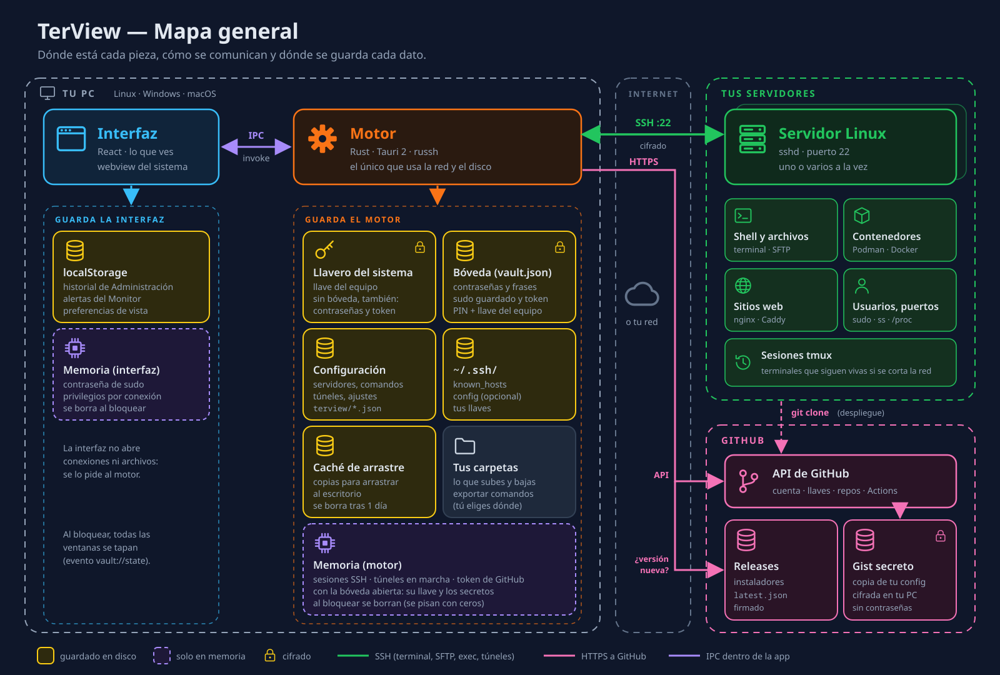

La app tiene dos mitades dentro del mismo programa:

- **Interfaz** (React, dibujada por el motor web del sistema: WebKitGTK en Linux, WebView2 en
  Windows, WKWebView en macOS). Pinta pantallas y le pide cosas al motor. **No abre conexiones ni
  archivos**: la CSP de la ventana no le deja salir a internet.
- **Motor** (Rust). Es el único que habla con la red y con el disco: SSH, SFTP, túneles, GitHub,
  llavero y archivos de configuración.

### Dónde se guarda cada dato

`<config>` es la carpeta de configuración del sistema: `~/.config` en Linux,
`%APPDATA%` (`C:\Users\<tú>\AppData\Roaming`) en Windows y `~/Library/Application Support` en macOS.

| Almacén | Qué guarda | Formato | Dónde | ¿Cifrado? | Quién lo lee y escribe |
|---------|------------|---------|-------|-----------|------------------------|
| **Llavero del sistema** | Servicio `terview`. **Con bóveda:** solo la llave del equipo (usuario `vault-device-key`, 32 bytes al azar). **Sin bóveda:** además la contraseña o frase de cada servidor (usuario = id del servidor), su contraseña de sudo guardada (usuario `<id>:sudo`) y el token de GitHub (usuario `github-token`). | Entradas del llavero | Linux: Secret Service (GNOME Keyring / KWallet) · Windows: Administrador de credenciales · macOS: Llavero | Sí, lo cifra el sistema | Motor: `storage/secrets.rs` (crate `keyring`), `storage/vault.rs` |
| **Bóveda `vault.json`** (opcional) | Con PIN activo: contraseñas y frases de los servidores, sus contraseñas de sudo guardadas y el token de GitHub. | Sobre JSON `terview-vault`: parámetros de Argon2id, sal, tipo de PIN (`kind`), nonce y texto cifrado (base64) | `<config>/terview/vault.json` | Sí: AES-256-GCM; llave = Argon2id(PIN, llave del equipo) | Motor: `storage/vault.rs`, `storage/cipher.rs`, `storage/lock.rs` |
| **`vault-attempts.json`** | Fallos de PIN y hora del próximo intento permitido (5 libres; luego 30 s, el doble cada vez, hasta 15 min). | JSON | `<config>/terview/vault-attempts.json` | No (no lleva secretos) | Motor: `storage/vault.rs` |
| **`profiles.json`** | Servidores y proyectos (host, usuario, puerto, tipo de autenticación, ruta de la llave, marcadores). Nunca contraseñas. | JSON | `<config>/terview/profiles.json` | No (archivo 0600, carpeta 0700 en Unix) | Motor: `storage/` (`ProfileStore`) |
| **`settings.json`** | Ajustes: tema, fuentes, transferencias simultáneas, política de conflictos, señal de vida, reconexión, tamaños de paneles (`layout`), sincronizar `~/.ssh/config`. | JSON | `<config>/terview/settings.json` | No | Motor: `storage/` (`SettingsStore`) |
| **`commands.json`** | "Mis comandos" (biblioteca propia). | JSON | `<config>/terview/commands.json` | No | Motor: `snippets/store.rs` |
| **`tunnels.json`** | Túneles guardados por servidor (tipo, puertos, destino, `autoStart`). | JSON | `<config>/terview/tunnels.json` | No | Motor: `tunnels/store.rs` |
| **`github.json`** | Recetas de despliegue y el id del Gist de sincronización. Nunca el token. | JSON | `<config>/terview/github.json` | No | Motor: `github/config.rs` |
| **`ssh-aliases.json`** | Alias elegidos a mano para los `Host` que TerView escribe en `~/.ssh/config`. | JSON | `<config>/terview/ssh-aliases.json` | No | Motor: `storage/ssh_config.rs` |
| **Estado de la ventana** | Tamaño, posición y si estaba maximizada (solo la ventana principal). | JSON | Linux `~/.config/com.terview.app/.window-state.json` · Windows `%APPDATA%\com.terview.app\` · macOS `~/Library/Application Support/com.terview.app/` | No | Plugin `tauri-plugin-window-state` |
| **`~/.ssh/known_hosts`** | Huellas de los servidores en los que confías (el mismo archivo que usa `ssh`). | Texto OpenSSH | `~/.ssh/known_hosts` (Windows: `C:\Users\<tú>\.ssh\known_hosts`) | No | Motor: `ssh/known_hosts.rs` (lee, añade o reemplaza; escritura atómica) |
| **`~/.ssh/config`** | Opcional: bloque marcado con tus servidores, para usar `ssh <alias>` en la terminal. La primera vez se guarda `config.bak-terview`. También se puede importar desde ahí. | Texto OpenSSH | `~/.ssh/config` | No | Motor: `storage/ssh_config.rs` |
| **Tus llaves SSH** | Llaves privadas para conectar (las de siempre) y públicas (`*.pub`) para GitHub. | OpenSSH | `~/.ssh/` | La frase, si la tiene | Motor: `ssh/connect.rs` (privadas, solo lectura) · `github/localkey.rs` (solo `*.pub`) |
| **`localStorage`** | Historial de Administración (`terview.admin.history.v1.<perfil>`, 300 entradas), alertas del Monitor (`terview.monitor.alerts.<perfil>`), preferencias del Monitor, de Contenedores, de Ejecutar en varios servidores, servidores recientes, búsqueda de actualizaciones, editor en pestaña o ventana, GPU de la terminal, proyectos plegados. | Clave → texto (JSON) | Lo gestiona el motor web. Linux: `~/.local/share/com.terview.app/localstorage/` · Windows: `%LOCALAPPDATA%\com.terview.app\EBWebView\` | No | Interfaz (con try/catch: si falla, todo funciona igual y solo se pierde la preferencia) |
| **Caché de arrastre** | Copias descargadas para arrastrar al escritorio. Se borran al abrir la app si tienen más de un día. | Archivos | Linux `~/.cache/com.terview.app/arrastre/` · Windows `%LOCALAPPDATA%\com.terview.app\arrastre\` · macOS `~/Library/Caches/com.terview.app/arrastre/` | No | Motor: `dragout/` y `transfer/` |
| **Tus carpetas** | Lo que subes y bajas, y los archivos de exportar o importar comandos. Tú eliges dónde. | Archivos | Donde elijas | No | Motor: `transfer/`, `localfs.rs` |
| **Memoria del motor** | Sesiones SSH abiertas, terminales, canales SFTP, cola de transferencias, ejecuciones en curso, túneles en marcha y el token de GitHub ya leído. Con la bóveda abierta, también su llave y los secretos descifrados; al bloquear se pisan con ceros (`Zeroizing`) y se olvida el token. El stdin con contraseñas se sobrescribe con ceros al terminar. | Estructuras Rust | RAM | — | Motor (`SessionStore`, `TerminalStore`, `SftpStore`, `TransferManager`, `ExecRegistry`, `TunnelManager`, `Vault`) |
| **Memoria de la interfaz** | Contraseña de sudo por conexión (`useSudo`), privilegios detectados, pestañas abiertas. La contraseña de sudo se olvida al cerrar la pestaña, al perder la conexión o al bloquear TerView. | Stores de zustand sin persistencia | RAM | — | Interfaz: `features/privileges/`, `features/lock/` y `stores/` |
| **Sesiones tmux** (en el servidor) | Terminales persistentes `terview-<id>` con su historial (50.000 líneas). | Servidor tmux propio `-L terview` | Tu servidor | — | Motor: `terminal/tmux.rs` por SSH |
| **Gist secreto** (GitHub) | `terview-sync.json`: copia de servidores, proyectos y comandos, sin contraseñas. | JSON cifrado | Tu cuenta de GitHub | Sí: AES-256-GCM con clave derivada por Argon2id de una frase que nunca se guarda | Motor: `github/crypto.rs`, `github/mod.rs` |
| **Releases** (GitHub) | Instaladores, sus firmas `.sig` y `latest.json`. | Archivos | `github.com/LeoMael/TerView/releases` | Firmados (minisign), no cifrados | GitHub Actions los sube; el actualizador de la app los lee |

### Qué significa cada flecha del mapa

| Flecha | Protocolo | Canal o mecanismo | Módulo |
|--------|-----------|-------------------|--------|
| Interfaz ↔ Motor (**IPC**) | Mensajes internos de Tauri, dentro del mismo proceso | `invoke()` para comandos y respuestas; `Channel` para los bytes de la terminal; `emit()` para eventos globales (progreso de transferencias, `tunnel://status`, `vault://state` a todas las ventanas, reconexión, fin de terminal) | `src/api/*` ↔ comandos registrados en `src-tauri/src/lib.rs` |
| Motor ↔ Servidor (**SSH :22**) | SSH 2 (russh), cifrado, una conexión por pestaña | Canales: `session` + PTY (terminal), subsistema `sftp` (explorador y transferencias), `exec` (comandos aparte), `direct-tcpip` y `forwarded-tcpip` (túneles) | `ssh/`, `terminal/`, `sftp/`, `transfer/`, `snippets/exec.rs`, `tunnels/` |
| Motor → GitHub (**HTTPS, API**) | HTTPS con reqwest + rustls (sin OpenSSL) | API REST de GitHub; solo hosts de GitHub (`ALLOWED_HOSTS`); token en la cabecera `Authorization`, nunca en registros | `github/http.rs`, `github/api.rs` |
| Motor → GitHub (**¿versión nueva?**) | HTTPS | `releases/latest/download/latest.json`, descarga del instalador y verificación de la firma | `tauri-plugin-updater` (lo usa `src/features/updater/`) |
| Servidor → GitHub (**git clone**) | git por SSH | El servidor clona con su propia llave de despliegue de solo lectura (`GIT_SSH_COMMAND`); TerView solo le envía los comandos por `exec` | `src/features/github/shell.ts` |
| Motor ↔ disco | Archivos y llavero del sistema | Escritura atómica (temporal + renombrar); archivo dañado → se aparta como `.bak-<fecha>` | `storage/fsutil.rs`, `storage/secrets.rs` |
| Interfaz ↔ `localStorage` | API Web Storage del motor web | Lectura y escritura síncronas, siempre con try/catch | `features/*`, `components/*` |

---

## 1. Vista general (diagrama 1)

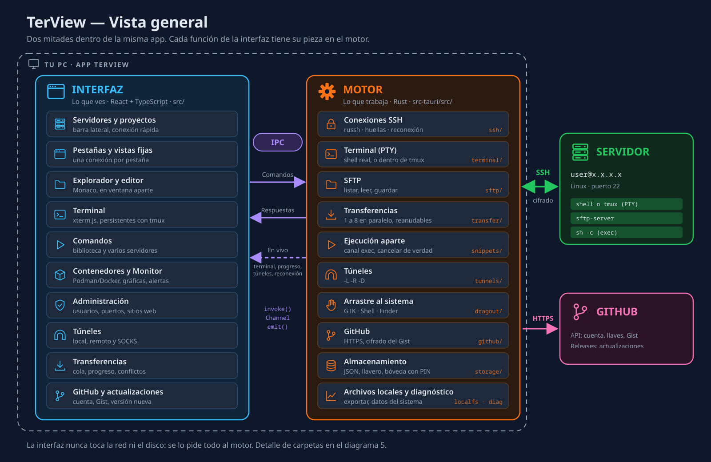

Cada función que ves tiene una pieza del motor que hace el trabajo real:

| Interfaz (`src/`) | Motor (`src-tauri/src/`) |
|-------------------|--------------------------|
| Servidores y proyectos, pestañas | `ssh/` (conectar, huellas, reconexión), `storage/` |
| Explorador y editor | `sftp/` |
| Terminal (persistente con tmux) | `terminal/` |
| Transferencias | `transfer/` |
| Comandos, Ejecutar en varios servidores, Contenedores, Monitor, Administración | `snippets/` (canal exec) |
| Túneles | `tunnels/` |
| Arrastrar al escritorio | `dragout/` + `transfer/` |
| GitHub | `github/` (+ exec para lo que toca al servidor) |
| Actualizaciones | plugins `updater` y `process` |
| Ajustes → Seguridad (PIN y bloqueo) | `storage/vault.rs`, `storage/lock.rs` |
| Ajustes → Diagnóstico, exportar comandos | `diagnostics.rs`, `localfs.rs` |

**Hay dos tipos de mensaje:**

- **Comandos (pregunta y respuesta).** Ejemplo: `invoke("sftp_list_dir", { sessionId, path })` →
  el motor lee la carpeta por SFTP → la interfaz recibe la lista y la pinta.
- **Flujos y eventos (datos continuos).** Los bytes de la terminal llegan por un `Channel`; el
  progreso de las transferencias (cada ~200 ms), el estado de los túneles y los avisos de
  reconexión llegan como eventos globales.

¿Por qué así? Rust es rápido y seguro para red y archivos, y React es cómodo para interfaces. La
ventana usa el motor web del sistema, así que la app es pequeña (no lleva un navegador entero como Electron).

---

## 2. Una conexión, muchos canales (diagrama 2)

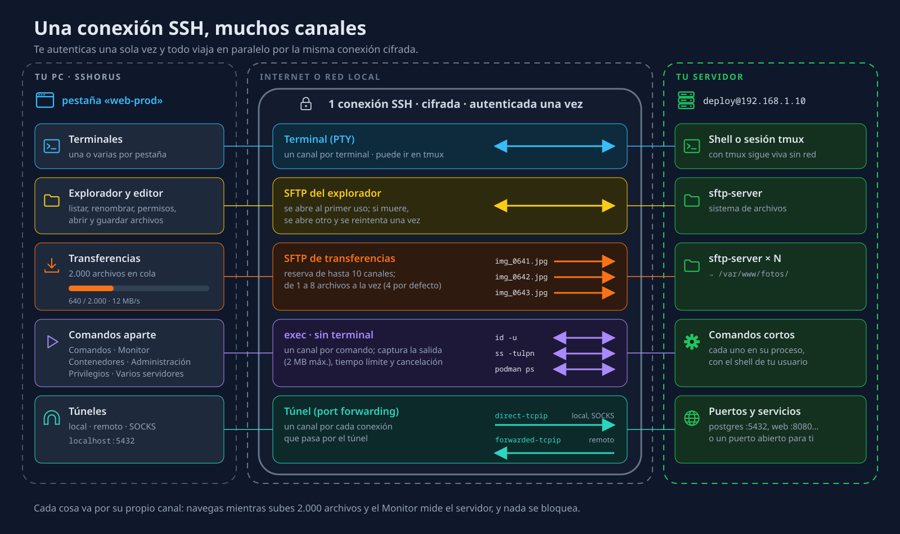

- Al conectar se abre **una sola conexión SSH** (`SshSession`, `ssh/mod.rs`). Todo lo demás son
  canales dentro de ella (`open_channel` / `open_sftp`).
- **Terminal:** un canal con PTY por terminal (`terminal/shell.rs`). Si el servidor tiene tmux, ese
  canal se engancha a una sesión tmux propia y la terminal sobrevive a los cortes (sección 15).
- **SFTP del explorador:** uno por sesión, se abre al primer uso (`sftp/mod.rs`). Si muere, se abre
  otro y la operación se reintenta una vez.
- **SFTP de transferencias:** reserva de hasta 10 canales por servidor (`transfer/pool.rs`), de 1 a 8
  archivos a la vez (ajuste `transferConcurrency`, 4 por defecto).
- **exec (sin terminal):** un canal por comando (`snippets/exec.rs`), con salida capturada (2 MB por
  flujo como máximo), tiempo límite y cancelación. Ver el diagrama 9.
- **Túneles:** un canal por cada conexión que pasa por el túnel: `direct-tcpip` (local y SOCKS) o
  `forwarded-tcpip` (remoto, llega por `ssh/handler.rs` → `tunnels/remote.rs`).

Ventaja: te autenticas una vez, y navegar, subir archivos, medir el servidor y usar la terminal no se bloquean entre sí.

---

## 3. Subir una carpeta completa (diagrama 3)

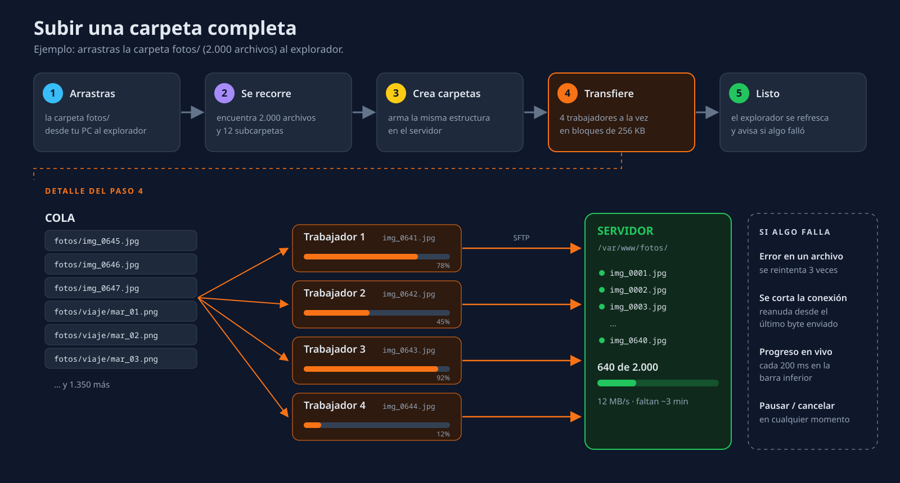

- `transfer/paths.rs` recorre la carpeta local; se crean las carpetas remotas (varias a la vez) y
  cada archivo entra en la cola de su servidor (`transfer/engine.rs`).
- Cada servidor tiene su cola y trabaja con hasta `transferConcurrency` archivos a la vez, así que dos
  servidores avanzan en paralelo. Los enlaces simbólicos se recrean (nunca se siguen).
- `transfer/copy.rs` copia con peticiones encadenadas: bloques de 255 KB y unos 4 MB en vuelo, sin
  esperar cada respuesta. Al final se copian fecha y permisos.
- Si el archivo ya existe se aplica la política `transferConflict` (`transfer/policy.rs`): sobrescribir,
  omitir, solo si es más nuevo o preguntar (con "mantener ambos" y "aplicar a todos").
- Un error se reintenta hasta 3 veces. Si se corta la conexión, los trabajos esperan la reconexión
  hasta 5 minutos sin gastar reintentos y siguen desde el último byte confirmado.
- Cada 200 ms el motor envía solo los trabajos que cambiaron. Bajar funciona igual, al revés.

---

## 4. Cómo se ve la ventana (diagrama 4)

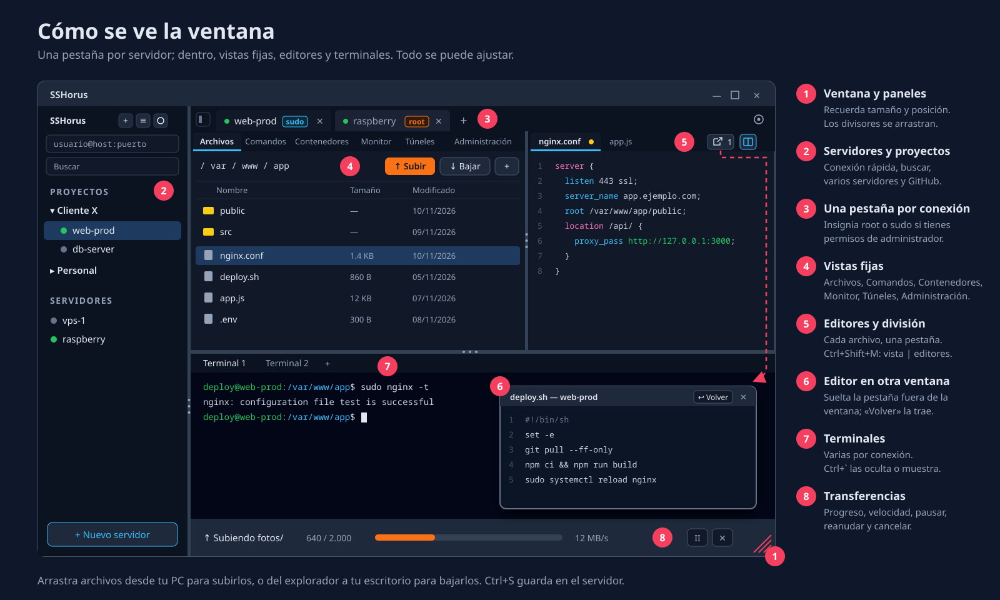

- **Barra lateral:** proyectos y servidores, conexión rápida `usuario@host:puerto`, buscar,
  "Ejecutar en varios servidores" y GitHub. Doble clic en un servidor va a su pestaña abierta.
- **Pestañas de conexión:** una por servidor, con su estado y una insignia de privilegios
  (`root`, `sudo`/`doas` o `sudo?`), detectada en segundo plano al conectar.
- **Vistas fijas** dentro de cada conexión: Archivos, Comandos, Contenedores, Monitor, Túneles y
  Administración. Cada una se monta la primera vez que se abre y luego se conserva.
- **Editores:** cada archivo abierto es una pestaña más en la misma fila. Ctrl+Shift+M divide el
  área en vista fija | editores.
- **Editor en otra ventana:** suelta la pestaña fuera de la ventana o usa "Abrir en ventana aparte".
  Las ventanas se hablan por eventos (`windows/editorWindowBus.ts`); "Volver" o cerrar la ventana la
  devuelve como pestaña. Al cerrar la ventana principal se cierra toda la app.
- **Abajo:** terminales (varias por conexión; con ∞ si son persistentes con tmux) y el panel de
  transferencias. Con PIN activo, una pantalla de bloqueo tapa todas las ventanas.
- La ventana principal se abre en 1280×800 (mínimo 900×600), recuerda tamaño y posición, y los
  paneles guardan su tamaño en `settings.json` (`layout`).

---

## 5. Estructura del código (diagrama 5)

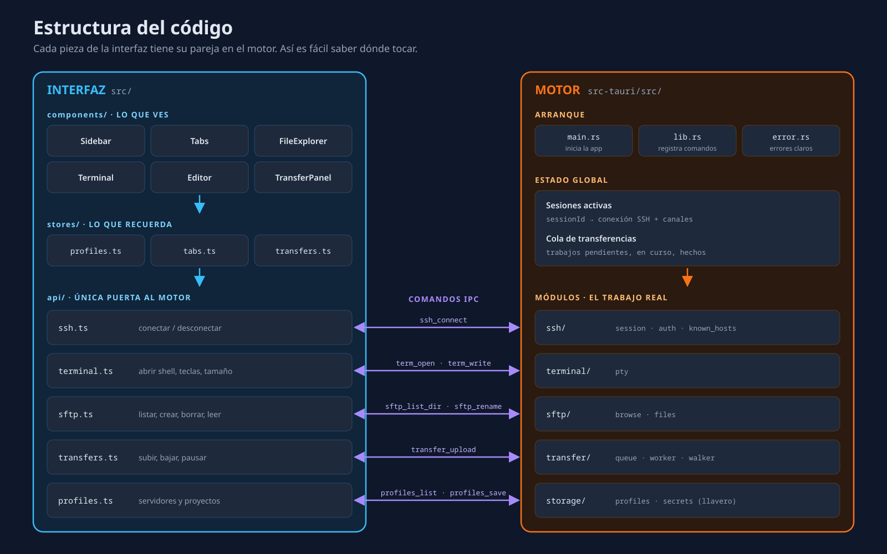

**Interfaz (`src/`):**

| Carpeta | Qué tiene |
|---------|-----------|
| `components/` | Lo que ves: `Sidebar`, `Tabs`, `Session`, `FileExplorer`, `Editor`, `Terminal`, `TransferPanel`, `Commands`, `MultiRun`, `Containers`, `Monitor`, `Admin`, `Tunnels`, `GitHub`, `Settings`, `Diagnostics`, `Welcome`, `About`, `ui` |
| `features/` | La lógica de cada función: scripts que se envían al servidor, lectura de sus salidas y estado. `admin`, `containers`, `monitor`, `multirun`, `privileges`, `tunnels`, `github`, `updater`, `lock` (pantalla de bloqueo y PIN), `tmux`, `connect.ts` |
| `stores/` | Estado global con zustand: `profiles`, `settings`, `tabs`, `transfers`, `terminalBus`, `toasts`, `ui` |
| `api/` | La única puerta al motor: un archivo por módulo (`ssh.ts`, `sftp.ts`, `snippets.ts`…), `core.ts` (llamada y errores) y `types.ts` (espejo exacto de `types.rs`) |
| `windows/` | La ventana de editor aparte |
| `lib/` | Utilidades: rutas, formato, plataforma, carga diferida |

**Motor (`src-tauri/src/`):**

| Módulo | Qué hace |
|--------|----------|
| `lib.rs`, `main.rs` | Arranque: registra plugins, estado global y todos los comandos |
| `error.rs`, `types.rs` | Errores traducidos a mensajes claros y tipos compartidos con la interfaz |
| `platform.rs` | Ajustes de WebKitGTK antes de crear la ventana (problemas con NVIDIA) |
| `ssh/` | Conectar y autenticar (`connect`), huellas (`known_hosts`, `handler`), reconexión (`reconnect`) |
| `terminal/` | Shell con PTY sobre un canal SSH (`shell`) y sesiones persistentes (`tmux`) |
| `sftp/` | Explorador y editor: listar, crear, renombrar, permisos, leer y guardar |
| `transfer/` | Cola, trabajadores, reserva de canales, copia encadenada, conflictos |
| `snippets/` | "Mis comandos" y ejecución aparte por canal exec, con cancelación |
| `tunnels/` | Túneles local, remoto y SOCKS, con vigilante |
| `dragout/` | Arrastre nativo al escritorio (Linux, Windows, macOS) |
| `github/` | Cuenta, API, llaves públicas locales, cifrado del Gist, compartir comandos |
| `storage/` | Perfiles, ajustes, llavero (`secrets`), bóveda con PIN (`vault`, `cipher`), bloqueo e inactividad (`lock`), `~/.ssh/config` |
| `localfs.rs`, `diagnostics.rs` | Archivos de texto que eliges (exportar/importar) y datos del sistema para el diagnóstico |

Librerías clave del motor: `tauri`, `tokio`, `russh`, `russh-sftp`, `keyring`, `serde`, `reqwest`
(con rustls), `aes-gcm` + `argon2` (bóveda y Gist cifrado), `zeroize` (borrar secretos de la memoria), `gtk` (arrastre en Linux), `windows` (arrastre en
Windows), `drag` (arrastre en macOS). Plugins: `window-state`, `opener`, `dialog`, `clipboard-manager`,
`updater`, `process`.

Librerías clave de la interfaz: `react`, `@xterm/xterm` (con WebGL), `@monaco-editor/react`,
`zustand`, `react-resizable-panels`, `@tauri-apps/api` y los plugins de Tauri, `lucide-react` (iconos).

---

## 6. Qué pasa al conectarte (diagrama 6)

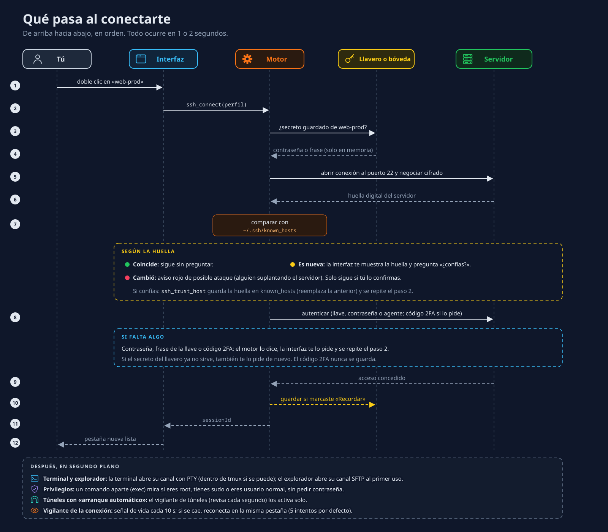

- La interfaz (`features/connect.ts`) llama a `ssh_connect`. Si no le diste la contraseña o la frase,
  el motor la busca en la bóveda (si hay PIN) o en el llavero; solo vive en memoria. Si TerView está
  bloqueado, responde `Locked`.
- `ssh/connect.rs` abre TCP, negocia el cifrado y compara la huella con `~/.ssh/known_hosts`.
  - Huella **nueva**: la interfaz te la muestra y pregunta si confías.
  - Huella **cambiada**: aviso rojo de posible ataque; solo sigue si lo confirmas.
  - Si confías, `ssh_trust_host` guarda la huella (reemplaza la anterior) y se repite la conexión.
- La autenticación puede encadenar llave, contraseña, agente y código 2FA. Si falta un dato, el
  motor lo dice (`NeedsPassword`, `NeedsPassphrase`, `NeedsOtp`), la interfaz lo pide y repite.
  Con "Recordar", el secreto se guarda en el llavero solo si la conexión funcionó. El código 2FA nunca se guarda.
- El motor arranca el vigilante (`ssh/reconnect.rs`): señal de vida cada 10 s, caída tras 3 sin
  respuesta y reconexión automática en la misma pestaña (5 intentos por defecto).
- Después, en segundo plano: la terminal abre su canal PTY, el explorador su canal SFTP al primer
  uso, se detectan los privilegios (root, sudo o usuario normal) y se activan los túneles con
  arranque automático.

---

## 7. Biblioteca de comandos (diagrama 7)

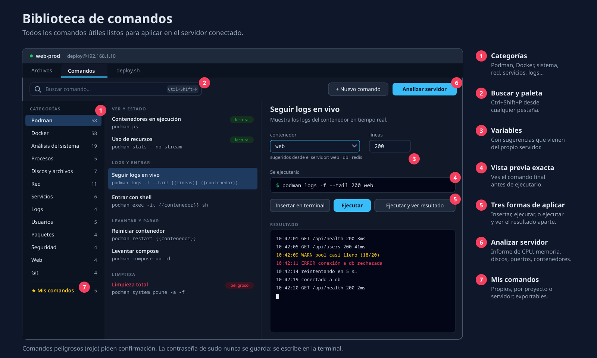

Panel "Comandos" de cada conexión: catálogo por categorías, variables con sugerencias del propio
servidor, vista previa exacta, "Insertar en terminal", "Ejecutar" y "Ejecutar y ver resultado"
(este último por el canal exec, y se puede cancelar de verdad), análisis del servidor y "Mis
comandos" (exportar, importar y compartir por Gist). Los comandos con `sudo` se mandan a la terminal
para que escribas la contraseña ahí. Detalle en [PENDIENTES.md](PENDIENTES.md#1-biblioteca-de-comandos).

---

## 8. Ejecutar un comando aparte y como root (diagrama 9)

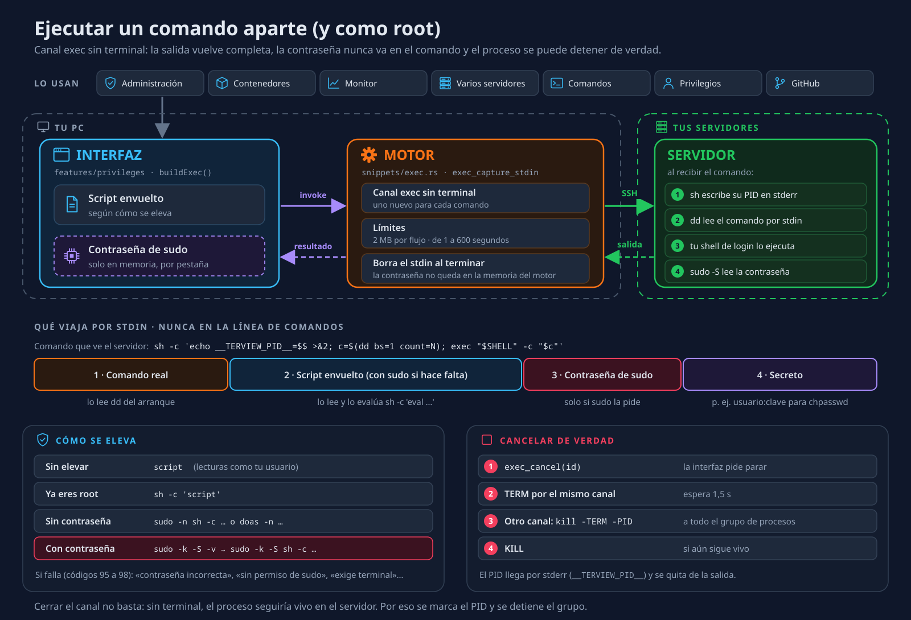

Lo usan Administración, Contenedores, Monitor, Ejecutar en varios servidores, Comandos ("Ejecutar
y ver resultado"), la detección de privilegios y GitHub (clonar y desplegar).

- **Canal exec sin terminal**, uno nuevo por comando (`exec_capture` / `exec_capture_stdin` en
  `snippets/`). Límites: 2 MB por flujo y de 1 a 600 segundos.
- **El comando real no va en la línea de comandos.** El servidor solo recibe un arranque corto:
  `sh -c 'echo __TERVIEW_PID__=$$ >&2; c=$(dd bs=1 count=N); exec "$SHELL" -c "$c"'`. `dd` lee
  exactamente N bytes de stdin y el shell de login del usuario los ejecuta con el mismo PID.
- **Qué viaja por stdin, en orden:** 1) el comando real; 2) el script envuelto (`buildExec` en
  `features/privileges/elevate.ts`, que lo lee con `sh -c 'eval "$(dd …)"'`); 3) la contraseña de
  sudo, si hace falta; 4) un secreto, por ejemplo `usuario:clave` para `chpasswd`.
- **Cómo se eleva:** sin elevar (el script tal cual), ya eres root (`sh -c`), sin contraseña
  (`sudo -n` o `doas -n`) o con contraseña (`sudo -k -S -v` la comprueba y después
  `sudo -k -S sh -c …` ejecuta). Los fallos se reconocen por el código de salida (95 a 98) y una
  marca en stderr: exige terminal, sin permiso, contraseña incorrecta o pide contraseña.
- **La contraseña de sudo vive en memoria**, una por conexión (`useSudo`). Se olvida al cerrar
  la pestaña, al perder la conexión, al bloquear o si es incorrecta. Si el servidor tiene «La de la
  conexión» o «Guardar», se lee del motor (`profiles_sudo_password`) cuando un panel la necesita, se
  comprueba con `sudo -v` y, si falla, se pide otra y se ofrece guardarla. El motor nunca registra el stdin y lo
  sobrescribe con ceros al terminar.
- **Cancelación real:** `exec_cancel(id)` → el motor pide TERM por el mismo canal y espera 1,5 s →
  si no se cierra, abre **otro** canal y ejecuta `kill -TERM -PID` (a todo el grupo de procesos) →
  si sigue vivo, KILL. Lo mismo pasa al vencer el tiempo límite. Cerrar el canal no basta: sin
  terminal, el proceso seguiría vivo en el servidor.
- Hoy pasan un `exec_id` (y por tanto se pueden cancelar a mitad) **Comandos** y **Ejecutar en
  varios servidores**. El resto usa el mismo arranque, así que también se detiene en el servidor al
  vencer el tiempo.

---

## 9. Administración del servidor (diagrama 10)

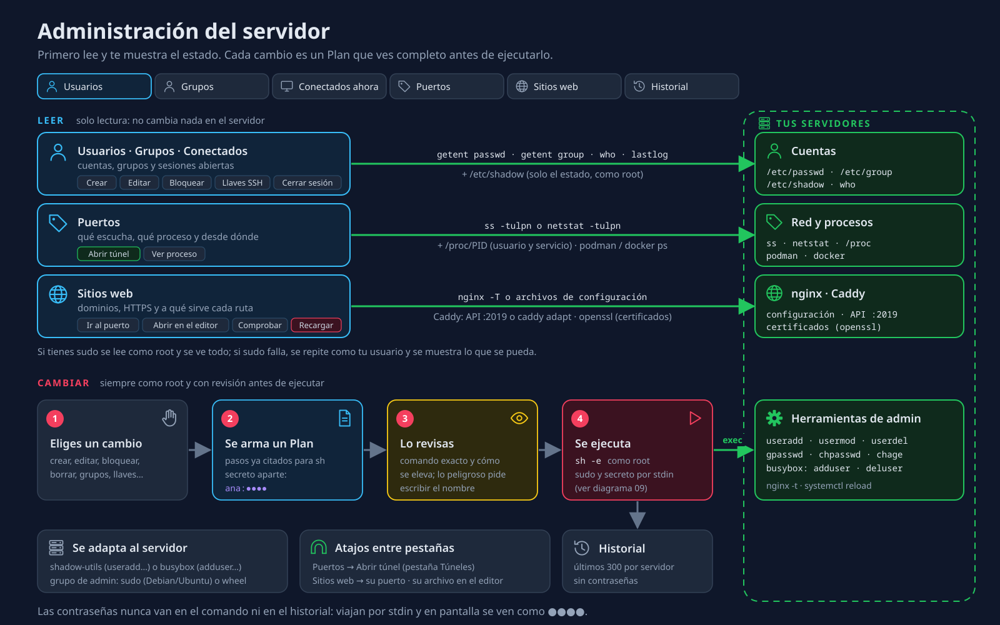

- **Sub-pestañas:** Usuarios, Grupos, Conectados ahora, Puertos, Sitios web e Historial. Interfaz en
  `components/Admin/`, lógica en `features/admin/`. Todo pasa por el canal exec de la sección 8.
- **Lecturas:**
  - Usuarios, grupos y sesiones: `READ_SCRIPT` como tu usuario (`getent passwd/group`, `who`,
    `lastlog`). Como root se añade `/etc/shadow`, del que solo se saca el estado de cada cuenta.
  - **Puertos:** `ss -tulpn` (o `netstat -tulpn`), más `/proc/<pid>` para el usuario y el servicio
    systemd, y `podman ps` / `docker ps` para saber de qué contenedor es cada puerto.
  - **Sitios web:** `nginx -T` (o los archivos de configuración si falla); Caddy por su API local
    `127.0.0.1:2019/config/` o, si no responde, `caddy adapt`; caducidad de certificados con `openssl`.
  - `readElevated`: si tienes sudo se lee como root; si sudo falla, se repite como tu usuario.
- **Cambios:** cada cambio es un **Plan** (pasos ya escapados que se ejecutan con `sh -e` como root,
  más un secreto aparte que se ve enmascarado). `PlanReview` muestra **el comando exacto** y cómo se
  eleva antes de ejecutar; lo peligroso pide escribir el nombre para confirmar.
- **Historial:** cada cambio queda en `localStorage`, por servidor, con las últimas 300 entradas y
  nunca contraseñas.
- **Se adapta al servidor:** shadow-utils (`useradd`, `usermod`, `chpasswd`, `chage`…) o busybox
  (`adduser`, `deluser`); grupo de administración `sudo` (Debian/Ubuntu) o `wheel`.
- **Atajos:** Puertos → "Abrir túnel" (sección 10); Sitios web → ir a su puerto, abrir la
  configuración en el editor, comprobar (`nginx -t` / `caddy validate`) y recargar (también como Plan).

---

## 10. Túneles (diagrama 11)

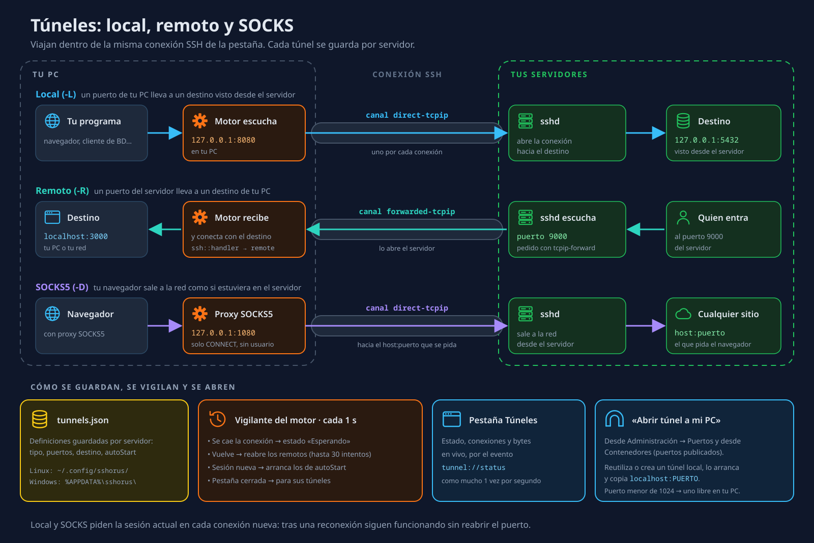

- **Local (-L):** el motor escucha en tu PC (p. ej. `127.0.0.1:8080`); cada conexión abre un canal
  `direct-tcpip` hacia un destino visto desde el servidor.
- **Remoto (-R):** el motor pide `tcpip-forward` al servidor; cuando alguien entra a ese puerto, el
  servidor abre un canal `forwarded-tcpip` que llega por `ssh::handler` a `tunnels::remote`, y el
  motor lo conecta con el destino en tu PC.
- **SOCKS5 (-D):** proxy mínimo en tu PC (solo CONNECT, sin usuario); cada petición es un canal
  `direct-tcpip` al `host:puerto` pedido.
- Se guardan en `tunnels.json`. El **vigilante** del motor (cada segundo) marca "Esperando" si se cae
  la conexión, reabre los remotos al reconectar (hasta 30 intentos), arranca los `autoStart` en
  sesiones nuevas y para los túneles de pestañas cerradas. Los locales y SOCKS siguen funcionando
  tras una reconexión sin reabrir el puerto.
- La pestaña Túneles muestra estado, conexiones y bytes con el evento `tunnel://status`.
- **"Abrir túnel a mi PC"** (desde Administración → Puertos y desde los puertos publicados de
  Contenedores): `openLocalTunnel` reutiliza o crea un túnel local guardado, lo arranca y copia
  `localhost:PUERTO`. Si el puerto es menor de 1024, en tu PC se usa uno libre.

---

## 11. Arrastrar del servidor al escritorio (diagrama 12)

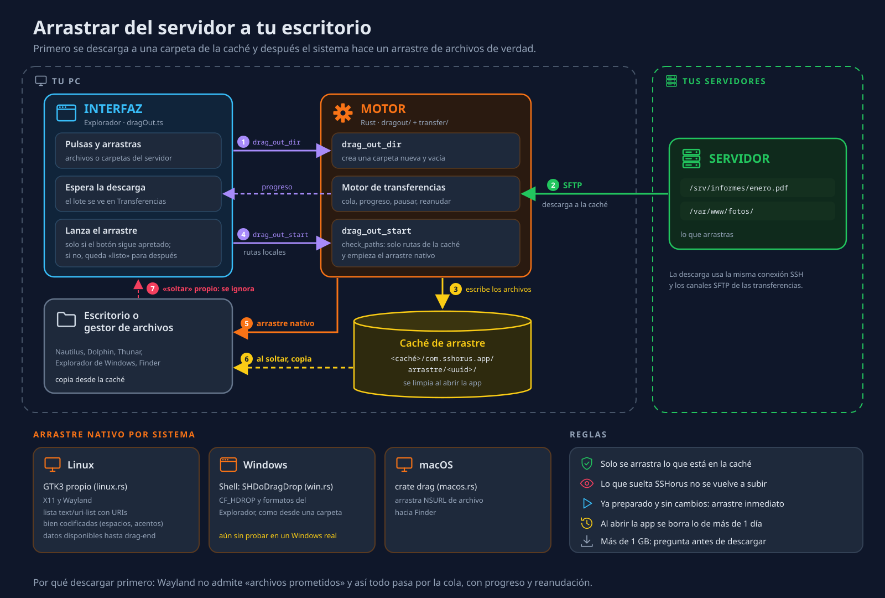

- **Primero se descarga y después se arrastra.** `drag_out_dir` crea una carpeta nueva en la caché
  de arrastre y lo seleccionado se descarga ahí con el motor de transferencias normal (cola,
  progreso, pausa, reanudación: se ve en el panel).
- Con la descarga lista y el botón del ratón todavía apretado, la interfaz llama a `drag_out_start`.
  `check_paths` exige rutas absolutas, sin `..`, existentes y dentro de la caché; luego empieza un
  arrastre nativo y, al soltar, el gestor de archivos copia desde la caché.
- **Por sistema:** Linux, GTK3 propio (`dragout/linux.rs`, X11 y Wayland, `text/uri-list` con URIs
  bien codificadas); Windows, `SHDoDragDrop` del Shell con `CF_HDROP` (`win.rs`, aún sin probar en
  un Windows real); macOS, crate `drag` (`macos.rs`).
- Mientras dura el arrastre, la ventana de TerView también recibe el "soltar": el explorador lo
  ignora con `ownDragActive()` / `isOwnDragPaths()` para **no volver a subir lo propio**.
- Si lo preparado no cambió en el servidor (mismo tamaño y fecha), el siguiente arrastre es
  inmediato. Más de 1 GB pregunta antes. Al abrir la app se borra lo de más de un día.
- Por qué así: Wayland no admite "archivos prometidos", y las promesas de Windows y macOS
  descargarían por fuera del motor, sin cola ni reanudación.

---

## 12. Publicación y actualizaciones (diagrama 13)

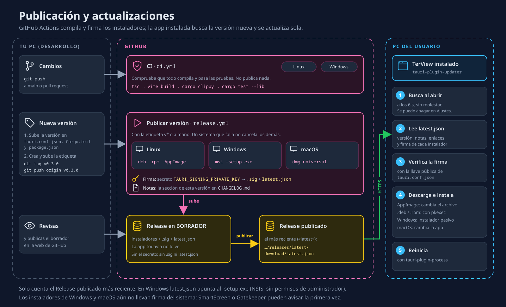

- **`.github/workflows/ci.yml`:** en cada push o pull request a `main`, en Linux y Windows: `tsc`,
  `vite build`, `cargo clippy` (en Linux con `-D warnings`) y `cargo test --lib`. Comprueba, no publica.
- **`.github/workflows/release.yml`:** con una etiqueta `v*` o a mano. Antes hay que subir la versión
  en `tauri.conf.json`, `Cargo.toml` y `package.json`. Instaladores: Linux `.deb`, `.rpm` y
  `.AppImage`; Windows `.msi` y `-setup.exe`; macOS `.dmg` universal. Un sistema que falla no cancela los demás.
- **Firma:** con el secreto `TAURI_SIGNING_PRIVATE_KEY` cada instalador lleva su `.sig` y se sube
  `latest.json`. Sin el secreto salen los instaladores, pero sin actualización automática.
- **Notas:** la sección de esa versión en `CHANGELOG.md`, que va al Release y a `latest.json`.
- **Release en borrador:** la app no lo ve hasta que lo publicas a mano; solo cuenta el Release
  publicado más reciente.
- **En la app** (`tauri-plugin-updater`): busca a los 6 s de abrir (desactivable), lee
  `latest.json`, verifica la firma con la `pubkey` de `tauri.conf.json`, descarga e instala según el
  formato (AppImage reemplaza el archivo, `.deb`/`.rpm` con `pkexec`, NSIS o MSI en modo pasivo,
  macOS reemplaza la app) y reinicia con `tauri-plugin-process`.
- Los instaladores de Windows y macOS aún no llevan firma del sistema (SmartScreen o Gatekeeper
  pueden avisar la primera vez).

---

## 13. GitHub dentro de la app (diagrama 14)

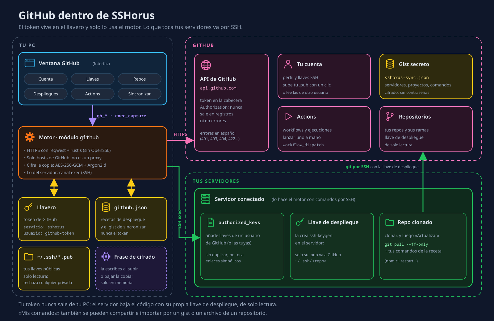

- **Token** en el llavero (servicio `terview`, usuario `github-token`), o en la bóveda si hay PIN;
  nunca en `github.json` ni en la interfaz.
- **Todas las peticiones salen del motor** (`github/`, reqwest + rustls). Solo puede hablar con hosts
  de GitHub: no es un proxy genérico. Los errores llegan en español.
- **Llaves:** subir una llave pública de tu PC (`~/.ssh/*.pub`, solo lectura, rechaza cualquier
  privada) a tu cuenta, o traer las llaves de un usuario de GitHub al `authorized_keys` del servidor
  (por exec, sin duplicar).
- **Repos y despliegues:** para un repo privado se crea en el servidor una llave de despliegue de
  solo lectura y solo su `.pub` va a GitHub. Clonar y "Actualizar" (`git pull --ff-only` + los
  comandos de la receta) se ejecutan en el servidor por exec. Las recetas se guardan en `github.json`.
- **Actions:** ver workflows y ejecuciones, y lanzar uno a mano (`workflow_dispatch`).
- **Sincronización:** `terview-sync.json` en un Gist secreto, cifrado en el motor con AES-256-GCM y
  una clave Argon2id de una frase que solo vive en memoria. Sin contraseñas.
- **Compartir comandos** por un Gist o un archivo de un repositorio.

---

## 14. Bóveda con PIN y bloqueo (diagrama 15)

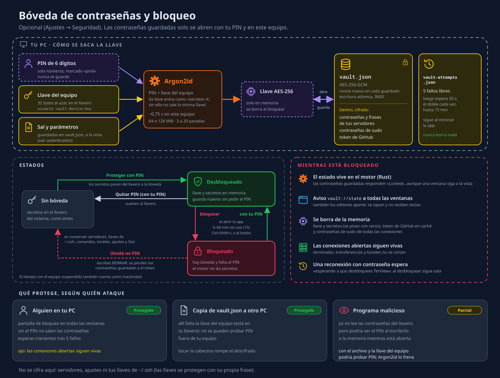

- **Es opcional** (Ajustes → Seguridad). Sin bóveda todo sigue como antes: contraseñas, frases y
  token de GitHub en el llavero del sistema (`storage/secrets.rs`).
- **Con bóveda**, esos secretos salen del llavero y pasan a `<config>/terview/vault.json`: un sobre
  AES-256-GCM (formato `terview-vault`) con la cabecera autenticada, escritura atómica, permisos 0600
  y un nonce nuevo en cada guardado. "Proteger con PIN" los mueve del llavero a la bóveda; "Quitar
  PIN" (pide el PIN) los devuelve.
- **Qué guarda:** por servidor, la contraseña o frase de conexión (id = id del servidor) y, si eliges
  «Contraseña de sudo: Guardar», la de sudo (id `<id>:sudo`). Activar o quitar el PIN, «Olvidé mi PIN»,
  borrar y duplicar un servidor mueven, borran o copian las dos (`secrets::server_secret_ids`). El modo
  (`sudoMode`: `ask`, `login` o `saved`) va en el perfil; la contraseña, nunca (tampoco en el Gist).
  En el editor del servidor se elige «Contraseña de sudo»: **Pedir cada vez** (`ask`), **La de la
  conexión** (`login`) o **Guardar** (`saved`). Sin bóveda, la de sudo guardada va al llavero con el
  mismo id `<id>:sudo`.
- **Ver una contraseña guardada:** el botón de ojo de los campos de contraseña (`features/SecretInput.tsx`)
  llama a `profiles_reveal_secret`, que con bóveda pide y comprueba el PIN en el motor antes de devolverla.
- **Candado en la barra de pestañas** (`components/Tabs/LockButton.tsx`): bloquear ahora, cambiar el
  PIN y abrir Ajustes → Seguridad.
- **El PIN es de 6 números** (`vault::check_new_pin`, también en el motor). El tipo va en la cabecera
  autenticada del sobre (`kind: "pin6"`): cambiarlo o quitarlo rompe el descifrado. Las bóvedas de antes,
  creadas con una contraseña libre, no lo llevan: se tratan como `text` y la pantalla de bloqueo muestra
  un campo de texto hasta que se cambia el PIN. 6 números bastan porque sin la llave del equipo no se
  puede probar ningún PIN contra el archivo, y en el equipo frenan las esperas tras fallos.
- **Cómo se saca la llave:** Argon2id recibe el PIN y, como su
  "secreto" K, una **llave del equipo** de 32 bytes al azar guardada en el llavero (usuario
  `vault-device-key`). El coste se calibra en tu equipo para tardar unos 0,75 s (64 o 128 MiB, de 3 a
  20 pasadas) y queda guardado en el archivo. La llave AES-256 solo vive en memoria
  (`storage/vault.rs`, `storage/cipher.rs`; el mismo cifrado que usa la copia en Gist).
- **Fallos de PIN:** `vault-attempts.json` deja 5 fallos libres; después hay que esperar 30 s, el
  doble con cada fallo, hasta 15 min. La espera sigue aunque reinicies la app y fallar nunca borra nada.
- **Estados:** sin bóveda → desbloqueado ⇄ bloqueado. Se bloquea al abrir la app, tras 5–60 min sin
  uso (15 por defecto; el tiempo con el equipo suspendido también cuenta), con Ctrl+Shift+L o con el
  botón. "Olvidé mi PIN" (escribiendo BORRAR) borra la bóveda: se pierden las contraseñas guardadas
  y el token, y se conservan servidores, llaves de `~/.ssh`, comandos, túneles, ajustes y la copia en Gist.
- **El bloqueo vive en el motor** (`storage/lock.rs`): mientras está bloqueado, `secrets::*` responde
  `Locked` aunque una ventana siga a la vista. Cada cambio se avisa con `vault://state` a todas las
  ventanas, incluidos los editores aparte, que se tapan y dejan de recibir teclas (`features/lock/`).
  Las ventanas avisan de la actividad del usuario con `vault_activity` y un vigilante del motor
  bloquea por inactividad.
- **Al bloquear se borra de memoria** la llave y los secretos (`Zeroizing` los pisa con ceros), el
  token de GitHub en caché y las contraseñas de sudo de todas las conexiones (`forgetAllSudo`). Las
  conexiones abiertas siguen vivas; las contraseñas de sudo guardadas se vuelven a leer (y comprobar con
  `sudo -v`) al desbloquear, cuando un panel las necesita (`features/privileges/stored.ts`); una reconexión que necesita contraseña espera al desbloqueo
  ("esperando a que desbloquees TerView") y sigue sola después (`ssh/reconnect.rs`).
- **Qué protege:**

| Quién ataca | ¿Protegido? | Por qué |
|-------------|-------------|---------|
| Alguien sentado en tu PC | Sí | Pantalla de bloqueo en todas las ventanas, PIN y esperas crecientes. Ojo: las conexiones abiertas siguen vivas, solo se tapa la pantalla. |
| Alguien que copia `vault.json` a otro PC | Sí | Allí falta la llave del equipo, así que no puede probar PIN fuera de tu equipo. Cambiar la cabecera rompe el descifrado. |
| Un programa malicioso con tu usuario | En parte | Ya no lee las contraseñas directamente del llavero, pero podría ver el PIN al escribirlo, leer la memoria mientras está desbloqueado o copiar también la llave del equipo del llavero. |

  No se cifran aquí servidores, ajustes ni tus llaves de `~/.ssh` (las llaves se protegen con su propia frase).

---

## 15. Terminales persistentes con tmux (diagrama 16)

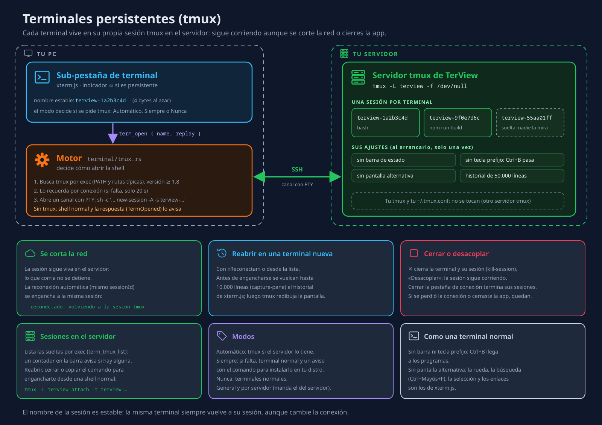

- **Nombre estable:** cada sub-pestaña de terminal tiene su sesión, `terview-` + 8 caracteres
  hexadecimales al azar. Según el modo, la interfaz pide tmux y `term_open` recibe `{ name, replay }`.
- **Buscar tmux** (`terminal/tmux.rs`): el motor lo busca por exec, primero en el PATH y luego en
  rutas típicas (`/usr/local/bin`, `/opt/homebrew/bin`…), y exige la versión 1.8 o más nueva (por
  `new-session -A`). El resultado se recuerda por conexión; si falta, solo 20 s, por si lo instalas.
  Sin tmux se abre una shell normal y la respuesta (`TermOpened`) lo avisa.
- **Servidor tmux propio:** el canal con PTY ejecuta `sh -c '… new-session -A -s terview-…'` sobre
  `tmux -L terview -f /dev/null`. No toca tu `~/.tmux.conf` ni tus sesiones, y `list-sessions` solo
  ve las de TerView. Si ese servidor no corre, lo arranca con sus ajustes: sin barra de estado, sin
  tecla prefijo (Ctrl+B llega a los programas), sin pantalla alternativa (la rueda, la búsqueda, la
  selección y los enlaces son los de xterm.js) e historial de 50.000 líneas.
- **Si se corta la red:** la sesión sigue viva en el servidor y la reconexión automática (mismo
  `sessionId`) se engancha a la misma sesión ("volviendo a la sesión tmux").
- **Reabrir en una terminal nueva** (botón "Reconectar" o desde la lista): antes de engancharse se
  vuelcan hasta 10.000 líneas de historial (`capture-pane`) en xterm.js y luego tmux redibuja la pantalla.
- **Cerrar o desacoplar:** la ✕ cierra la terminal y mata su sesión (`kill-session`, como una shell
  normal); "Desacoplar" la deja corriendo. Cerrar una pestaña de conexión conectada termina sus
  sesiones; si la conexión se perdió o cerraste la app, quedan en el servidor.
- **"Sesiones en el servidor":** `term_tmux_list` lista las sesiones sueltas (un contador en la barra
  avisa si hay alguna). Se pueden reabrir, cerrar (`term_tmux_kill`) o copiar
  `tmux -L terview attach -t terview-…` para engancharse desde una shell normal.
- **Modos:** Automático (tmux si el servidor lo tiene), Siempre (si falta, terminal normal y un aviso
  con el comando para instalarlo según la distro) y Nunca. Hay un ajuste general (`terminalTmux`) y
  otro por servidor; manda el del servidor.

---

## 16. Servidor MCP (opcional, en pausa · diagrama 8)

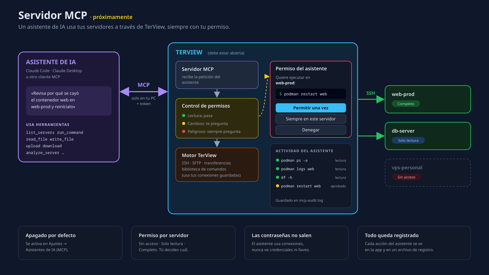

> **Esto es un diseño, no algo construido.** El código actual no tiene servidor MCP. Se dejó en pausa
> como idea opcional para que asistentes de IA usen las conexiones de TerView con permisos
> controlados. Detalle en [PENDIENTES.md](PENDIENTES.md#3-servidor-mcp-conectar-asistentes-de-ia).

---

## 17. Seguridad

- **Contraseñas, frases, contraseñas de sudo guardadas y token de GitHub** en el llavero del sistema o, con PIN, en la bóveda
  cifrada (`vault.json`, AES-256-GCM con llave Argon2id del PIN de 6 dígitos y de una llave del equipo). Nunca en
  archivos sin cifrar ni en la interfaz.
- **Bloqueo con PIN** (opcional): el estado vive en el motor, que no entrega secretos mientras está
  bloqueado; todas las ventanas se tapan; al bloquear se borran de la memoria la llave, los secretos,
  el token en caché y las contraseñas de sudo. Esperas crecientes tras 5 PIN incorrectos.
- **Contraseña de sudo** en memoria, por conexión (y, si lo eliges, guardada como un secreto más
  del servidor, `<id>:sudo`); viaja siempre por stdin, nunca en la línea
  de comandos ni en el historial. El motor borra el búfer al terminar.
- **Verificación de huella** del servidor con `~/.ssh/known_hosts`, igual que `ssh`.
- **Antes de cambiar algo como root** se muestra el comando exacto (Plan) y lo peligroso pide confirmación escrita.
- **Permisos de Tauri (capabilities):** la interfaz solo puede llamar a los comandos definidos; las
  ventanas de editor aparte (`editor-*`) tienen su propia capability.
- **CSP** activa: la ventana no carga scripts externos ni se conecta a internet. Las peticiones a
  GitHub las hace el motor, y solo a hosts de GitHub.
- **Archivos de configuración** con escritura atómica, permisos 0600/0700 en Unix y copia `.bak` si se dañan.
- **El editor guarda de forma atómica** (archivo temporal + renombrar).
- **Gist de sincronización** cifrado en tu PC antes de subirlo.
- **Actualizaciones** verificadas con firma antes de instalarse.

---

## 18. Plan por fases

| Fase | Qué se construye | Estado |
|------|------------------|--------|
| 0–8 | Proyecto, SSH con huellas, terminal, explorador, transferencias masivas, servidores y proyectos, editor, temas y ajustes, reconexión | Hecho |
| 9 | Biblioteca de comandos ([detalle](PENDIENTES.md#1-biblioteca-de-comandos)) | Hecho |
| 9b | Exportar e importar con `~/.ssh/config` ([detalle](PENDIENTES.md#5-exportar-servidores-a-sshconfig)) | Hecho |
| 10 | Servidor MCP para asistentes de IA ([detalle](PENDIENTES.md#3-servidor-mcp-conectar-asistentes-de-ia)) | En pausa (opcional) |
| 11 | Optimización y rendimiento, panel de diagnóstico ([detalle](PENDIENTES.md#81-optimización--rendimiento)) | Hecho; falta medir en la app real |
| 12 | Administración: usuarios, grupos, sesiones, puertos y sitios web ([detalle](PENDIENTES.md#82-gestión-del-servidor-usuarios-y-grupos)) | Hecho; servicios, firewall y paquetes pendientes |
| 13 | Monitor en vivo con alertas ([detalle](PENDIENTES.md#83-monitoreo-en-vivo)) | Hecho |
| 14 | Túneles local, remoto y SOCKS ([detalle](PENDIENTES.md#84-túneles-port-forwarding)) | Hecho |
| 15 | Versiones, actualizaciones automáticas e instaladores para Linux, Windows y macOS ([detalle](PENDIENTES.md#85-versiones-y-actualizaciones)) | Hecho |
| 16 | Ejecutar en varios servidores a la vez ([detalle](PENDIENTES.md#86-ejecutar-en-varios-servidores-a-la-vez)) | Hecho |
| 17 | GitHub: Actions y cuenta en la app ([detalle](PENDIENTES.md#9-github)) | Hecho |
| 18 | Contenedores Podman / Docker | Hecho |
| 19 | Arrastrar al escritorio | Hecho; falta probar en Windows real y compilar en macOS |
| 20 | Terminales persistentes con tmux (ver sección 15) | Hecho |
| 21 | PIN, bóveda de contraseñas y bloqueo (ver sección 14) | Hecho |

---

## 19. Comandos útiles

```bash
npm run tauri dev      # Abrir la app en modo desarrollo (se recarga sola)
npm run tauri build    # Generar instaladores en src-tauri/target/release/bundle/
```

### Editar los diagramas

Cada diagrama es un SVG escrito a mano (los iconos van dentro de cada archivo, sin dependencias).
Después de editarlo, genera el PNG con Inkscape y revísalo:

```bash
inkscape docs/arquitectura/NN-nombre.svg --export-type=png --export-filename=docs/arquitectura/NN-nombre.png
```
