# Manual de uso de TerView

TerView es un programa para trabajar con tus servidores Linux desde tu PC: terminal, archivos, comandos, contenedores y más, todo en una sola ventana.

Este manual también está dentro de TerView: pulsa el botón **?** de la barra de pestañas, o ve a **Ajustes → Manual de uso**.

## Índice

1. [Instalar y actualizar](#instalar-y-actualizar)
2. [Añadir un servidor](#añadir-un-servidor)
3. [Proyectos y favoritos](#proyectos-y-favoritos)
4. [Terminal](#terminal)
5. [Explorador de archivos](#explorador-de-archivos)
6. [Transferencias](#transferencias)
7. [Editor](#editor)
8. [Comandos](#comandos)
9. [Ejecutar en varios servidores](#ejecutar-en-varios-servidores)
10. [Contenedores](#contenedores)
11. [Monitor y alertas](#monitor-y-alertas)
12. [Túneles](#túneles)
13. [Administración](#administración)
14. [Vulnerabilidades](#vulnerabilidades)
15. [IA para explicar informes](#ia-para-explicar-informes)
16. [GitHub](#github)
17. [PIN y bloqueo](#pin-y-bloqueo)
18. [Asistentes de IA (MCP)](#asistentes-de-ia-mcp)
19. [Terminal local, Claude Code y Codex](#terminal-local-claude-code-y-codex)
20. [Ajustes](#ajustes)
21. [Atajos de teclado](#atajos-de-teclado)
22. [Solución de problemas](#solución-de-problemas)

---

## Instalar y actualizar

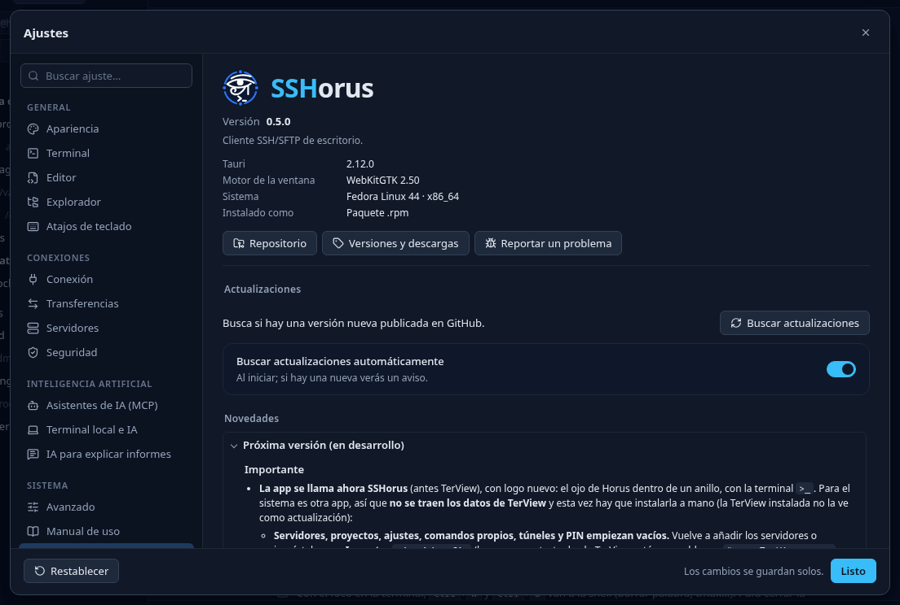

**Para qué sirve:** tener TerView en tu PC y al día.

**Cómo se usa:**

1. Abre la página de [la última versión](https://github.com/LeoMael/TerView/releases/latest) y baja el archivo de tu sistema.
2. Windows: ejecuta el `…-setup.exe`. Fedora: `sudo dnf install ./TerView-*.rpm`. Ubuntu: `sudo apt install ./TerView_*.deb`. Cualquier Linux: la `.AppImage` (dale permiso con `chmod +x`).
3. Para actualizar, ve a **Ajustes → Acerca de** y pulsa **Buscar actualizaciones**.
4. Si hay una versión nueva, pulsa **Actualizar y reiniciar**.

**Notas:**

- Con **Buscar actualizaciones automáticamente** activado, TerView mira al abrirse y te avisa con **Ver novedades** o **Más tarde**.
- Con `.deb` o `.rpm` te pedirá tu contraseña de administrador al instalar.
- Si sale «Esta instalación no se actualiza sola», pulsa **Ir a descargas** y baja el instalador nuevo.

## Añadir un servidor

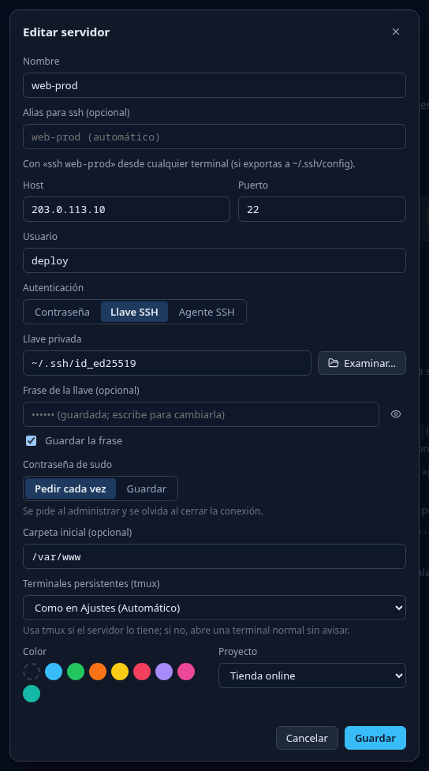

**Para qué sirve:** guardar los datos de un servidor para entrar con un doble clic.

**Cómo se usa:**

1. En la barra lateral pulsa **+ Nuevo → Servidor**.
2. Escribe **Nombre**, **Host**, **Puerto** y **Usuario**. Al escribir el host verás tus servidores guardados; elige uno para copiar su host y puerto.
3. En **Autenticación** elige **Contraseña**, **Llave SSH** o **Agente SSH**.
4. En **Contraseña de sudo** elige **Pedir cada vez**, **La de la conexión** o **Guardar**.
5. Pulsa **Guardar**. Antes de guardar, TerView prueba la conexión (máx. 10 s) y desconecta.
6. La primera vez verás la huella del servidor: si es el tuyo, pulsa **Confiar y conectar**.
7. Haz **doble clic** en el servidor para conectarte.

**Notas:**

- **Llave SSH**: elige la llave **privada** (sin `.pub`). Si tiene frase, escríbela y marca **Guardar la frase**.
- **2FA**: si el servidor pide un código, sale la ventana **Código de verificación**. Escribe el código de tu app y pulsa **Verificar**.
- **Probar conexión**: pruébala cuando quieras sin guardar. Si falla, verás el motivo (no se encuentra el host, puerto cerrado, contraseña o llave rechazada, huella cambiada) y puedes pulsar **Guardar de todos modos** (por ejemplo, si el servidor está apagado ahora). Al editar solo se prueba si cambias host, puerto, usuario o autenticación.
- **Servidor repetido**: si ya tienes uno con el mismo host, puerto y usuario, verás «Ya tienes este servidor guardado como «X»» con **Abrir** para ir a ese.
- **Terminales persistentes (tmux)**: **Automático**, **Siempre** o **Nunca**. Lo normal es dejar «Como en Ajustes».
- Para entrar rápido sin guardar nada, escribe `usuario@host:puerto` en **Conexión rápida** y pulsa `Enter`.

## Proyectos y favoritos

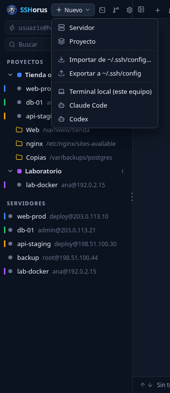

**Para qué sirve:** agrupar servidores (por cliente, por entorno…) y guardar carpetas a las que vas a menudo.

**Cómo se usa:**

1. Pulsa **+ Nuevo → Proyecto**, escribe un **Nombre** y marca sus **Servidores**.
2. En **Marcadores (carpetas favoritas)** añade un servidor y una ruta, por ejemplo `/var/www/app`.
3. Pulsa un marcador en la barra lateral para abrir el servidor directamente en esa carpeta.
4. Con clic derecho en un servidor tienes **Añadir a proyecto** y **Añadir marcador…**.
5. Para meter un servidor en un proyecto, pulsa el **+** de su fila (o clic derecho en el proyecto):
   **Añadir servidor nuevo…** abre el editor ya dentro del proyecto; **Añadir servidor existente** muestra
   los servidores guardados que aún no están en él.
6. Con clic derecho en un proyecto tienes también **Conectar a todos** y **Ejecutar comando en el proyecto…**.

**Importar o exportar `~/.ssh/config`:**

1. Pulsa **+ Nuevo → Importar de ~/.ssh/config…**.
2. Marca los servidores que quieras y pulsa **Importar**.
3. Para el camino contrario, pulsa **+ Nuevo → Exportar a ~/.ssh/config**.

**Notas:**

- En Windows el archivo es `%USERPROFILE%\.ssh\config`.
- En **Ajustes → Servidores** puedes activar **Mantener ~/.ssh/config sincronizado**. Así tus servidores también funcionan con `ssh`, VS Code o Claude Code.

## Terminal

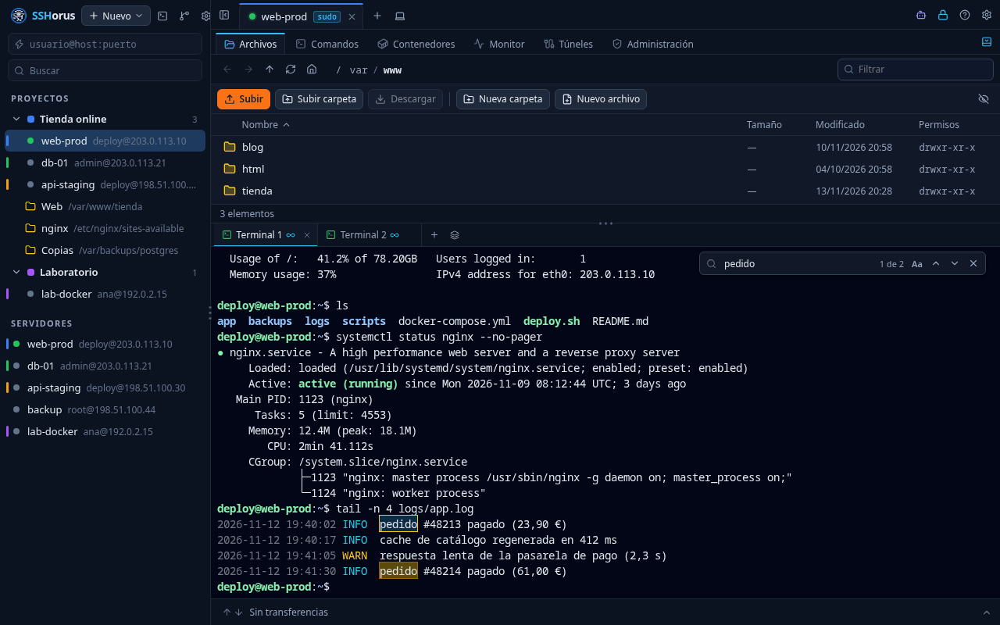

**Para qué sirve:** escribir comandos en el servidor, como en `ssh`.

**Cómo se usa:**

1. Conéctate: la terminal aparece abajo.
2. Pulsa **+** (**Nueva terminal**) para abrir otra.
3. Para copiar y pegar usa `Ctrl+Shift+C` y `Ctrl+Shift+V`, o el clic derecho.
4. Para buscar texto pulsa `Ctrl+Shift+F`. `Enter` va al siguiente y `Shift+Enter` al anterior.
5. Para ocultar o mostrar la terminal pulsa `` Ctrl+` ``.

**Terminales persistentes (tmux):**

- Si el servidor tiene tmux, cada terminal sigue viva aunque se corte la red o cierres TerView. Lo verás con el símbolo **∞** en su pestaña.
- Al volver a conectar, TerView retoma la terminal sola.
- Clic derecho en la pestaña → **Desacoplar (sigue corriendo en el servidor)** para dejarla trabajando.

**Sesiones sueltas:**

1. Si quedaron terminales en el servidor, el botón **Terminales persistentes en el servidor** muestra un número.
2. Púlsalo y elige **Abrir** para retomar una, o **Cerrar** para terminarla.

**Notas:**

- Con el foco en la terminal, `Ctrl+W` y `Ctrl+B` son de la shell (borrar palabra, prefijo de tmux), no de TerView.
- Cerrar una terminal persistente termina su sesión tmux.

## Explorador de archivos

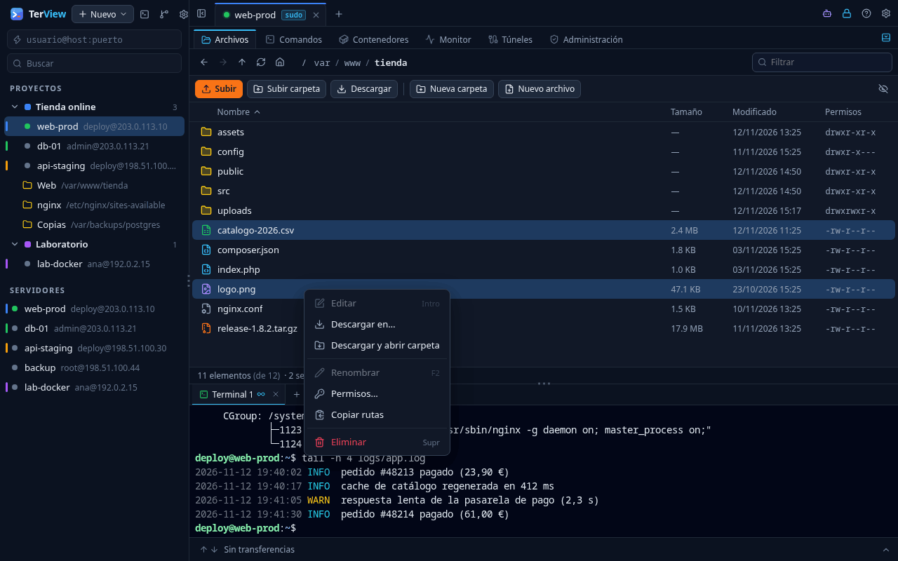

**Para qué sirve:** ver y manejar los archivos del servidor como en el explorador de tu PC.

**Cómo se usa:**

1. Abre la pestaña **Archivos**. Doble clic en una carpeta para entrar.
2. Para subir, pulsa **Subir** o **Subir carpeta**, o arrastra archivos desde tu PC a la lista.
3. Para bajar, selecciona y pulsa **Descargar**, o clic derecho → **Descargar en…** y elige la carpeta.
4. Clic derecho → **Descargar y abrir carpeta** baja a Descargas y luego abre la carpeta.
5. Para llevarlo al escritorio, arrastra el archivo fuera de TerView y suéltalo donde quieras.
6. Clic derecho → **Permisos…** para marcar lectura, escritura y ejecución (o escribir el número **Octal**).

**Notas:**

- También tienes **Nueva carpeta**, **Nuevo archivo**, **Renombrar**, **Copiar ruta** y **Eliminar**.
- El botón del ojo muestra u oculta los archivos ocultos (los que empiezan por punto).
- Al arrastrar al escritorio, TerView primero lo baja a una carpeta temporal. Lo verás en Transferencias.

## Transferencias

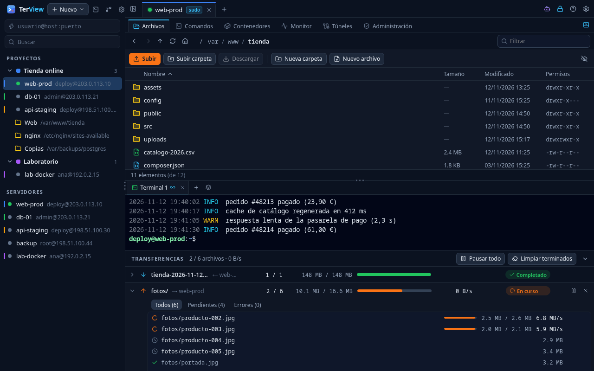

**Para qué sirve:** ver cómo van las subidas y bajadas, y controlarlas.

**Cómo se usa:**

1. Sube o baja algo. Abajo aparece la barra de transferencias.
2. Púlsala (**Ver transferencias**) para ver la lista completa.
3. Usa **Pausar**, **Reanudar** o **Cancelar** en cada una.
4. Si algo falla, pulsa **Reintentar los fallidos**.
5. Pulsa **Limpiar terminados** para vaciar la lista.

**Notas:**

- Si se corta la red, la transferencia sigue desde donde quedó al volver la conexión.
- Si el archivo ya existe, se hace lo que digas en **Ajustes → Transferencias → Si el archivo ya existe**.
- Con **Preguntar**, verás **Sobrescribir**, **Omitir**, **Mantener ambos** o **Solo si es más nuevo**, y la casilla **Aplicar a todos los conflictos de esta transferencia**.

## Editor

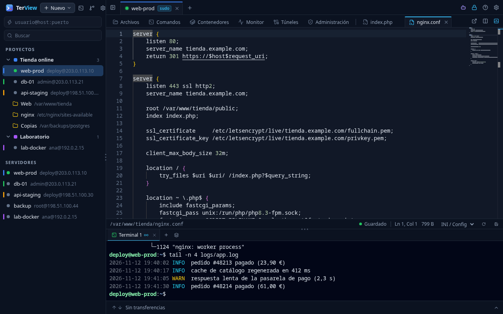

**Para qué sirve:** editar archivos del servidor sin bajarlos, con el mismo editor de VS Code.

**Cómo se usa:**

1. En **Archivos**, haz doble clic en un archivo de texto. Se abre en una pestaña.
2. Edita y pulsa `Ctrl+S` (o el botón **Guardar**) para guardarlo en el servidor.
3. Arrastra una pestaña para cambiarla de orden.
4. Para abrirla en una ventana aparte, arrástrala fuera de la ventana o usa clic derecho → **Abrir en ventana aparte**.
5. En esa ventana, **Volver a la pestaña principal** la devuelve como pestaña.

**Notas:**

- Clic derecho en la pestaña: **Dividir con Archivos** o **Dividir con Comandos**. `Ctrl+Shift+M` divide o quita la división.
- Clic central en una pestaña la cierra.
- En **Ajustes → Editor → Al abrir un archivo** eliges **Pestaña**, **Dividido** o **En ventana aparte**.

## Comandos

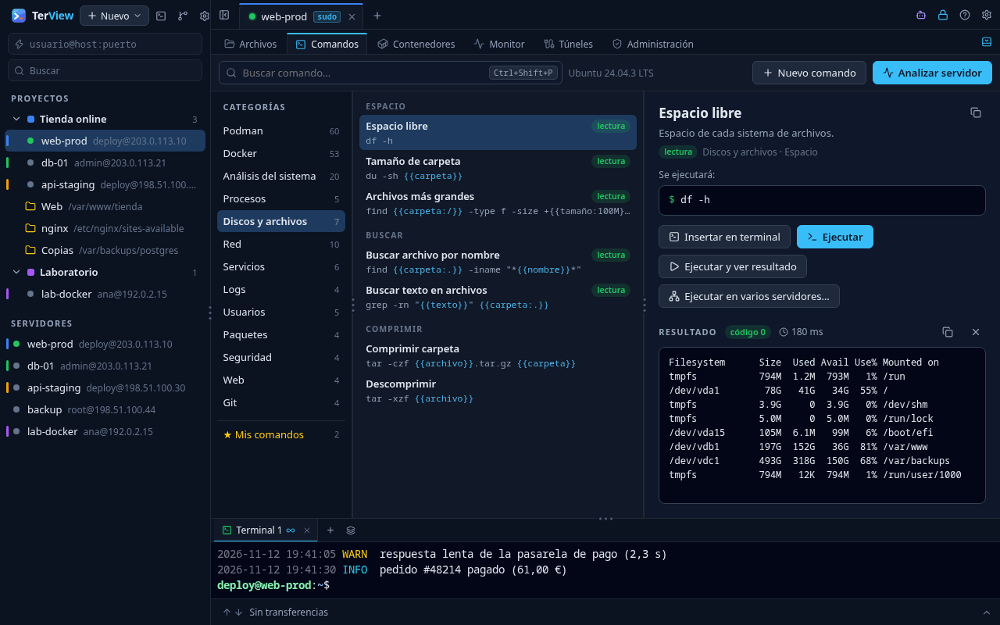

**Para qué sirve:** usar comandos listos (Podman, Docker, discos, red, logs…) sin tener que recordarlos.

**Cómo se usa:**

1. Abre la pestaña **Comandos** y elige una categoría, o escribe en **Buscar comando…**.
2. Pulsa un comando. Si tiene variables (por ejemplo el nombre de un contenedor), rellénalas.
3. Pulsa **Ejecutar** (en la terminal), **Insertar en terminal** (sin pulsar Enter) o **Ejecutar y ver resultado** (la salida sale aquí mismo).
4. Si tarda demasiado, pulsa **Cancelar**: se detiene también en el servidor.
5. Pulsa **Analizar servidor** para un informe rápido: sistema, CPU, memoria, discos, procesos, puertos, contenedores y errores.

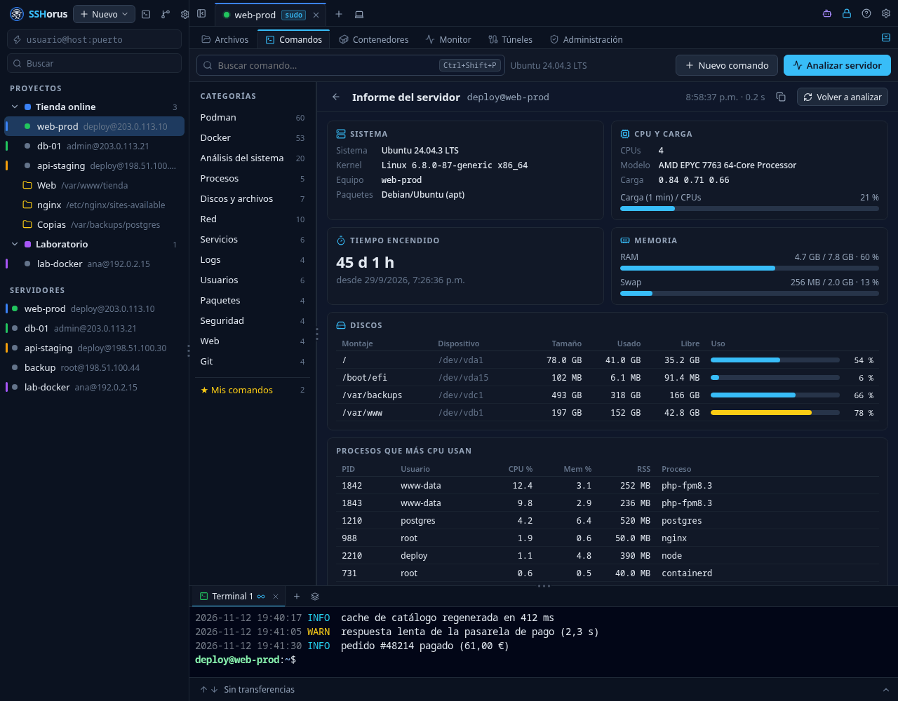

**Mis comandos:**

1. Pulsa **Nuevo comando**, escribe **Nombre** y **Comando**, y elige dónde está **Disponible en**.
2. Para variables escribe `{{nombre}}`, o con valor por defecto `{{lineas:200}}`.
3. En **★ Mis comandos** tienes **Exportar a archivo…** e **Importar desde archivo…** para pasarlos a otro PC.

**Notas:**

- `Ctrl+Shift+P` abre la paleta rápida de comandos desde cualquier sitio.
- Un comando de la biblioteca no se puede cambiar, pero sí **Copiar a Mis comandos…** y editar la copia.

## Ejecutar en varios servidores

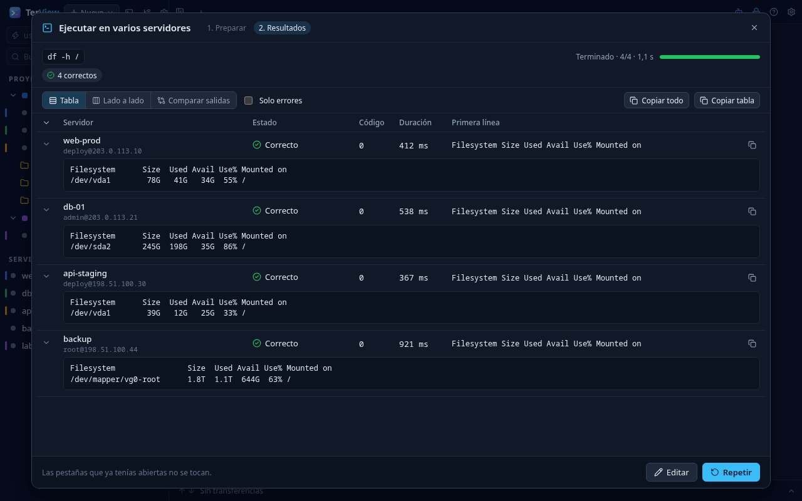

**Para qué sirve:** lanzar el mismo comando en muchos servidores a la vez y comparar lo que responde cada uno.

**Cómo se usa:**

1. Pulsa el botón **Ejecutar en varios servidores** de la barra lateral (o clic derecho en un proyecto).
2. Marca los servidores, o un proyecto entero.
3. Escribe el comando o pulsa **Biblioteca…** para elegir uno.
4. Pulsa **Ejecutar en N servidores**.
5. Mira el resultado en **Tabla**, **Lado a lado** o **Comparar salidas**.

**Notas:**

- No hace falta tenerlos abiertos: se conectan en segundo plano y se desconectan al terminar.
- **Cancelar todo** detiene el comando en todos. **Repetir** lo vuelve a lanzar.
- Los comandos con `sudo` solo funcionan donde tienes sudo sin contraseña.

## Contenedores

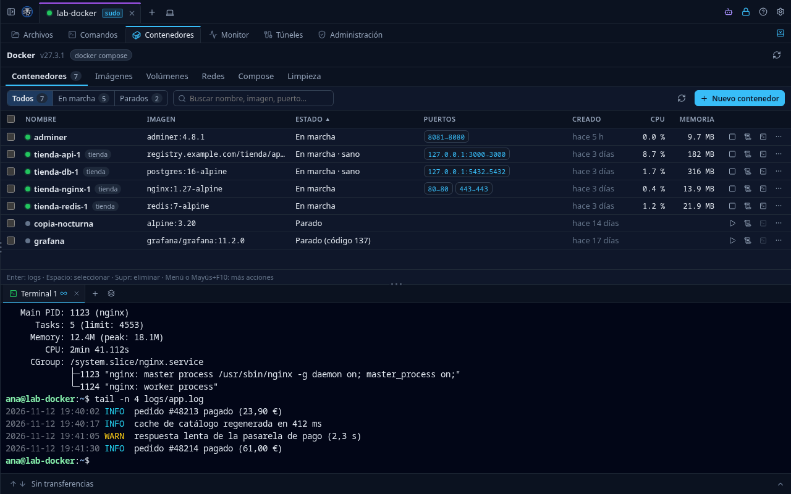

**Para qué sirve:** manejar Podman o Docker sin escribir comandos.

**Cómo se usa:**

1. Abre la pestaña **Contenedores**. TerView detecta Podman o Docker solo.
2. Selecciona contenedores y usa **Iniciar**, **Parar**, **Reiniciar** o **Eliminar**.
3. En cada fila tienes **Logs** y **Terminal dentro del contenedor**.
4. Pulsa **Nuevo contenedor**, elige una plantilla (Nginx, PostgreSQL, Redis…) y pulsa **Crear y arrancar**.
5. En **Compose** añade la carpeta de tu proyecto y usa **Levantar** o **Bajar**.
6. En **Limpieza** ves cuánto espacio ocupan y pulsas **Limpiar todo…**.

**Notas:**

- Con root o sudo, arriba eliges **Usuario**: tú, **root**, cada usuario con contenedores propios o
  **Todos** (con una columna «Usuario»). Lo que hagas se ejecuta como el dueño de cada contenedor.
- Clic en un puerto de un contenedor → **Abrir túnel a mi PC…** para usarlo en tu navegador.
- En **Imágenes**, el botón de vulnerabilidades te lleva a Administración → Vulnerabilidades.

## Monitor y alertas

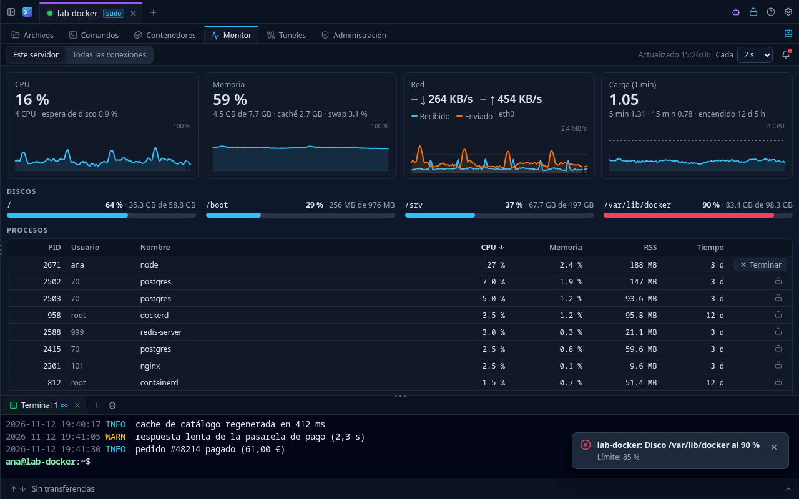

**Para qué sirve:** ver en vivo cómo va el servidor y recibir un aviso si algo se dispara.

**Cómo se usa:**

1. Abre la pestaña **Monitor**. Verás CPU, memoria, red, carga, discos y procesos.
2. En **Cada** elige cada cuántos segundos se actualiza.
3. Pulsa **Todas las conexiones** para ver un resumen de todos tus servidores abiertos.
4. Para cerrar un proceso que se ha colgado, pulsa **Terminar** en su fila.
5. Pulsa la **campana** para configurar las alertas.
6. Marca **Avisar cuando algo pase del límite**, ajusta Disco, Memoria y CPU, y pulsa **Guardar**.

**Notas:**

- Con alertas activas, el servidor se revisa cada 30 s aunque no mires la pestaña.
- Avisa una sola vez hasta que el valor vuelva a bajar.

## Túneles

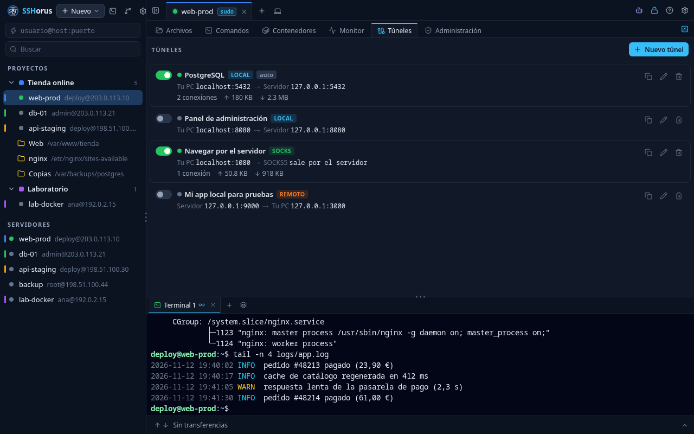

**Para qué sirve:** usar en tu PC un servicio del servidor (una base de datos, un panel web) sin abrir puertos.

**Cómo se usa:**

1. Abre la pestaña **Túneles** y pulsa **Nuevo túnel**.
2. Elige una plantilla (**PostgreSQL**, **MySQL**, **Redis**, **Panel web**, **SOCKS**) o el tipo a mano.
3. Revisa los puertos y pulsa **Guardar y activar**.
4. Usa el servicio en tu PC, por ejemplo en `localhost:5432`.
5. Usa el interruptor de la fila para activar o desactivar el túnel.

**Notas:**

- **Local**: un servicio del servidor aparece en tu PC. **Remoto**: lo contrario. **SOCKS**: navegar como si estuvieras en el servidor.
- Marca **Activar automáticamente al conectar a este servidor** para no tener que hacerlo cada vez.

## Administración

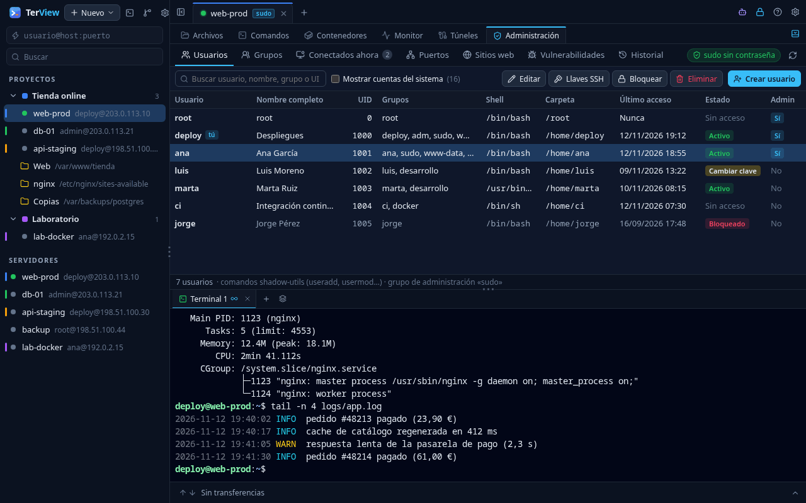

**Para qué sirve:** gestionar usuarios, grupos, puertos y sitios web del servidor sin escribir comandos.

**Cómo se usa:**

1. Abre la pestaña **Administración**. Arriba ves si tienes permisos (**root**, **sudo**) o **Solo lectura**.
2. En **Usuarios** pulsa **Crear usuario**, o selecciona uno y usa **Editar**, **Llaves SSH**, **Bloquear** o **Eliminar**.
3. En **Grupos** pulsa **Crear grupo**, o usa **Miembros**, **Renombrar** o **Eliminar**.
4. Antes de cada cambio verás el comando exacto. Pulsa **Ejecutar** para aplicarlo.
5. En **Conectados ahora** ves quién está dentro y puedes **Cerrar sesión**.
6. **Historial** guarda lo que has cambiado desde TerView.

**Puertos y sitios web:**

- **Puertos**: cada puerto abierto, con su programa, usuario y servicio. **Túnel** lo abre en tu PC.
- **Sitios web**: los sitios de nginx y Caddy, con dominios, HTTPS y caducidad del certificado. Tienes **Comprobar configuración** y **Recargar**.

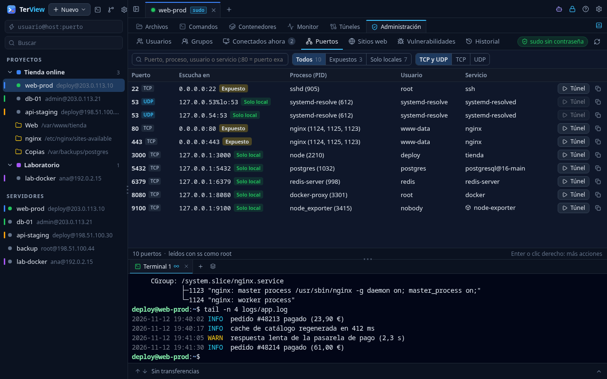

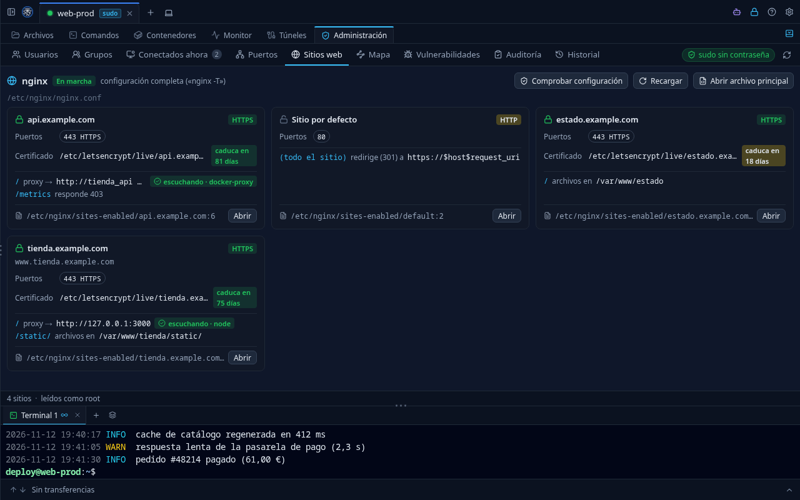

**Con y sin sudo:**

- Sin sudo puedes mirar casi todo, pero no cambiar nada.
- Si tienes sudo, pulsa **Tengo sudo: introducir contraseña** (o **Cambiar contraseña de sudo…**).
- En **Puertos**, **Ver todos con sudo** muestra también los procesos de otros usuarios.

## Vulnerabilidades

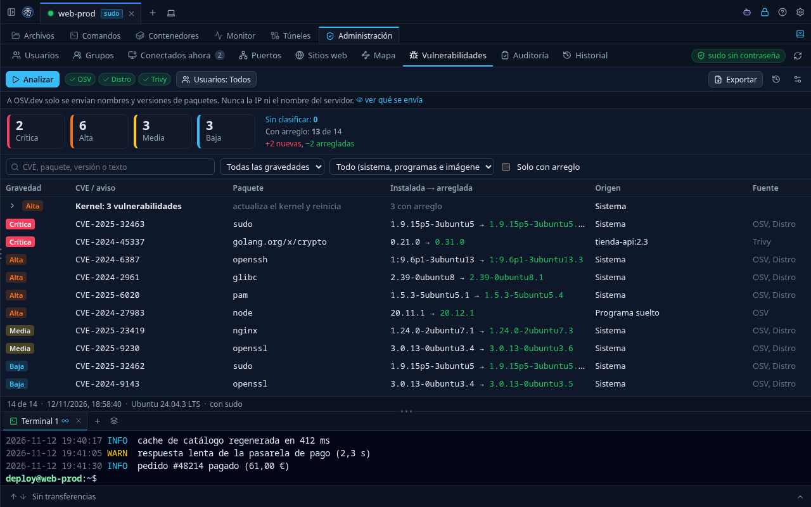

**Para qué sirve:** saber si el software del servidor tiene fallos de seguridad conocidos y cómo arreglarlos.

**Cómo se usa:**

1. Ve a **Administración → Vulnerabilidades** y pulsa **Analizar**. Tarda unos minutos.
2. Arriba ves el **resumen**: Crítica, Alta, Media y Baja. Pulsa una para ver solo esas.
3. Filtra con la búsqueda o con **Solo con arreglo**.
4. Pulsa una fila para ver el **detalle**: versión instalada, versión arreglada, enlaces y **Cómo arreglarlo**.
5. Usa **Copiar** o **Insertar en terminal** con el comando de arreglo. Revísalo y pulsa `Enter` tú.
6. El botón **Historial de análisis** abre los 20 últimos análisis. **Exportar** lo guarda en JSON o Markdown.

**Con y sin sudo:**

- Sin sudo se analizan el sistema y tus contenedores, no los de otros usuarios ni los de root. Pulsa **Analizar con sudo** si lo tienes.
- Con sudo, el botón **Usuarios** elige de qué usuarios se miran los contenedores.

**Notas:**

- La lista sale de OSV.dev, de la herramienta de tu distro y de Trivy si está instalado. Nunca de una IA.
- A OSV.dev solo se envían nombres y versiones de paquetes. **ver qué se envía** te lo enseña.
- **Cancelar** detiene el análisis también en el servidor. TerView nunca ejecuta arreglos solo.

## IA para explicar informes

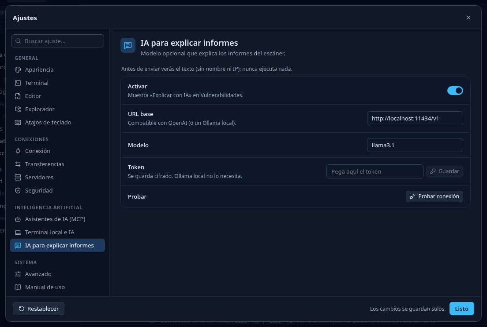

**Para qué sirve:** que una IA te explique con palabras sencillas un informe de vulnerabilidades. Es opcional.

**Cómo se usa:**

1. Ve a **Ajustes → IA para explicar informes** y activa **Activar**.
2. Escribe la **URL base** (por ejemplo `https://api.openai.com/v1`, o `http://localhost:11434/v1` para Ollama).
3. Escribe el **Modelo** y pega el **Token** (Ollama local no lo necesita). Pulsa **Guardar**.
4. Pulsa **Probar conexión** para comprobarlo.
5. En **Vulnerabilidades**, pulsa **Explicar con IA**, revisa el texto exacto que se enviará y pulsa **Enviar**.

**Notas:**

- No se envían el nombre del servidor, su IP, usuarios, rutas ni contraseñas.
- La IA solo explica. Los comandos que proponga nunca se ejecutan solos.
- No es lo mismo que el MCP: aquí TerView le pregunta a la IA, no al revés.

## GitHub

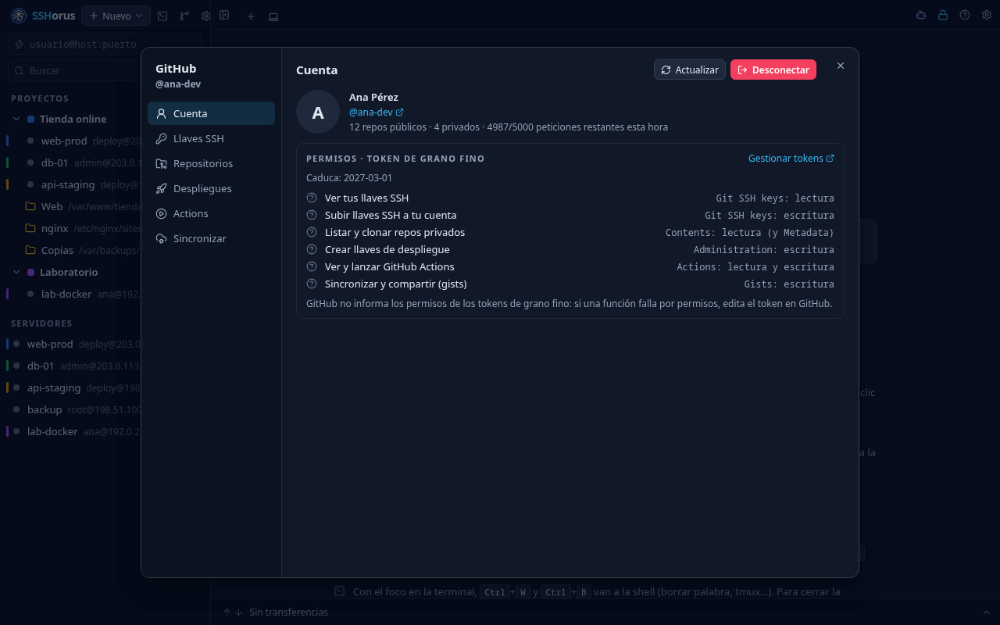

**Para qué sirve:** usar tu cuenta de GitHub con tus servidores: llaves, repositorios, despliegues y copia de tu configuración.

**Cómo se usa:**

1. Pulsa el botón **GitHub** de la barra lateral.
2. En **Cuenta**, pega un token y pulsa **Conectar**, o usa **Iniciar sesión en GitHub** con un código.
3. En **Llaves SSH**: **Añadir a authorized_keys** pasa tus llaves de GitHub a un servidor. **Subir a GitHub** sube la llave de tu PC.
4. En **Repositorios**, pulsa **Clonar…** para clonar un repo en un servidor.
5. En **Despliegues**, crea una **Nueva receta** y pulsa **Actualizar desde GitHub** cuando quieras desplegar.
6. En **Sincronizar**, **Subir copia cifrada** guarda tu configuración en un gist privado. En otro PC usa **Descargar y ver**.

**Notas:**

- En **Actions** ves las últimas ejecuciones y puedes lanzar un workflow.
- Las contraseñas y llaves privadas nunca se suben al gist.

## PIN y bloqueo

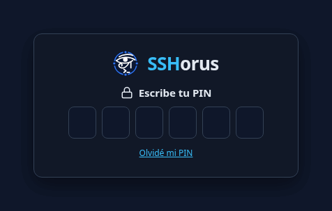

**Para qué sirve:** cifrar tus contraseñas guardadas y bloquear TerView cuando no lo usas.

**Cómo se usa:**

1. Pulsa el **candado** de la barra de pestañas → **Proteger con PIN** (o acepta la oferta al abrir TerView).
2. Escribe un PIN de 6 números dos veces y pulsa **Crear PIN**.
3. Para bloquear al momento: candado → **Bloquear ahora**, o `Ctrl+Shift+L`.
4. Para desbloquear, escribe tu PIN.
5. En **Ajustes → Seguridad** eliges **Bloquear tras** (5 a 60 min, o **Nunca**) y puedes **Cambiar PIN**.

**Si olvidaste el PIN:**

1. En la pantalla de bloqueo pulsa **Olvidé mi PIN**.
2. Escribe `BORRAR` y pulsa **Borrar y empezar de nuevo**.
3. Pierdes las contraseñas guardadas y los tokens (GitHub, asistentes de IA e IA de informes). Conservas servidores, proyectos, comandos, túneles y ajustes.

**Notas:**

- Al bloquear, las conexiones siguen abiertas.
- Tras 5 PIN incorrectos hay que esperar, cada vez más (hasta 15 min). Nunca se borra nada por fallar.

## Asistentes de IA (MCP)

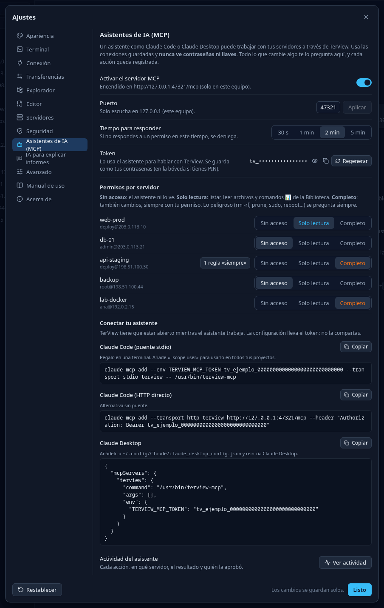

**Para qué sirve:** que un asistente como Claude Code o Claude Desktop te ayude con tus servidores a través de TerView, sin ver nunca tus contraseñas ni tus llaves.

**Cómo se usa:**

1. Ve a **Ajustes → Asistentes de IA (MCP)** y activa **Activar el servidor MCP**.
2. En **Permisos por servidor** elige para cada uno **Sin acceso**, **Solo lectura** o **Completo**.
3. En **Conectar tu asistente**, pulsa **Copiar** en **Claude Code (puente stdio)**.
4. Pégalo en una terminal de tu PC y pulsa `Enter`. Es un comando así:

```bash
claude mcp add --env TERVIEW_MCP_TOKEN=<token> --transport stdio terview -- /ruta/a/terview-mcp
```

5. Deja TerView abierto y pídele algo al asistente.
6. Cuando quiera cambiar algo, TerView te pregunta: **Permitir una vez**, **Permitir siempre…** o **Denegar**.

**Notas:**

- `terview-mcp` es el puente que se instala con TerView. Añade `--scope user` al comando para usarlo en todos tus proyectos.
- Con la AppImage, usa **Claude Code (HTTP directo)**: la ruta del puente cambia en cada arranque.
- Para Claude Desktop, copia el bloque **Claude Desktop** en `claude_desktop_config.json` y reinicia Claude Desktop.
- Lo que solo lee pasa solo. Lo peligroso (`rm -rf`, `sudo`, `reboot`…) se pregunta siempre. Si no respondes a tiempo, se deniega.
- El botón del **robot** en la barra de pestañas abre **Actividad del asistente**, con todo lo que ha hecho.

**Aceptar automáticamente:** si te cansa aprobar cada paso, en **Ajustes → Asistentes de IA (MCP)** pulsa **Automático…** junto a un servidor con acceso **Completo** (o, en el propio diálogo de permiso, **Aceptar automáticamente en este servidor…**).

- **Cambios normales**: lo que no es peligroso pasa sin preguntar.
- **Todo (incluido sudo)**: también lo peligroso y los comandos con sudo. Se marca en rojo y se pide confirmación. Si TerView tiene la contraseña de sudo (en memoria o guardada) la usa sin preguntar; si no, la pide una vez.
- Duración: **15 min**, **1 hora**, **hasta cerrar TerView** o **siempre**.
- Mientras esté activo verás **Automático** en la barra de pestañas: un clic lo apaga en todos los servidores.
- Nunca funciona con TerView bloqueado ni en servidores de solo lectura. Cada acción queda en **Actividad del asistente** marcada como «automático», y las peligrosas muestran un aviso.

## Terminal local, Claude Code y Codex

**Para qué sirve:** tener en TerView una terminal de **tu propio PC** y abrir **Claude Code** o **Codex** que ya saben qué servidores tienes.

**Cómo se usa:**

1. Pulsa el botón del **portátil** en la barra de pestañas (junto a **+**).
2. Elige **Terminal local**, **Claude Code** o **Codex**. Se abre una pestaña con el icono del portátil (o del robot).
3. Para trabajar en otra carpeta, pulsa **Cambiar carpeta…** en el mismo menú. TerView recuerda la última.
4. Si el asistente no está instalado, TerView te muestra el comando oficial y, si aceptas, lo ejecuta en una pestaña para que veas la instalación. Al terminar, vuelve a pulsar **Claude Code** o **Codex**.
5. La primera vez, el asistente te pide iniciar sesión (con tu suscripción o una clave de API): `/login` en Claude Code, o lo que indique Codex.

**Qué sabe el asistente:** la lista de tus servidores con su alias de `~/.ssh/config` (puede usar `ssh <alias> '<comando>'`), su usuario, host y proyecto, cuáles están conectados, qué servidor estabas mirando y la fecha. Si el **MCP** está activo, también lo tiene configurado, con tus permisos de siempre. Nunca recibe contraseñas, llaves, tokens ni el PIN.

**Enviar a la IA:** en la terminal de un servidor, selecciona un texto, haz clic derecho y elige **Enviar a la IA**. Se pega en el asistente abierto (sin `Enter`) para que añadas tu pregunta.

**Notas:**

- Cerrar la pestaña termina lo que corre en ella y todo lo que lanzó.
- En **Ajustes → Terminal local e IA** eliges qué contexto recibe (y lo puedes ver), y si usa ssh directo, el MCP o las dos cosas.
- Para el ssh directo, exporta los servidores a `~/.ssh/config` (barra lateral → **Nuevo → Exportar**). Los servidores con contraseña solo funcionan por el MCP.
- TerView no escribe nada en tu carpeta ni lee la configuración de Claude Code o Codex.

## Ajustes

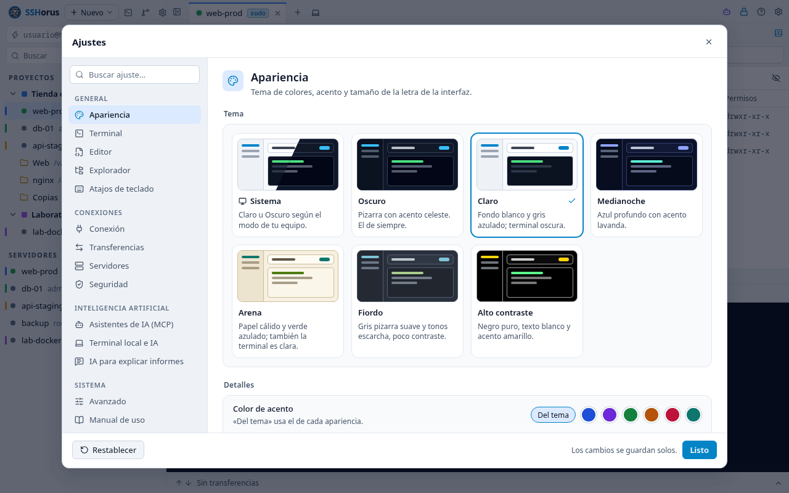

**Para qué sirve:** adaptar TerView a tu gusto.

**Cómo se usa:**

1. Pulsa el engranaje (**Ajustes**) o `Ctrl+,`.
2. Elige una sección a la izquierda, o escribe en **Buscar ajuste…** (por ejemplo «letra» o «tmux»). Con la ventana estrecha, las secciones salen arriba.
3. Cambia lo que quieras. Los cambios se guardan solos.
4. Pulsa **Listo** para cerrar.

**Lo más útil:**

- **Apariencia → Tema**: elige una tarjeta: **Sistema** (sigue el modo claro u oscuro de tu equipo), **Oscuro**, **Claro**, **Medianoche** (azul profundo), **Arena** (cálido, con la terminal también clara), **Fiordo** (gris suave) o **Alto contraste**. Cambia al momento la interfaz, la terminal y el editor (también el de ventana aparte).
- **Apariencia → Detalles**: **Color de acento** (o «Del tema») y **Tamaño de la letra de la interfaz**. La terminal y el editor tienen su propio tamaño.
- **Terminal**: tamaño y tipo de letra, y **Terminales persistentes (tmux)**.
- **Conexión**: **Reconectar automáticamente** e **Intentos**.
- **Transferencias**: **Transferencias simultáneas** y **Si el archivo ya existe**.
- **Explorador**: **Mostrar archivos ocultos** y **Confirmar antes de borrar**.
- **Avanzado → Diagnóstico**: **Copiar informe**, útil para reportar un problema.
- **Restablecer** vuelve a los valores de fábrica.

## Atajos de teclado

En macOS, donde la tabla dice ⌘, usa ⌘ en lugar de Ctrl. Los demás atajos usan Ctrl también en macOS.

**Generales**

| Atajo | Qué hace | En macOS |
|-------|----------|----------|
| `Ctrl+Shift+P` | Paleta de comandos | ⌘⇧P |
| `Ctrl+Tab` / `Ctrl+Shift+Tab` | Siguiente / anterior pestaña | Ctrl |
| `Ctrl+AvPág` / `Ctrl+RePág` | Siguiente / anterior conexión | Ctrl |
| `Ctrl+W` | Cerrar la pestaña actual | ⌘W |
| `Ctrl+B` | Mostrar u ocultar la barra lateral | ⌘B |
| `` Ctrl+` `` | Mostrar u ocultar la terminal | Ctrl |
| `Ctrl+Shift+M` | Dividir (vista y editor) o quitar la división | Ctrl |
| `Ctrl+,` | Ajustes | ⌘, |
| `Ctrl+Shift+L` | Bloquear TerView (con PIN) | ⌘⇧L |
| `Supr` en una pestaña | Cerrar esa pestaña | Supr |
| Clic central en una pestaña | Cerrarla | Igual |

**Barra lateral**

| Atajo | Qué hace |
|-------|----------|
| Doble clic o `Enter` | Conectar, o ir a su pestaña si ya está abierta |
| `Ctrl` + doble clic, `Ctrl+Enter` o clic central | Abrir otra conexión al mismo servidor (⌘ en macOS) |
| `Shift+F10` | Menú del servidor |

**Terminal**

| Atajo | Qué hace |
|-------|----------|
| `Ctrl+Shift+C` / `Ctrl+Shift+V` | Copiar / pegar |
| `Ctrl+Shift+F` | Buscar |
| `Enter` / `Shift+Enter` | Siguiente / anterior resultado |
| `Alt+C` | Distinguir mayúsculas en la búsqueda |
| `Esc` | Cerrar la búsqueda |

**Explorador de archivos** (⌘ en lugar de Ctrl en macOS)

| Atajo | Qué hace |
|-------|----------|
| `Enter` | Abrir |
| `Backspace` o `Alt+↑` | Subir de carpeta |
| `Alt+←` / `Alt+→` | Atrás / adelante |
| `Ctrl+L` | Escribir una ruta |
| `Ctrl+F` | Filtrar por nombre |
| `Ctrl+A` | Seleccionar todo |
| `Ctrl` + clic / `Shift` + clic | Añadir a la selección / seleccionar un rango |
| `F2` | Renombrar |
| `Supr` | Eliminar |
| `F5` | Refrescar |
| `Esc` | Quitar la selección |
| Escribir letras | Saltar al archivo que empieza así |

**Editor y comandos**

| Atajo | Qué hace |
|-------|----------|
| `Ctrl+S` | Guardar el archivo en el servidor (⌘S en macOS) |
| `Enter` | Ejecutar el comando en la terminal |
| `Alt+Enter` | Escribir el comando en la terminal sin ejecutarlo |
| `Ctrl+Enter` | Ejecutar y ver el resultado en el panel |
| `Ctrl+Enter` en «Nuevo comando» o en «Ejecutar en varios servidores» | Guardar / ejecutar (⌘ en macOS) |
| `Esc` | Volver o cerrar la paleta |

## Solución de problemas

**«¡La huella del servidor cambió!»**
Si reinstalaste el servidor, es normal: pulsa **Confiar en la nueva huella**. Si no, pulsa **Cancelar** y pregunta al administrador: podría ser un ataque.

**«Usuario o contraseña incorrectos»**
Revisa el usuario y la contraseña en **Editar servidor**. Si dice «el servidor no acepta contraseña», cambia a **Llave SSH**.

**«El servidor rechazó la llave»**
Elige la llave **privada** (sin `.pub`) y comprueba que la pública está en `~/.ssh/authorized_keys` del servidor.

**El servidor pide un código (2FA)**
Escribe el código de tu app de autenticación en **Código de verificación** y pulsa **Verificar**. Si dice «el servidor exige un segundo método», revisa que tienes la llave y el código.

**«El agente SSH no tiene llaves cargadas»**
Carga tu llave con `ssh-add`. En Windows, activa el servicio *Agente de autenticación OpenSSH* o abre Pageant.

**Administración en «Solo lectura»**
Necesitas root o sudo. Pulsa **Tengo sudo: introducir contraseña**. Si el servidor usa doas con contraseña, conéctate como root o usa sudo.

**«tmux no está instalado»**
Pulsa **Escribir el comando en la terminal**, revísalo y pulsa `Enter`. Las terminales nuevas ya serán persistentes.

**Olvidé el PIN**
En la pantalla de bloqueo pulsa **Olvidé mi PIN** y escribe `BORRAR`. Ver [PIN y bloqueo](#pin-y-bloqueo).

**«Llavero del sistema no disponible» (Linux)**
Instala o activa GNOME Keyring o KWallet. Sin llavero, TerView te pedirá la contraseña en cada conexión.

**El asistente dice «Abre TerView para usar tus servidores» o «TerView está bloqueado»**
TerView tiene que estar abierto y desbloqueado. Si dice «Token incorrecto», copia otra vez la configuración desde **Ajustes → Asistentes de IA (MCP)**.

**Lentitud o ventana en blanco en Linux**
Abre TerView con `WEBKIT_DISABLE_COMPOSITING_MODE=1 terview`.
