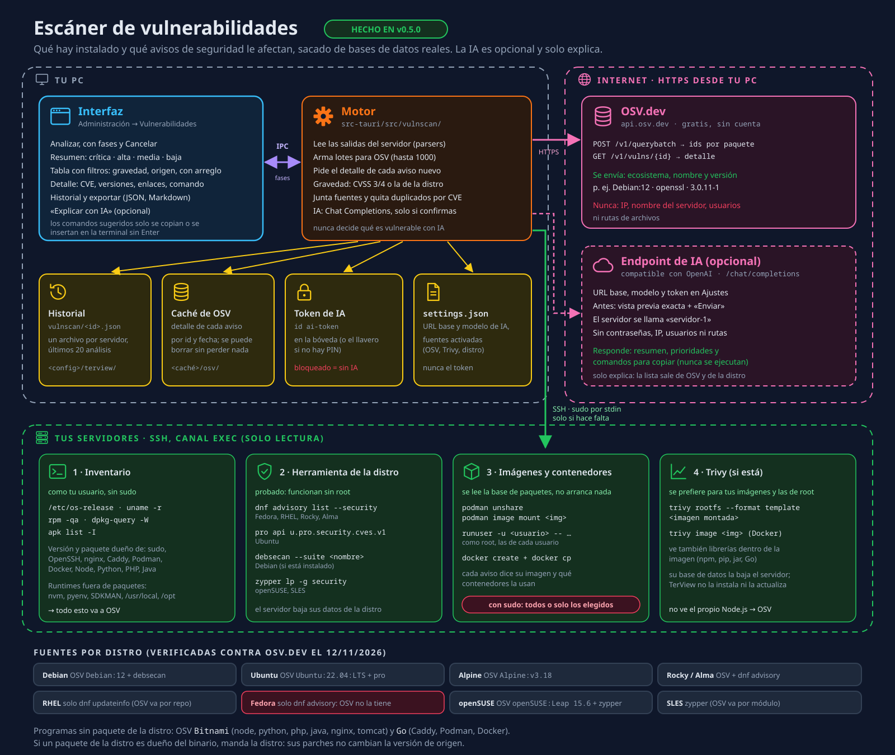

# TerView — Pendientes y próximas funciones

Estado al 12/11/2026: versión publicada **0.3.0**; **0.4.0 lista para publicar** (lo hecho después de
0.3.0 se marca como **v0.4.0**, igual que en el CHANGELOG). Todo el plan de la sección 8 está construido:
administración (usuarios, grupos, **puertos y sitios web**), monitor, túneles, contenedores, ejecutar en
varios servidores, GitHub, versiones y actualizaciones. Los comandos que se ejecutan aparte ya se pueden
**cancelar de verdad** (se detienen también en el servidor).

El **servidor MCP** (sección 3) ya está construido para la **v0.5.0**.

**Lo que sigue pendiente:**
- **Escáner de vulnerabilidades** (sección 10): diseñado para la v0.5.0, sin construir.
- **Probar el MCP con los clientes reales** (Claude Code y Claude Desktop) y ver la interfaz en la app (sección 3).
- **Firmar el instalador** de Windows (SmartScreen avisa al instalar).
- **Pruebas reales**: en un Windows real, contra un servidor con 2FA y con un agente SSH real.
- **Medir el rendimiento** en la app real (el panel de diagnóstico ya existe).
- **Probar con el ratón el arrastre al sistema** (ya implementado en Linux, Windows y macOS; macOS sin compilar).
- **Pruebas automáticas de la interfaz** dentro de la app real.

Este documento guarda lo que falta, **con suficiente detalle para retomarlo más tarde**.

| # | Función | Prioridad | Estado |
|---|---------|-----------|--------|
| 1 | [Biblioteca de comandos](#1-biblioteca-de-comandos) (Podman, análisis del sistema, etc.) | Alta | ✅ Hecho (v0.2.0) |
| 2 | [Reconexión rápida y automática](#2-reconexión-rápida-y-automática) | Alta | ✅ Hecho (v0.2.0) |
| 3 | [Servidor MCP (conectar asistentes de IA)](#3-servidor-mcp-conectar-asistentes-de-ia) | Opcional | ✅ Hecho (v0.5.0) |
| 5 | [Exportar servidores a `~/.ssh/config`](#5-exportar-servidores-a-sshconfig) | Alta (corta) | ✅ Hecho (v0.2.0) |
| 4 | [Otros pendientes detectados](#4-otros-pendientes-detectados) | Media/Baja | Mayoría hecha; ver tabla |
| 10 | [Escáner de vulnerabilidades](#10-escáner-de-vulnerabilidades--diseñado-v050) (OSV.dev, herramientas de la distro, Trivy; IA opcional solo para explicar) | Alta (v0.5.0) | Diseñado (v0.5.0) |

**Orden sugerido:** 2 (reconexión) → 5 (exportar a `~/.ssh/config`) → 1 (biblioteca de comandos)
→ 3 (MCP, solo si hace falta; reutiliza `exec_capture` y el catálogo de la biblioteca).

---

## 1. Biblioteca de comandos


### Qué es
Un lugar dentro de la app donde están **todos los comandos útiles listos para aplicar** en el
servidor conectado, sin tener que recordarlos ni escribirlos: levantar contenedores con Podman,
ver logs, analizar el sistema, revisar discos, puertos, servicios, etc.

El catálogo inicial (todos los comandos, por categoría) está en
[`comandos/CATALOGO.md`](comandos/CATALOGO.md).

### Cómo se usa
1. **Panel "Comandos"** en cada pestaña de conexión (junto a "Archivos"), con buscador y categorías:
   Podman · Docker · Análisis del sistema · Procesos · Discos · Red · Servicios (systemd) · Logs ·
   Usuarios · Paquetes · Seguridad · Web (nginx/apache) · Git · **Mis comandos**.
2. **Paleta rápida** con `Ctrl+Shift+P`: escribes "podman logs" y lo ejecutas sin tocar el ratón.
3. Cada comando muestra **exactamente lo que se va a ejecutar** antes de correrlo.
4. Tres formas de aplicarlo:
   - **Insertar en terminal**: lo escribe en la terminal activa sin pulsar Enter (para revisarlo).
   - **Ejecutar**: lo escribe y lo ejecuta en la terminal activa.
   - **Ejecutar y ver resultado**: lo corre aparte (canal `exec`) y muestra la salida en el panel
     (tabla o texto), sin ensuciar la terminal. Ideal para análisis.

### Comandos con variables
Ejemplo: `podman logs -f --tail {{lineas:200}} {{contenedor}}`
- `{{contenedor}}` abre un formulario; las opciones **se sugieren desde el servidor**
  (p. ej. lista de contenedores con `podman ps -a --format '{{.Names}}'`).
- `{{lineas:200}}` = variable con valor por defecto.

### Análisis del sistema (un clic)
Botón **"Analizar servidor"** que corre comandos de solo lectura y arma un informe visual:
sistema operativo y kernel, tiempo encendido, CPU y carga, memoria y swap, discos (con alerta
si > 85 %), procesos que más consumen, servicios fallidos, puertos abiertos, contenedores
(Podman/Docker), últimos errores del sistema, actualizaciones pendientes.
Detecta la distribución (Fedora/RHEL → `dnf`, Debian/Ubuntu → `apt`, Alpine → `apk`) para usar
el comando correcto.

### Mis comandos (personalizados)
- Crear, editar, duplicar y borrar comandos propios.
- Alcance: **global**, **por proyecto** o **por servidor**.
- Importar/exportar en JSON para compartir con el equipo.
- Se guardan en `~/.config/terview/commands.json`.

### Seguridad
- Comandos marcados como **peligrosos** (borrar, `prune`, reiniciar, `rm`…) piden confirmación
  y se muestran en rojo.
- Comandos con `sudo` se marcan; la contraseña de sudo **nunca** se guarda ni se envía sola:
  se escribe en la terminal.
- "Ejecutar y ver resultado" tiene límite de tiempo (p. ej. 30 s) y botón para cancelar.

### Cómo se construiría
| Parte | Dónde | Qué hace |
|-------|-------|----------|
| Catálogo base | `src/features/commands/catalog.ts` | Comandos incluidos (desde `CATALOGO.md`) |
| Mis comandos (motor) | `src-tauri/src/snippets/` | Guardar/leer `commands.json` (mismo patrón que `storage/`) |
| Ejecutar y capturar | `src-tauri/src/snippets/exec.rs` | Canal `exec` con tiempo límite; devuelve salida, errores y código |
| Panel | `src/components/Commands/` | Lista, buscador, categorías, formulario de variables, resultados |
| Paleta | `src/components/Commands/Palette.tsx` | `Ctrl+Shift+P` |
| Análisis | `src/components/Commands/Analysis.tsx` | Informe visual del servidor |
| Insertar en terminal | `TerminalArea` | Exponer "escribir en la terminal activa" (hoy no existe) |

Comandos Tauri nuevos: `snippets_load`, `snippets_save`, `snippets_delete`, `exec_capture(sessionId, command, timeoutSecs)`.

---

## 2. Reconexión rápida y automática

### Cómo funciona hoy
- Un vigilante revisa cada **1,5 s** si la conexión sigue viva (`ssh/commands.rs`, `WATCH_INTERVAL`).
- **Si el servidor cierra** la conexión (reinicio, expulsión): se detecta en **1–2 s**.
- **Si se cae la red** (wifi, cable, VPN): se detecta en **90–120 s**, porque la señal de vida
  (`keepalive`) se envía cada 30 s y se da por perdida tras 3 sin respuesta
  (`ssh/connect.rs`: `keepalive_interval: 30s`, `keepalive_max: 3`).
- Al detectarse: punto rojo en la pestaña, aviso **"Conexión perdida"** con **Reconectar** / **Cerrar**,
  terminales muestran "Conexión cerrada", transferencias pasan a error (se pueden reintentar y
  continúan desde donde quedaron).

### Mejora 1 — Detección más rápida
- Bajar `keepalive_interval` a **10 s** (detección en ~30 s).
- Hacerlo configurable en **Ajustes → Conexión** ("Detectar desconexión en: 15 s / 30 s / 60 s / 2 min").
- Archivos: `src-tauri/src/ssh/connect.rs`, `src-tauri/src/types.rs` (`Settings`),
  `src/api/types.ts`, `src/components/Settings/SettingsDialog.tsx`.

### Mejora 2 — Reconexión automática
1. Al caerse, la pestaña muestra **"Reconectando… (intento 2 de 5)"** en vez del error.
2. Reintentos con espera creciente: 1 s, 2 s, 5 s, 10 s, 30 s (configurable, se puede desactivar).
3. Usa la contraseña/frase guardada en el llavero; si no hay, muestra el aviso con **Reconectar**.
4. Al volver:
   - **Mismo `sessionId`** (se reemplaza la conexión dentro de `SessionStore`), así la interfaz
     no tiene que rehacer pestañas.
   - Explorador recarga **la misma carpeta** (requiere que `FileExplorer` informe su ruta actual:
     prop `onPathChange`).
   - Terminales: sin tmux abren una shell nueva (la anterior se pierde). ✅ Con **terminales
     persistentes (tmux)** vuelven a engancharse a la misma sesión y lo que corría sigue vivo (v0.4.0,
     ver sección 7, idea 6).
   - Transferencias con error se **reanudan solas** (el motor ya sabe continuar desde el último byte).
5. Nuevo evento `session://reconnected` y estado `"reconnecting"` en `SessionTab`.

Archivos: `ssh/commands.rs` (vigilante + bucle de reintentos), `ssh/mod.rs` (`SessionStore::replace`),
`types.rs` + `src/api/types.ts` (evento), `stores/tabs.ts` (estado), `components/Session/SessionView.tsx`
(aviso), `components/Terminal/*` (reabrir shell), `stores/transfers.ts` (reanudar).

---

## 3. Servidor MCP (conectar asistentes de IA)

> **Hecho para la v0.5.0** (antes estaba en pausa como idea opcional). Un asistente de IA (Claude Code,
> Claude Desktop u otro cliente MCP) trabaja con tus servidores **usando las conexiones de TerView, sin ver
> nunca contraseñas ni llaves**, con permisos por servidor, aprobación en la app y registro.
> Las alternativas sin TerView siguen valiendo: Claude Code + `ssh` con los servidores exportados a
> `~/.ssh/config` ([punto 5](#5-exportar-servidores-a-sshconfig)).


### Cómo se usa
1. Ajustes → **Asistentes de IA (MCP)** → activar (viene apagado).
2. Elegir el acceso de cada servidor: **Sin acceso** (por defecto), **Solo lectura** o **Completo**.
3. Copiar la configuración que muestra Ajustes (lleva el token y la ruta del puente):
   - Claude Code por stdio: `claude mcp add --env TERVIEW_MCP_TOKEN=<token> --transport stdio terview -- <ruta>/terview-mcp`
   - Claude Code por HTTP: `claude mcp add --transport http terview http://127.0.0.1:47821/mcp --header "Authorization: Bearer <token>"`
   - Claude Desktop: bloque `mcpServers` → `terview` con `command` (el puente) y `env.TERVIEW_MCP_TOKEN`.
4. TerView tiene que estar abierto: el puente reenvía a la app. Si está cerrada, el asistente ve
   «Abre TerView para usar tus servidores» y las herramientas aparecen solas al abrirla.

### Herramientas
| Herramienta | Qué hace | Permiso |
|-------------|----------|---------|
| `list_servers` / `list_projects` / `list_sessions` | Servidores (solo los que tienen acceso), proyectos y conexiones abiertas. Sin contraseñas. | Lectura |
| `connect` | Abre una conexión a un servidor guardado (aparece como pestaña; si pide contraseña o huella, la pides tú en TerView) | Pide permiso (también en solo lectura) |
| `run_command` | Comando no interactivo por el exec cancelable: código, stdout y stderr. 60 s por defecto (máx. 600) y 64 KB por flujo (máx. 512) | Pide permiso; en solo lectura, rechazado |
| `list_catalog` | Comandos de la Biblioteca y de «Mis comandos», con sus variables | Lectura |
| `run_catalog_command` | Un comando de la Biblioteca con sus variables (citadas como en la interfaz; no pueden empezar por «-») | 📊 de solo lectura: pasa; el resto pide permiso |
| `list_dir` / `stat` / `read_file` | SFTP. `read_file` por trozos: 64 KB por defecto, 1 MB máx. por llamada; binarios no se muestran | Lectura |
| `write_file` | Guardado atómico (hasta 1 MB). El diálogo muestra las diferencias | Pide permiso; en solo lectura, rechazado |
| `upload` / `download` | Con la cola de transferencias de la app (rutas locales absolutas) | Pide permiso (descargar también en solo lectura) |
| `transfer_status` | Progreso de un lote o de todas | Lectura |
| `list_ports` / `list_sites` / `list_containers` | Los escaneos de Administración y Contenedores, como el usuario conectado (sin sudo) | Lectura |

### Seguridad
- **Apagado por defecto**; al encenderlo se crea el token (`tv_` + 64 hex). Se guarda con la API de
  secretos (id `mcp-token`): en la bóveda si tienes PIN, si no en el llavero. Se puede ver, copiar y regenerar.
- **HTTP solo en `127.0.0.1`** (puerto 47821 por defecto, se cambia en Ajustes), ruta `/mcp`, token
  `Authorization: Bearer` comparado en tiempo constante. Peticiones con cabecera `Origin` (páginas web) → 403.
  El SDK además valida la cabecera `Host` (contra DNS rebinding).
- **TerView bloqueado** (PIN): se rechaza todo con «TerView está bloqueado: desbloquéalo para continuar»;
  al bloquear se olvida el token de la memoria y se deniegan las preguntas pendientes. Si se bloquea
  mientras espera tu respuesta, no se ejecuta aunque lo hayas permitido.
- **Permisos** (`mcp/policy.rs`): Sin acceso → rechazado (y el servidor no aparece en las listas);
  lectura → pasa; cambio → diálogo; peligroso → diálogo siempre y sin «Permitir siempre».
  Peligroso = ⚠️ de la Biblioteca o las reglas de `features/multirun/danger.ts` (rm -r, prune, reboot,
  mkfs, dd, kill -9, DROP TABLE…) más `sudo`, `doas`, `pkexec` y `su`.
- **Aprobación**: diálogo con el comando exacto y el servidor; Permitir una vez / Permitir siempre este
  comando en este servidor (se guarda la acción exacta en `mcp.json` y se puede quitar en Ajustes) /
  Denegar. Sin respuesta en 2 min (30 s–5 min en Ajustes) → denegado. La ventana se trae al frente.
- **Las contraseñas y llaves nunca salen**: el asistente solo usa conexiones abiertas en la app.
- **Registro**: `<config>/terview/mcp-audit.jsonl` (una línea por acción: herramienta, servidor, comando o
  ruta, resultado, quién lo aprobó, duración, cliente). Al pasar de 1 MiB se renombra a
  `mcp-audit.1.jsonl`. Panel **Actividad del asistente** (botón del robot en la barra de pestañas) con
  las últimas 300 y botón para detener un comando en marcha.

### Cómo está construido
| Parte | Dónde | Qué hace |
|-------|-------|----------|
| Lógica | `src-tauri/src/mcp/core.rs`, `policy.rs` | Permisos, aprobación, límites, registro. Sin Tauri (trait `Backend`): se prueba con un motor simulado |
| Servidor MCP | `mcp/server.rs` | SDK oficial `rmcp` 3.9 (`ServerHandler`): lista de herramientas con esquema e indicaciones de solo lectura |
| Transporte | `mcp/http.rs` | HTTP «streamable» del SDK, sin sesiones y con respuestas JSON, detrás de hyper con token y bloqueo |
| Puente stdio | `src-tauri/src/bin/terview-mcp.rs` + `mcp/bridge.rs` | Reenvía cada mensaje JSON-RPC a la app; responde él mismo si está cerrada |
| Motor real | `mcp/backend.rs` | Sesiones, exec cancelable (`ExecRegistry`), SFTP, transferencias |
| Peticiones a la interfaz | `mcp/ui.rs` + `src/features/mcp/uiBridge.ts` | Abrir pestaña, catálogo, puertos, sitios y contenedores (reutiliza el TypeScript ya probado) |
| Aprobaciones | `src/features/mcp/ApprovalDialog.tsx` | Diálogo con cuenta atrás, diferencias y peligro |
| Ajustes | `src/components/Settings/McpSection.tsx` | Activar, puerto, tiempo, token, permisos, reglas, configuración para copiar |
| Actividad | `src/components/McpActivity/` | Lista de acciones con resultado y quién aprobó |

### Cambios respecto al diseño original
- **Puente sin lógica**: reenvía mensajes en vez de ser un segundo servidor; así hay una sola puerta de permisos.
  El token le llega por la variable `TERVIEW_MCP_TOKEN` (no se escribe en ningún archivo de TerView) y el puerto lo lee de `mcp.json`.
- **Servidor sin sesiones** y con respuestas JSON: cada petición es independiente (más simple para el puente y
  para reconectar).
- **Lo que vive en TypeScript se pide a la interfaz** (catálogo, puertos, sitios, contenedores, abrir pestaña)
  en lugar de copiarlo a Rust: no se duplican 1.500 líneas de analizadores ya probados. La decisión de
  permisos y el texto final del comando siguen en Rust.
- **Nuevas herramientas**: `list_catalog`, `list_ports`, `list_sites`, `list_containers`. `analyze_server` y los
  recursos MCP quedan fuera (el análisis vive en la interfaz; se puede añadir igual que los escaneos).
- **Comandos interactivos** (`top`, `tail -f`…) se rechazan con una pista; los valores de variables no pueden empezar por «-».
- **Registro en JSONL** (`mcp-audit.jsonl`) en vez de `mcp-audit.log`, con rotación simple.
- **Con TerView bloqueado se rechaza todo**, incluidas las listas.

### Pruebas
- `cargo test --lib mcp`: permisos por nivel, aprobación (una vez, siempre, denegar) con un aprobador
  simulado, tiempo límite, bloqueo (también mientras espera), MCP apagado, servidor sin acceso, solo
  lectura, peligrosos que siempre preguntan, variables citadas, límites de salida y de lectura,
  diferencias, registro con rotación, token incorrecto / `Origin` / bloqueo en HTTP y el puente stdio
  (reenvío, token malo, app cerrada que luego se abre).
- `cargo test --lib mcp::e2e -- --ignored --test-threads=1` contra `terview-sshd`: cliente oficial de
  `rmcp` (initialize, tools/list, list_servers, run_command, tiempo límite, peligroso denegado,
  write_file/read_file/list_dir), JSON-RPC a mano como `curl` y el puente stdio.

### Sin verificar
- Con **Claude Code y Claude Desktop reales** (solo se probó con el cliente de `rmcp`, JSON-RPC a mano y el puente).
- La **interfaz en la app real**: diálogo, Ajustes, panel y botón (compila, pero no se abrió la ventana).
- Las herramientas que pasan por la interfaz (`connect`, `list_catalog`, `list_ports`, `list_sites`,
  `list_containers`) y `upload` / `download` con el motor de transferencias real: probadas solo con el motor simulado.
- Que los **instaladores** incluyan `terview-mcp` junto a `terview` (el CLI de Tauri empaqueta los binarios de
  `src/bin`; no se generó ningún instalador). Con la **AppImage** la ruta del puente cambia en cada arranque: usar HTTP.
- Windows y macOS (la ruta del puente y el llavero para el token).
- Detener un comando cuando el cliente cancela la petición (el SDK lo avisa; probado solo en código).

---

## 5. Exportar servidores a `~/.ssh/config`

### Para qué
Que los servidores guardados en TerView funcionen también con `ssh web-prod` en cualquier terminal,
con `scp`/`rsync`, con VS Code Remote-SSH y con asistentes como Claude Code — sin configurarlos dos veces.

### Cómo
- Botón **"Exportar a ~/.ssh/config"** (menú de la barra lateral y en Ajustes) y opción
  **"Mantener sincronizado"** (se actualiza al guardar/borrar servidores).
- TerView escribe **solo dentro de un bloque marcado**, sin tocar el resto del archivo:
  ```
  # >>> TerView (no editar a mano) >>>
  Host web-prod
      HostName 192.168.1.10
      Port 22
      User deploy
      IdentityFile ~/.ssh/id_ed25519
  # <<< TerView <<<
  ```
- Alias = nombre del servidor convertido a formato seguro (`Cliente X / web` → `cliente-x-web`), sin duplicados.
- Servidores con contraseña: se exportan igual (ssh la pedirá); se sugiere pasar a llave.
- **Importar** desde `~/.ssh/config`: leer los `Host` existentes y ofrecer agregarlos a TerView.
- Copia de seguridad `~/.ssh/config.bak-terview` antes de la primera escritura; permisos 0600.

Archivos: `src-tauri/src/storage/ssh_config.rs` (leer/escribir bloque), comandos
`profiles_export_ssh_config` / `profiles_import_ssh_config`, botón en `Sidebar` y opción en `SettingsDialog`.

---

## 4. Otros pendientes detectados

| Tema | Estado |
|------|--------|
| 2FA / códigos OTP | ✅ Hecho: diálogo "Código de verificación", varias rondas, llave + código. ⚠️ Sin probar contra un servidor 2FA real. Las sesiones con 2FA no se reconectan solas (el código es de un solo uso). |
| Agente SSH | Implementado, ⚠️ sin probar con un agente real. |
| Conflictos al subir | ✅ Sobrescribir / Omitir / Solo si es más nuevo / **Preguntar** archivo por archivo (v0.4.0). |
| Simultáneas por servidor | ✅ Hecho (el límite cuenta por servidor). |
| Symlinks en carpetas | ✅ Se copian como enlaces en ambos sentidos. |
| Buscar en la terminal | ✅ Ctrl+Shift+F. |
| Atajos en la terminal | ✅ Documentados en la bienvenida. |
| Fuente del editor | ✅ Ajuste propio. |
| Duplicar servidor | ✅ Copia también la contraseña guardada. |
| Logo e ícono | ✅ `docs/marca/`, ícono de la app generado. |
| Instaladores | ✅ `.rpm`, `.deb`, `.AppImage`, `.msi`, `-setup.exe` con GitHub Actions (v0.3.0). ⏳ Falta firmar (SmartScreen avisa). |
| Arrastrar al sistema | ✅ Implementado (v0.4.0), ⚠️ **sin probar con un arrastre real** en ningún sistema. Arrastrar filas del explorador remoto al escritorio o a una carpeta: primero se descargan a `<caché>/arrastre/<id>/` con el motor de transferencias (se ven en el panel) y luego se arrastran los archivos locales. Si ya estaban descargados y no cambiaron, el arrastre es inmediato; si no, se muestra «Preparando para arrastrar…» abajo y, si el botón sigue apretado al terminar, arrastra en ese momento (si no, avisa «Listo para arrastrar»). Más de 1 GB pide confirmación. La caché se limpia al abrir la app (lo de más de un día). Módulo `dragout`. **Linux** (X11 y Wayland): GTK3 propio con `text/uri-list` (URIs codificadas por GLib: espacios y acentos ok). `tauri-plugin-drag`/`drag` 2.1.1 sigue con los fallos en GTK (URIs sin codificar, botón mal pasado, entrega de datos desconectada antes de que el destino la pida), por eso no se usa en Linux. Sin XDS (solo X11 y pocos gestores). **Windows**: objeto de datos del Shell + `SHDoDragDrop` (compila con `cargo-zigbuild clippy`; ⚠️ sin probar). **macOS**: crate `drag` ⚠️ sin compilar ni probar (lo compila la CI de publicación). Pendiente si hiciera falta: archivos virtuales (`CFSTR_FILECONTENTS` en Windows, `NSFilePromiseProvider` en macOS) para no copiar dos veces los archivos grandes; quedarían fuera del motor de transferencias. Alternativas que siguen: «Descargar en…» y «Descargar y abrir carpeta». |
| Exportar "Mis comandos" a archivo | ✅ Exportar/importar a archivo con vista previa (v0.4.0). |
| Alias de `~/.ssh/config` | ✅ Detecta choques (Host, patrones, Include, Match) y propone alias (v0.4.0). |
| Cancelar "ver resultado" | ✅ «Cancelar» y el tiempo límite detienen también el proceso en el servidor: señal TERM por el canal y, si no basta, `kill` al grupo del comando desde otro canal (TERM y luego KILL). Comando Tauri `exec_cancel(execId)` (v0.4.0). Lo usan el panel de Comandos y «Ejecutar en varios servidores»: al cancelar (un servidor, «Cancelar todo» o al cerrar el panel) se detiene el comando tanto en sesiones de pestaña como en las propias; las propias se desconectan **después**, cuando el comando ya paró (como mucho 15 s). ⚠️ Sin probar contra servidores reales variados (la señal por el canal necesita OpenSSH 7.9 o más nuevo; si no, se usa `kill`). |
| Pruebas de la interfaz | ⏳ La interfaz se revisó con capturas en navegador; faltan pruebas automáticas dentro de la app real. |

---

## 6. Windows (y macOS)

El código ya es multiplataforma (Tauri + Rust): todo lo específico de Linux (permisos 0600, enlaces
simbólicos, agente por socket) tiene su alternativa en Windows. Llavero: Administrador de credenciales
de Windows. Ventana: WebView2 (ya viene en Windows 10/11). `~/.ssh` = `C:\Users\<usuario>\.ssh`.

Falta:
| Tema | Detalle |
|------|---------|
| Compilar para Windows | ✅ Hecho en v0.3.0 con GitHub Actions (`.github/workflows/release.yml`); la CI compila y prueba también en Windows. Chequeo local posible con `cargo-zigbuild check --target x86_64-pc-windows-gnu`. Antes: no se podía desde Fedora (una librería de cifrado necesita compilar C para Windows). Opciones: compilar en una PC con Windows (`npm run tauri build` → `.msi` / `.exe`) o **GitHub Actions** con `tauri-action` (Linux + Windows + macOS automáticamente en cada versión). |
| Agente SSH en Windows | ✅ Implementado en v0.3.0 (pipe de OpenSSH y Pageant), ⚠️ sin probar en un Windows real. Antes daba "no soportado". russh ya trae soporte: OpenSSH de Windows (`\\.\pipe\openssh-ssh-agent`) y Pageant (PuTTY). |
| Probar en Windows | Rutas con `\`, arrastrar desde el Explorador de Windows, tema del sistema. |
| Firmar el instalador | Sin firma, Windows SmartScreen muestra un aviso al instalar. |

---

## 7. Ideas recomendadas (siguientes funciones)

Ordenadas por utilidad para el día a día:

| # | Función | Para qué |
|---|---------|----------|
| 1 | **Túneles (port forwarding)** `-L` / `-R` / SOCKS | Abrir en tu PC una base de datos o panel web del servidor (`localhost:5432` → servidor) sin exponer puertos. Panel con túneles guardados por servidor y un clic para activarlos. |
| 2 | **Servidor intermedio (jump host / bastión)** | Llegar a servidores internos pasando por otro (`ProxyJump`). Muy común en empresas. |
| 3 | **Ejecutar en varios servidores a la vez** | Un comando de la biblioteca en todo un proyecto (p. ej. `podman ps` en 5 servidores) con resultados lado a lado. |
| 4 | **Monitoreo en vivo** | Gráficas de CPU, memoria, disco y red en tiempo real (amplía "Analizar servidor"), con alertas. |
| 5 | **Sincronizar carpeta** | Carpeta local ↔ remota: al guardar en tu PC se sube sola (desarrollo web). |
| 6 | **Sesiones persistentes con tmux** | La terminal sobrevive a cortes de red y a cerrar la app. ✅ Hecho (v0.4.0), detalle abajo. |
| 7 | **Comparar archivos** | Diferencias entre un archivo local y uno remoto, o entre dos servidores. |
| 8 | **Actualizaciones automáticas** | La app se actualiza sola (`tauri-plugin-updater`) + instaladores para Windows/macOS con GitHub Actions. |
| 9 | **Respaldo/sincronización de servidores** | Exportar todo cifrado con contraseña o sincronizar entre tus equipos. |
| 10 | **Historial por servidor** | Comandos usados y grabación opcional de sesiones (auditoría). |

### 7.6 Terminales persistentes con tmux — ✅ Hecho (v0.4.0)

- **Ajuste**: Ajustes → Terminal → «Terminales persistentes (tmux)»: Automático (por defecto), Siempre o
  Nunca. Cada servidor puede cambiarlo en su ficha («Como en Ajustes» hereda el general).
  - Por qué Automático: es lo que hace útil la reconexión automática, y en servidores sin tmux no cambia
    nada ni avisa. Cambia el comportamiento para quien ya usaba TerView: si el servidor tiene tmux, lo
    que corre en la terminal **sigue vivo al cerrar la app** (antes moría). Por eso las sesiones sueltas
    se ven con un contador en la barra de terminales y se pueden cerrar desde la lista.
- **Cómo funciona**: cada terminal tiene una sesión tmux con nombre propio (`terview-<8 hex>`), guardada en
  el estado de la sub-pestaña. El motor (`src-tauri/src/terminal/tmux.rs`) busca tmux una vez por
  conexión y abre la terminal con `exec` + PTY: `tmux -L terview new-session -A -s <nombre>`. Al
  reconectar (automático o botón «Reconectar», que abre pestaña nueva) se engancha a la misma sesión.
  - Servidor tmux propio (`-L terview`, `-f /dev/null`): no lee ni toca `~/.tmux.conf` ni las sesiones
    tmux del usuario. A mano: `tmux -L terview attach -t terview-…` (lo copia el menú de la pestaña).
  - Configuración por línea de comandos al arrancar ese servidor: sin barra de estado, **sin tecla
    prefijo** (Ctrl+B llega a los programas), `escape-time 10`, historial de 50 000 líneas,
    `default-terminal` tmux-256color (o screen-256color si el servidor no lo conoce), `-u -2`, color real,
    `aggressive-resize` y `window-size latest` (3.1+), hipervínculos (3.4+). Opciones según la versión.
  - **Historial y búsqueda**: tmux no usa la pantalla alternativa hacia xterm.js
    (`terminal-overrides …smcup@:rmcup@`). Así la rueda, el historial, Ctrl+Shift+F, la selección,
    copiar/pegar y los enlaces siguen funcionando con xterm.js, como sin tmux. Contras: en `less`/`man`
    la rueda mueve el historial de xterm.js en vez de la página (usa las flechas o RePág), y lo que salió
    mientras no había conexión y ya no cabe en pantalla queda solo en el historial de tmux. Al reabrir una
    sesión en una terminal nueva (lista o «Reconectar») se vuelcan antes sus últimas 10 000 líneas.
- **Cerrar**: la ✕ de la sub-pestaña o cerrar la pestaña de la conexión **terminan** la sesión tmux (como
  una shell normal). Menú de la sub-pestaña → «Desacoplar» la deja corriendo. Si la conexión se corta,
  se cierra la app o se cierra sin conexión, la sesión **se conserva**.
- **Sesiones sueltas**: botón de capas junto al «+» de las terminales (con contador si hay sueltas que
  nadie mira): lista con programa, carpeta y actividad, para **Abrir** en una terminal nueva o
  **Cerrar** (una o todas las sueltas).
- **Sin tmux**: en Automático, terminal normal sin avisos (se recuerda 20 s por conexión para no
  comprobarlo en cada terminal). En Siempre, avisa una vez por servidor con el comando de instalación
  según la distro (detección de privilegios) y ofrece escribirlo en la terminal.
- Indicador ∞ en la sub-pestaña cuando la terminal es persistente.
- Pruebas: `cargo test --lib terminal::tmux` (scripts, versiones, `tmux ls`) y, con el contenedor
  (`podman exec terview-sshd apk add tmux`), `cargo test --lib terminal::tmux -- --ignored`: crea la
  sesión, corta la conexión con un `sleep` en marcha, se engancha desde otra conexión y comprueba que el
  proceso y la shell siguen, el historial volcado y la configuración propia; y dos terminales por conexión.
- ⚠️ **Sin probar**: en la app real con un corte de red de verdad (wifi/VPN), servidores con tmux viejo
  (1.8–2.x), macOS (tmux de Homebrew) y FreeBSD, otros shells de login (fish, tcsh), programas con ratón
  (vim/htop) dentro de tmux, y el dibujado al cambiar el tamaño con mucho historial.

### 7.7 PIN, bóveda cifrada y bloqueo — ✅ Hecho (v0.4.0)

- **Bóveda** (`src-tauri/src/storage/vault.rs`): `vault.json` en la carpeta de configuración (atómico,
  0600) con un mapa id → secreto (servidores + `github-token`) cifrado con AES-256-GCM. Sobre JSON con
  cabecera autenticada (AAD) compartido con la copia en Gist: la parte común salió de `github/crypto.rs`
  a `storage/cipher.rs` (mismo formato de antes, los Gist viejos se siguen abriendo).
  - Llave = Argon2id(PIN, sal) con la **llave del equipo** como «secreto» K de Argon2 (32 bytes al azar
    en el llavero, usuario `vault-device-key`). Sin ella no se abre ni con el PIN correcto.
  - Argon2id calibrado al crear o cambiar el PIN para unos 0,75 s: 64 MiB (128 MiB si el equipo es
    rápido) y 3–20 pasadas; los parámetros van en el archivo. En este PC: 128 MiB × 9 pasadas ≈ 0,63 s.
    `argon2` y `blake2` se compilan optimizados también en desarrollo (`Cargo.toml`).
  - Llave y secretos descifrados solo en memoria mientras está desbloqueada (`Zeroizing`).
  - Fallos: 5 libres; luego 30 s, el doble cada vez, máx. 15 min, en `vault-attempts.json`. Nunca se
    borra nada por fallar. Borrar ese archivo a mano quita la espera (quien puede hacerlo ya tiene acceso
    a tu usuario).
- **API sin cambios** (`storage/secrets.rs`): `get/set/delete_secret` y las del token van a la bóveda si
  existe (error `Locked` si está bloqueada) o al llavero si no.
- **Mover**: activar lee todo del llavero → escribe y comprueba la bóveda → borra del llavero. Desactivar
  (pide PIN) escribe en el llavero, comprueba, y solo entonces borra `vault.json` y la llave del equipo.
  Cambiar el PIN vuelve a cifrar con sal nueva (misma llave del equipo). «Olvidé mi PIN» (escribir
  BORRAR) borra bóveda y llave del equipo.
- **Bloqueo** (`storage/lock.rs`): estado en Rust, evento `vault://state` a todas las ventanas. Las
  ventanas avisan de la actividad (como mucho cada 15 s) y un vigilante bloquea tras `lockMinutes` (hora
  del sistema: cuenta el tiempo suspendido). Al bloquear: se olvidan el token de GitHub en caché y las
  contraseñas de sudo; la interfaz queda montada pero inerte y tapada. Atajo `Ctrl+Shift+L` (⌘⇧L).
- **Reconexión**: con la bóveda activa, la sesión no guarda en memoria la contraseña o frase guardada;
  se lee en cada intento. Si está bloqueado, el intento espera (aviso `waitingUnlock`, la pestaña dice
  «Esperando el desbloqueo…») sin gastar intentos. Las de llave sin frase reconectan normal.
- Interfaz: `src/features/lock/` (pantalla de bloqueo, «Olvidé mi PIN», primera vez con «Ahora no»,
  medidor de fortaleza) y Ajustes → Seguridad (`components/Settings/SecuritySection.tsx`).
- Pruebas: `cargo test --lib storage::vault` (ida y vuelta, PIN incorrecto, cambiar PIN, archivo dañado o
  cabecera alterada, bloqueada → `Locked`, 0600, esperas guardadas en disco, llave del equipo ausente u
  otra, «Olvidé mi PIN», mover con un llavero simulado) y `cargo test --lib ssh::reconnect` (espera al
  desbloqueo). Con el llavero real (servicio `terview-test`):
  `cargo test --lib storage -- --ignored --test-threads=1`.
- ⚠️ **Sin probar en la app real**: la pantalla de bloqueo y la de primera vez a mano; ventanas de editor
  aparte bloqueadas; el bloqueo por inactividad y tras suspender el equipo; una reconexión real esperando
  al desbloqueo; Windows (Credential Manager) y macOS (Keychain, puede pedir permiso para la llave del
  equipo); Linux sin llavero (el PIN no se puede activar: necesita el llavero para la llave del equipo);
  el atajo `Ctrl+Shift+L` dentro del editor (tapa «seleccionar todas las coincidencias» de Monaco).
- Límites conocidos: los secretos que se devuelven a otros módulos son `String` normales (no se pisan
  al soltarlos); serde puede dejar copias temporales al descifrar. Mientras está desbloqueado, un
  programa malicioso con tu usuario puede leer la memoria o ver el PIN al escribirlo.

---

## 8. Plan elegido para la siguiente ronda (11/11/2026)

| Orden | Función | Origen |
|-------|---------|--------|
| 1 | [Optimización / rendimiento](#81-optimización--rendimiento) | Se siente lenta |
| 2 | [Gestión del servidor: usuarios y grupos](#82-gestión-del-servidor-usuarios-y-grupos) | ✅ Hecho (v0.4.0) |
| 3 | [Monitoreo en vivo](#83-monitoreo-en-vivo) | ✅ Hecho (v0.4.0) |
| 4 | [Túneles (port forwarding)](#84-túneles-port-forwarding) | ✅ Hecho (v0.4.0) |
| 5 | [Versiones y actualizaciones](#85-versiones-y-actualizaciones) | ✅ Hecho (v0.4.0) |
| 6 | [Ejecutar en varios servidores a la vez](#86-ejecutar-en-varios-servidores-a-la-vez) | ✅ Hecho (v0.4.0) |
| 7 | [GitHub: Actions + conectar cuenta](#9-github) | ✅ Hecho (v0.3.0 Actions, v0.4.0 cuenta) |
| 8 | [Contenedores (Podman / Docker)](#87-administrador-de-contenedores-podman--docker--pedido-11112026) | ✅ Hecho (v0.4.0) |
| 9 | [Puertos y servicios web](#88-puertos-y-servicios-web--pedido-11112026) | ✅ Hecho (v0.4.0) |
| — | [Corrección: doble clic en un servidor](#corrección--doble-clic-en-un-servidor-de-la-barra-lateral) | ✅ Hecho (v0.4.0) |

### 8.1 Optimización / rendimiento

**Hecho en v0.3.0:** carga bajo demanda (paquete inicial 914 → 362 KB), terminal WebGL, arreglo automático
de WebKitGTK con NVIDIA, menos redibujados, `color-mix` precalculados. Panel de diagnóstico ✅ (v0.4.0). **Falta:** medir en la app real.

**Primero medir, luego cambiar.** Hay que saber *dónde* se siente lenta:
al abrir la app, al conectar, al navegar carpetas, al escribir en la terminal, al cambiar de pestaña,
al mover divisores o durante transferencias.

Causas probables (por revisar en este orden):
| # | Causa posible | Cómo verificar | Arreglo |
|---|---------------|----------------|---------|
| 1 | **Modo desarrollo** (`npm run tauri dev`): Rust sin optimizar + Vite en vivo | Comparar con el instalador `.rpm` (compilado optimizado) | Usar la versión instalada para el día a día |
| 2 | **WebKitGTK en Linux/Wayland** (motor de la ventana): problemas conocidos de dibujado con ciertas tarjetas gráficas | Probar con `WEBKIT_DISABLE_DMABUF_RENDERER=1` y con `WEBKIT_DISABLE_COMPOSITING_MODE=1` | Detectarlo y aplicar la variable automáticamente al iniciar si mejora |
| 3 | **Carga inicial pesada**: el paquete principal pesa ~780 KB y Monaco ~4 MB | Medir tiempo hasta la primera pantalla | Cargar Sidebar/Comandos/Transferencias bajo demanda; precargar Monaco en segundo plano |
| 4 | **Re-dibujados de React** innecesarios (estado global que redibuja toda la ventana: transferencias cada 200 ms, pestañas, ajustes) | React Profiler / contar renders | Selectores más finos en zustand, `memo`, separar el estado de progreso |
| 5 | **Listas largas** (explorador con miles de archivos, cola con miles de trabajos, catálogo de comandos) | Probar carpeta con 5.000 archivos | Virtualización en todas las listas |
| 6 | **Efectos visuales caros**: sombras, `backdrop-filter`, animaciones, `color-mix` | Desactivarlos y comparar | Simplificar en Linux |
| 7 | **xterm.js** sin aceleración | Probar `@xterm/addon-webgl` | Usar el renderizador WebGL si está disponible |
| 8 | **Llamadas al motor en serie** (p. ej. abrir una carpeta hace varias peticiones seguidas) | Registro de tiempos por comando | Unir peticiones, caché de carpetas visitadas |

Entregable: un pequeño **panel de diagnóstico** (Ajustes → Avanzado) con tiempos de arranque, de
cada comando y FPS al mover paneles, para comparar antes/después.

### 8.2 Gestión del servidor: usuarios y grupos

Nueva pestaña **"Administración"** en cada conexión (para quien entra como root o con sudo):

**Usuarios**
- Lista de usuarios (`getent passwd`), separando personas (UID ≥ 1000) de cuentas del sistema:
  nombre, UID, grupos, shell, carpeta personal, último acceso (`lastlog`/`last`), bloqueado sí/no, con sudo sí/no.
- **Crear usuario**: nombre, nombre completo, contraseña (o generar una segura), shell, crear carpeta
  personal, grupos, dar acceso sudo (`wheel` en Fedora/RHEL, `sudo` en Debian/Ubuntu), añadir llave SSH.
- **Editar**: cambiar contraseña, shell, nombre completo, grupos (añadir/quitar), forzar cambio de
  contraseña en el próximo inicio (`chage -d 0`), fecha de caducidad.
- **Bloquear / desbloquear** (`usermod -L/-U`), **eliminar** (con opción de borrar su carpeta; confirmación fuerte).
- **Llaves SSH del usuario**: ver, añadir y quitar líneas de su `~/.ssh/authorized_keys` (con permisos correctos).
- Ver **quién está conectado ahora** (`who`) y cerrar su sesión.

**Grupos**
- Lista (`getent group`), miembros, crear, renombrar, eliminar, añadir/quitar miembros (`gpasswd -a/-d`).

**Cómo se ejecuta**
- Comandos según la distribución (Fedora/RHEL, Debian/Ubuntu, Alpine: `useradd` vs `adduser`).
- **sudo**: si no eres root, la app pide tu contraseña de sudo **una vez por sesión** (solo en memoria,
  se puede olvidar con un botón) y usa `sudo -S`. Nunca se guarda en disco.
- Antes de cada cambio se muestra el **comando exacto** que se ejecutará.
- Todo cambio queda en un **registro** visible ("Historial de administración").

Siguientes ampliaciones naturales del mismo panel: **servicios** (systemd: iniciar/parar/activar, ver
logs), **firewall** (puertos abiertos), **paquetes** (actualizar, instalar), **tareas programadas** (cron/timers).

### 8.3 Monitoreo en vivo
- Gráficas en tiempo real (cada 2–5 s) de CPU, memoria, disco, red y carga, por servidor.
- Lectura ligera desde `/proc` por un canal `exec` dedicado (sin instalar nada en el servidor).
- Procesos que más consumen (con botón para terminar), contenedores con su consumo.
- **Alertas** configurables (disco > 85 %, memoria > 90 %, servicio caído) con aviso en la app.
- Vista "Proyecto": tarjetas de todos los servidores del proyecto a la vez.

### 8.4 Túneles (port forwarding)
- **Local** (`-L`): `localhost:5432` en tu PC → `db:5432` desde el servidor.
- **Remoto** (`-R`): exponer un puerto de tu PC en el servidor.
- **SOCKS** (`-D`): navegar como si estuvieras en la red del servidor.
- Túneles **guardados por servidor**, activar/desactivar con un clic, arranque automático al conectar,
  estado (activo, conexiones, bytes), aviso si el puerto local está ocupado.
- russh ya soporta `direct-tcpip` y `tcpip-forward`.

### 8.5 Versiones y actualizaciones
- **Acerca de**: versión, novedades de cada versión (changelog) y enlaces.
- **Buscar actualizaciones** y actualizar desde la app (`tauri-plugin-updater` + versiones publicadas en GitHub Releases, firmadas).
- **GitHub Actions** para generar instaladores de Linux (`.rpm`, `.deb`, `.AppImage`), Windows (`.msi`/`.exe`) y macOS en cada versión.
- Ver también la **versión de lo instalado en el servidor** (Podman, Docker, nginx, kernel…) y si hay
  actualizaciones pendientes del sistema (ya se detecta en "Analizar servidor").

### 8.7 Administrador de contenedores (Podman / Docker) — pedido 11/11/2026
Pestaña **Contenedores** en cada conexión, todo visual (sin escribir comandos):
- Detecta Podman y/o Docker (y si hace falta sudo o es modo *rootless*).
- **Contenedores**: lista con estado, imagen, puertos, uso de CPU/memoria; iniciar, parar, reiniciar,
  pausar, eliminar; ver logs en vivo; abrir una terminal dentro (`exec -it`); inspeccionar.
- **Crear / levantar**: formulario (imagen, nombre, puertos, volúmenes, variables, reinicio) y
  **Compose** (`compose up -d` / `down` / `pull` en una carpeta con `compose.yml`).
- **Imágenes**: listar, descargar (`pull`), eliminar, **limpiar** las que no se usan (`image prune`)
  mostrando antes cuánto espacio se libera.
- **Volúmenes y redes**: listar, crear, eliminar, limpiar.
- **Limpieza general** (`system prune`) con resumen de lo que se borrará y confirmación.
- Siempre muestra el comando exacto antes de las acciones que borran.

### 8.8 Puertos y servicios web — pedido 11/11/2026
✅ **Hecho (v0.4.0).** Archivos: `src/components/Admin/PortsTab.tsx`, `WebTab.tsx`,
`src/features/admin/ports.ts`, `web.ts` y `src/features/tunnels/openLocal.ts`.
Diferencias con lo pedido: en lugar de «ver el proceso en el Monitor» hay «Copiar PID». «Abrir túnel» a un
puerto menor de 1024 escucha en tu PC en un puerto libre que elige el motor (también en Contenedores).

En **Administración**, dos sub-pestañas nuevas:
- **Puertos**: todos los puertos en escucha (TCP/UDP, IPv4/IPv6) con proceso, PID, usuario y servicio
  systemd/contenedor. Con root/sudo se ven los de **todos los usuarios**; sin privilegios, solo los propios
  (y se avisa). Filtros: por usuario, por proceso, solo públicos (0.0.0.0/::) vs solo locales.
  Acciones: abrir un túnel a tu PC, copiar dirección, ver el proceso en el Monitor.
- **Sitios web**: detecta **nginx** y **Caddy**; lista cada sitio (dominios, puertos, HTTPS/certificado,
  raíz o `proxy_pass`/`reverse_proxy` hacia qué puerto), enlaza el puerto de destino con la lista de
  Puertos, abre el archivo de configuración en el editor, comprueba la configuración (`nginx -t`,
  `caddy validate`) y recarga el servicio con confirmación.

### Corrección — doble clic en un servidor de la barra lateral
✅ **Hecho (v0.4.0).** El doble clic (y Enter) **va a la pestaña ya abierta** de ese servidor y la
reconecta si estaba cerrada; si no hay pestaña, conecta (`openOrFocusServer` en `src/features/connect.ts`,
usado por `openOrFocus` en `Sidebar.tsx`). Para abrir una conexión adicional al mismo servidor:
Ctrl+doble clic, clic central o «Abrir otra conexión» en el menú.

### 8.6 Ejecutar en varios servidores a la vez
- Elegir servidores (o un proyecto completo) y ejecutar un comando de la biblioteca en todos.
- Resultados lado a lado o en tabla, con estado por servidor (correcto / error / tiempo agotado).
- Confirmación reforzada para comandos peligrosos.

---

## 9. GitHub

Dos partes independientes: **(A)** usar GitHub para construir y publicar TerView, y
**(B)** conectar una cuenta de GitHub dentro de la app para trabajar con los servidores.

### 9A. El proyecto en GitHub (GitHub Actions)
1. **Subir el proyecto**: `git init`, primer commit, repositorio en GitHub (privado o público),
   `.gitignore` ya existe (excluye `node_modules`, `dist`, `src-tauri/target`).
2. **Integración continua** (en cada cambio): compilar, `cargo clippy`, `cargo test` (los tests sin
   servidor), `tsc` y `vite build`. Opcional: levantar el contenedor SSH de pruebas en el propio
   Actions (`services:` con `linuxserver/openssh-server`) para correr también los tests con servidor.
3. **Publicar versiones** (al crear una etiqueta `v0.3.0`): `tauri-apps/tauri-action` genera
   instaladores de **Linux** (`.rpm`, `.deb`, `.AppImage`), **Windows** (`.msi`, `.exe`) y **macOS**
   (`.dmg`), y los adjunta a un **GitHub Release** con las notas de la versión.
4. **Actualizaciones automáticas**: el `tauri-plugin-updater` de la app consulta ese Release
   (archivo `latest.json` firmado) → "Hay una versión nueva, ¿actualizar?" (ver 8.5).
5. **Firmas**: llave de firma del actualizador (secreto en GitHub), y opcional certificado de
   firma de código para Windows/macOS (evita avisos de seguridad al instalar).

Archivos: `.github/workflows/ci.yml`, `.github/workflows/release.yml`, `CHANGELOG.md`.

### 9B. Conectar tu cuenta de GitHub en la app
Inicio de sesión con **GitHub (OAuth "device flow")**: la app muestra un código, lo pegas en
github.com y listo; el token se guarda en el **llavero del sistema**, nunca en archivos.
Se puede desconectar cuando quieras. Permisos mínimos según lo que se use.

Qué permitiría:
| Función | Para qué |
|---------|----------|
| **Llaves SSH ↔ GitHub** | Ver tus llaves públicas de GitHub y **añadirlas a un servidor** (`authorized_keys`) con un clic; o subir a GitHub una llave de tu PC. Útil junto a "Administración → llaves SSH de usuarios". |
| **Clonar repositorios en el servidor** | Elegir un repo de tu cuenta y clonarlo en una carpeta del servidor (con *deploy key* de solo lectura creada automáticamente). |
| **Desplegar** | Botón "Actualizar desde GitHub" en un proyecto: `git pull` + comandos posteriores (p. ej. `podman compose up -d --build`) en uno o varios servidores. |
| **Ver GitHub Actions** | Estado de los workflows de tus repos (último despliegue correcto/fallido) y lanzar uno manualmente. |
| **Sincronizar configuración** | Guardar servidores, proyectos y "Mis comandos" en un **Gist privado cifrado** para tenerlos en otra PC (las contraseñas **no** se sincronizan). |
| **Compartir comandos** | Publicar/importar colecciones de comandos desde un repo o gist (útil para equipos). |

Orden sugerido: 9A primero (da los instaladores de Windows/macOS y las actualizaciones), luego 9B
empezando por **llaves SSH** y **sincronizar configuración**.

---

## 10. Escáner de vulnerabilidades — diseñado (v0.5.0)

> **Estado: diseño, aún no construido.** El código actual no tiene nada de esto. Los comandos, nombres
> de ecosistemas y formatos de salida de esta sección se **probaron de verdad el 12/11/2026** contra
> OSV.dev y contenedores reales (ver [10.13](#1013-qué-se-comprobó-de-verdad-12112026)); lo que no se
> pudo probar está en [10.14](#1014-sin-verificar-y-riesgos).



### 10.1 Qué es

Un botón **Analizar** que responde: *¿qué software tiene este servidor, en qué versión, y qué
vulnerabilidades conocidas (CVE y avisos de seguridad) le afectan?* Cubre:

- sistema operativo y **kernel**, y todos los paquetes instalados;
- programas clave aunque no vengan de la distro: **sudo, OpenSSH, nginx, Caddy, Podman, Docker** y los
  runtimes **Node, Python, PHP y Java** (también los instalados en `$HOME` con nvm, pyenv, SDKMAN…);
- **imágenes de contenedores** (Podman y Docker) con los paquetes de dentro, y qué contenedores usan cada imagen.

**Regla de oro:** la lista de vulnerabilidades **sale siempre de bases de datos reales** (OSV.dev, la
herramienta de seguridad de la distro o Trivy). **Nunca de una IA.** La IA es un extra opcional que solo
*explica* un informe ya hecho (sección 10.8).

### 10.2 Fuentes y cómo se combinan

Hay tres fuentes. Se usan todas las que haya y se juntan quitando duplicados por CVE.

| Fuente | Dónde corre | Qué aporta | Cuándo |
|--------|-------------|------------|--------|
| **OSV.dev** | En tu PC, desde el motor (Rust, HTTPS) | Avisos de muchas distros y de proyectos de origen; incluye los que aún **no tienen arreglo** | Siempre que la distro esté en OSV y haya internet en tu PC |
| **Herramienta de la distro** | En el servidor, por exec | La opinión oficial de la distro: qué actualización pendiente arregla qué, con su gravedad | Si existe en el servidor (lista abajo) |
| **Trivy** | En el servidor, si ya está instalado | Escaneo completo de imágenes y de sistemas de archivos, incluidas librerías de npm, pip, jar y Go dentro de las imágenes | Si `trivy` está en el PATH del servidor; TerView no lo instala |

#### Por distribución (verificado)

Nombres de ecosistema **probados contra la API de OSV** (una consulta real a cada uno; ver 10.13). El
nombre del paquete que se envía es el **paquete fuente** salvo donde se indica.

| Distro (`ID` de `/etc/os-release`) | Ecosistema OSV | Nombre que se envía | Herramienta de la distro | Notas |
|---|---|---|---|---|
| Debian (`debian`) | `Debian:<VERSION_ID>` → `Debian:12` | paquete fuente `${source:Package}` y versión fuente `${source:Version}` | `debsecan --suite <VERSION_CODENAME>` si está instalado (no viene por defecto) | OSV trae los `DEBIAN-CVE-*` con `ecosystem_specific.urgency` (`unimportant`, `low`…) y sin `fixed` cuando aún no hay arreglo, más los `DSA-`/`DLA-` con versión arreglada. `sid` → `Debian:sid` |
| Ubuntu (`ubuntu`) | `Ubuntu:<VERSION_ID>` + `:LTS` si es LTS → `Ubuntu:22.04:LTS`; con Ubuntu Pro (ESM) también `Ubuntu:Pro:<ver>:LTS` | paquete fuente | `pro api u.pro.security.cves.v1` (JSON con `cvss_score`, prioridad, `fix_status`, `fix_version`) | LTS = `VERSION` contiene «LTS». `pro security-status` **no** lista CVE (solo cuenta actualizaciones): no sirve |
| Alpine (`alpine`) | `Alpine:v<major.minor>` → `Alpine:v3.18` (la `v` es obligatoria) | origen del paquete (`{origen}` de `apk list -I`) | No hay herramienta oficial; `apk list -u` (necesita `apk update` previo) solo dice qué se puede actualizar | El secdb oficial (`secdb.alpinelinux.org/v3.18/main.json`) ya está dentro de OSV |
| Rocky Linux (`rocky`) | `Rocky Linux:<major>` → `Rocky Linux:9` | **paquete fuente** (de `%{SOURCERPM}`) **y** binario | `dnf updateinfo` / `dnf advisory` | Probado: por nombre fuente salen 195 avisos, por binario 126 (todos incluidos en los 195) |
| AlmaLinux (`almalinux`) | `AlmaLinux:<major>` → `AlmaLinux:9` | **binario** y fuente | `dnf updateinfo` | Al revés que Rocky: por binario salen 224 avisos, por fuente 167 (incluidos). Por eso se consultan **los dos nombres** en las dos |
| RHEL (`rhel`) | `Red Hat:<CPE>`, p. ej. `Red Hat:enterprise_linux:9::baseos` / `::appstream` | binario o fuente | `dnf updateinfo` (**fuente principal**) | El CPE depende del repositorio de cada paquete; `Red Hat` sin sufijo mezcla todas las ramas (impreciso). Se usa OSV solo como complemento |
| CentOS Stream, Oracle Linux, Amazon Linux | — (no están en OSV) | — | `dnf/yum updateinfo` | Solo la herramienta de la distro |
| **Fedora** (`fedora`) | **No existe**: `Fedora:41` da `400 invalid ecosystem` | — | `dnf advisory list --security --json` (dnf5) o `dnf updateinfo list --security` (dnf4) | **Solo** se ven las actualizaciones de seguridad pendientes en los repos activados. No se ven vulnerabilidades **sin arreglo**. El informe lo dice claramente |
| openSUSE Leap / Tumbleweed (`opensuse-leap`, `opensuse-tumbleweed`) | `openSUSE:Leap 15.6`, `openSUSE:Tumbleweed` | paquete fuente | `zypper --xmlout list-patches --category security` | Ojo: la documentación dice que el sufijo es el `PRETTY_NAME`, pero `openSUSE:openSUSE Leap 15.6` da 0 resultados y `openSUSE:Leap 15.6` sí funciona: se quita «openSUSE » del principio |
| SLES (`sles`) | `SUSE:<módulo>` (p. ej. `SUSE:Linux Enterprise Module for Basesystem 15 SP6`) | — | `zypper list-patches --category security` (**fuente principal**) | OSV agrupa SLES por **módulo**, no por producto: no se sabe el módulo de cada paquete sin más datos. No se usa OSV |
| Arch, Gentoo, Void, NixOS, otras | — | — | — | Solo programas sueltos (siguiente tabla) e imágenes; el informe avisa «tu distro no tiene base de datos en OSV» |

Ecosistemas de OSV que existen pero no están en el plan inicial: `Mageia:<n>`, `Azure Linux:<n>`,
`openEuler:<ver>`, `Wolfi`, `Chainguard`, `Alpaquita`, `MinimOS`, `Echo`. Son baratos de añadir (misma
lógica) si alguien los pide; Wolfi y Chainguard son útiles para imágenes.

#### Programas que no vienen de un paquete de la distro

Si un paquete de la distro es **dueño del binario** (`rpm -qf`, `dpkg -S`, `apk info --who-owns`), manda
la distro: las distros arreglan con parches sin cambiar la versión de origen (`nginx 1.22.1` de Debian
puede estar arreglado y la de origen no), así que comparar contra la versión de origen daría falsos
positivos. **Solo** cuando nadie es dueño del binario (nvm, pyenv, SDKMAN, tarball en `/opt`,
`/usr/local`, binario de GitHub) se consulta por la versión de origen:

| Programa | Cómo se saca la versión | Ecosistema OSV y nombre (probados) |
|---|---|---|
| Node.js | `node --version` | `Bitnami` / `node` |
| Python | `python3 --version` | `Bitnami` / `python` |
| PHP | `php -v` | `Bitnami` / `php` |
| Java | `java -version` | `Bitnami` / `java` (son las CVE del JDK de Oracle/OpenJDK; avisar de que es aproximado) |
| nginx compilado o del repo de nginx.org | `nginx -v` | `Bitnami` / `nginx` |
| Tomcat, Apache httpd, PostgreSQL sueltos | versión del binario | `Bitnami` / `tomcat`, `apache`, `postgresql` |
| Caddy | `caddy version` | `Go` / `github.com/caddyserver/caddy/v2` |
| Podman binario suelto | `podman --version` | `Go` / `github.com/containers/podman/v5` (o `/v4`) |
| Docker de download.docker.com (`docker-ce`) | `docker version --format '{{.Server.Version}}'` | `Go` / `github.com/docker/docker` (vale con y sin `+incompatible`) |
| sudo, OpenSSH | — | No hay ecosistema de origen útil en OSV: **solo** por el paquete de la distro |

Repos de terceros: un paquete `nginx` instalado desde nginx.org **sí** tiene dueño (el paquete), pero no
es de la distro; consultarlo como `Debian:12/nginx` daría resultados falsos. Se detecta por el
vendedor/mantenedor: en RPM `%{VENDOR}` distinto del de la distro, en dpkg el campo `Maintainer`. Si no
es de la distro, se trata como «programa suelto» con su versión de origen.

**Kernel:** se usa el paquete del kernel de la distro (fuente `linux` en Debian/Ubuntu, `kernel` en RPM,
`linux-lts`/`linux-virt` en Alpine). El ecosistema `Linux` / `Kernel` de OSV es el kernel de origen: con
un kernel de distro daría miles de falsos positivos; no se usa. Ojo: en un contenedor, `uname -r` es el
kernel del anfitrión y no hay paquete de kernel: se dice «kernel del anfitrión, no se analiza».
Una versión vieja del kernel de Debian devolvió **3000 avisos y página siguiente**: hay que paginar y,
en la interfaz, agrupar el kernel en una sola fila desplegable con «actualiza el kernel y reinicia».

#### Reglas de la API de OSV (probadas)

- `POST https://api.osv.dev/v1/querybatch`: **máximo 1000 consultas** por petición (1001 → `400 too many
  queries`). Devuelve solo `id` y `modified` por paquete, en el mismo orden.
- Un **ecosistema inválido tumba el lote entero** (`400 invalid ecosystem`). Por eso los ecosistemas
  salen de una lista fija en el código, nunca se arman a ciegas.
- Paginación: si una consulta pasa de 1000 resultados (o el lote de 3000) llega `next_page_token`; se
  repite solo para esas consultas.
- `GET https://api.osv.dev/v1/vulns/{id}`: detalle (resumen, `details`, `severity`, `affected[].ranges`,
  `references`, `upstream`/`aliases`/`related`). También responde a ids `CVE-…` (útil para dar
  descripción a lo que llega de Trivy o de la distro).
- La versión se envía **sin epoch** en RPM (`3.0.1-43.el9_0`): con `1:` delante AlmaLinux perdía 2 avisos de openssl.
- Duplicados: el mismo CVE llega como `DEBIAN-CVE-…` y `DSA-…`, o `RLSA-…` + `CVE-…`. Se agrupa por CVE
  usando `upstream`, `aliases` y `related`; los avisos sin CVE quedan como fila propia.
- El detalle de cada id se guarda en la **caché** (por `id` + `modified`): el segundo análisis solo pide
  lo que cambió. Paralelismo de 8 peticiones de detalle, tiempo límite 25 s cada una.

### 10.3 Gravedad

Cuatro niveles más «sin clasificar». Por orden:

1. **Gravedad de la distro** para paquetes de la distro (es la que tiene en cuenta cómo está compilado):
   - Red Hat, Rocky, Alma, Fedora: `Critical`/`Important`/`Moderate`/`Low` (columna de dnf o el
     prefijo del resumen OSV, «Moderate: curl security update») → crítica/alta/media/baja.
   - Ubuntu: prioridad `critical`/`high`/`medium`/`low`/`negligible` (en OSV, `severity[].type =
     "Ubuntu"`) → `negligible` cuenta como baja.
   - Debian: `urgency` `high`/`medium`/`low`/`unimportant`; `unimportant` = baja y **oculta por defecto**
     (filtro «Mostrar lo que la distro considera sin importancia»); `not yet assigned` = sin clasificar.
   - Bitnami y GitHub (GHSA): `database_specific.severity`.
2. **CVSS** (`severity[]` con vector `CVSS_V3` o `CVSS_V4`): puntuación base ≥ 9 crítica, 7–8,9 alta,
   4–6,9 media, 0,1–3,9 baja. Se calcula con el crate `cvss` (RustSec, v3 y v4; comprobar al construir
   que puntúa bien el v4, que va por tablas). Ubuntu y Trivy ya traen la puntuación hecha.
3. Si no hay nada: **sin clasificar** (se cuenta aparte en el resumen).

El detalle muestra las dos cosas cuando difieren («Debian: baja · CVSS 7,5»).

«**Tiene arreglo**»: en OSV, el rango del ecosistema tiene `fixed` y es mayor que lo instalado (OSV ya
hizo la comparación); en dnf/zypper toda fila es un arreglo pendiente; en Ubuntu `fix_status`; en Trivy
`Status` (`fixed`, `affected`, `will_not_fix`, `fix_deferred`).

### 10.4 Alcance según privilegios

Se reutiliza lo de Administración: `usePrivilege`, `useElevation`, `SudoDialog`, `runScript` y
`readElevated` (`src/features/admin/run.ts`). Todo es **solo lectura**.

**Sin sudo** (o si sudo falla):
- Paquetes del sistema: `rpm -qa`, `dpkg-query -W` y `apk list -I` funcionan como usuario normal
  (probado en el servidor de pruebas como `test`).
- Herramientas de la distro: **probado que funcionan sin root** `dnf updateinfo` (dnf4, Rocky 9),
  `dnf advisory` (dnf5, Fedora 44), `debsecan` (Debian 12) y `pro api u.pro.security.cves.v1`
  (Ubuntu 22.04). Bajan sus datos a la caché del usuario: la primera vez tarda (30–90 s) y ocupa disco
  en `$HOME`. Se avisa en la fase. Si una pide root, se salta con aviso.
- Contenedores e imágenes **del usuario conectado** (Podman rootless; Docker si su usuario puede usar el
  socket) y runtimes de su `$HOME`.
- Aviso arriba del informe: «Sin sudo: no se ven los contenedores de otros usuarios ni los de root».

**Con root o sudo:**
- Todo lo anterior, más los contenedores e imágenes **de root** (`podman` como root, Docker con el
  socket del sistema) y de **todos los usuarios**.
- Selector **Usuarios: Todos / Elegir…** (lista con casillas). Candidatos: cuentas de `getent passwd`
  con UID ≥ 1000 (y root) que tengan almacén de Podman (`~/.local/share/containers/storage`) o de Docker
  rootless (`~/.local/share/docker`). La elección se recuerda por servidor.
- Cómo se entra a los contenedores de **otro usuario** (probado con Podman 6.1.3 en un contenedor):
  - `runuser -u <usuario> -- env HOME=<home> podman …` o `sudo -u <usuario> -H podman …`. **El HOME
    importa**: sin `-H`, Podman busca el almacén en el HOME de root y no ve nada.
  - Si existe `/run/user/<uid>` y es del usuario, se pasa `XDG_RUNTIME_DIR=/run/user/<uid>`.
  - Si el usuario **no tiene sesión ni lingering** (no hay `/run/user/<uid>`), Podman usa solo
    `/tmp/storage-run-<uid>` y **funciona igual** para listar imágenes y contenedores y para montar
    imágenes (probado). No hace falta `machinectl` ni `loginctl enable-linger`.
  - Orden: `runuser` (util-linux; en Fedora está en el paquete `util-linux`, no en `util-linux-core`) →
    `sudo -u` → `su -s /bin/sh <usuario> -c` (Alpine/busybox). Si el usuario no tiene rangos en
    `/etc/subuid`, Podman falla al montar (`newuidmap`): se muestra el error en esa fila y se sigue.
  - Docker rootless de otro usuario solo se ve si su demonio está corriendo
    (`/run/user/<uid>/docker.sock`); si no, se dice «Docker rootless de X: demonio parado».

### 10.5 Imágenes de contenedores

Para cada imagen (por ID, sin repetir aunque tenga varias etiquetas) se leen sus paquetes **sin
arrancar sus servicios**. Orden de preferencia:

1. **Trivy** si está (10.6).
2. **Podman: montar la imagen** y leer la base de paquetes como archivos:
   `podman unshare sh -c 'm=$(podman image mount IMG) && … && podman image unmount IMG'` (rootless:
   `image mount` fuera de `unshare` da «must execute podman unshare first»; como root no hace falta
   `unshare`). Dentro se lee:
   - `etc/os-release` (o `usr/lib/os-release`) para el ecosistema de la imagen (puede ser otra distro que el anfitrión);
   - Debian/Ubuntu: `var/lib/dpkg/status` y `var/lib/dpkg/status.d/*` (imágenes «distroless»);
   - Alpine: `lib/apk/db/installed` (campos `P:` nombre, `V:` versión, `o:` origen);
   - RPM: `rpm --dbpath <m>/var/lib/rpm -qa --qf …` **con el rpm del anfitrión** (probado: Rocky 9.0 desde
     Fedora). Ojo: `--root <m>` **no** sirve en un anfitrión moderno, porque busca en
     `/usr/lib/sysimage/rpm`. Si el anfitrión no tiene `rpm` (Debian/Ubuntu), paso 3.
3. **Ejecutar solo el gestor de paquetes de la imagen**, sin red y sin su entrada:
   `podman run --rm --network=none --entrypoint rpm IMG -qa --qf …` (probado con AlmaLinux 9.0). Arranca
   un contenedor efímero con **solo `rpm`**, no los servicios de la imagen. Falla en imágenes sin `rpm`
   (distroless): se marca «no se pudo leer».
4. **Docker** (no tiene `image mount`): `docker create IMG` → `docker cp <id>:/var/lib/dpkg/status -`
   (sale un tar por stdout) → `docker rm <id>`. `create` no arranca nada. Para RPM, paso 3 con
   `docker run`. (Probado el mismo flujo con `podman create` + `podman cp`; con Docker real, sin probar.)

Cada hallazgo de una imagen guarda **qué imagen** (repositorio:etiqueta + ID corto) y **qué contenedores**
la usan (`podman ps -a --format '{{.ID}} {{.Names}} {{.ImageID}} {{.State}}'`), con su estado. Las
imágenes sin contenedores se marcan «sin uso» (sugerencia: borrarla en vez de actualizarla).
Límite por defecto: 50 imágenes por usuario (ajustable), para no tardar horas.

### 10.6 Trivy

- Solo si `command -v trivy` lo encuentra. TerView **no lo instala ni actualiza su base de datos**
  (la baja el propio servidor la primera vez; descomprimida ocupa unos **1,7 GB**, medido con Trivy 0.76.2). Si su base es vieja, Trivy avisa en stderr
  y se muestra.
- Imágenes de Podman: `trivy rootfs` sobre la imagen montada dentro del mismo `podman unshare`
  (probado: Rocky 9.0 → 592 hallazgos, 1 crítico). Alternativa: `podman save -o <tmp>.tar` + `trivy image
  --input <tmp>.tar` (más disco). Docker: `trivy image IMG` habla con el socket.
- Salida: el JSON completo pasa fácil de **2 MB** (Rocky 9.0: 4,5 MB; Debian 12.0: 1,7 MB) y el canal exec
  corta en 2 MB. Se pide en formato plantilla, una línea por hallazgo:
  `--format template --template '{{- range . }}{{ $c := .Class }}{{- range .Vulnerabilities }}…'`
  con clase, CVE, paquete, versión instalada, arreglada, gravedad, estado y ruta (probado con `trivy
  convert`: 4,5 MB → 45 KB). Los textos (título, descripción) se piden luego a OSV por el id `CVE-…`.
- Trivy ve las librerías de lenguaje dentro de la imagen (`Class: lang-pkgs`: npm, pip, jar, Go), pero
  **no** el binario de Node.js: eso sigue por OSV/Bitnami.
- Cuando Trivy analiza una imagen, OSV no se consulta para esa imagen (evita doble conteo); el informe
  dice «fuente: Trivy 0.76.2».

### 10.7 Fases del análisis (con progreso y Cancelar)

Cada fase es un `runScript` con su `execId` (hoy `runScript` no lo pasa: se añade el parámetro y se
envía a `snippets.execStdin`). **Cancelar** llama a `cancelExec` (detiene el proceso en el servidor) y
corta las peticiones HTTP pendientes del motor.

| # | Fase | Dónde | Límite |
|---|------|-------|--------|
| 1 | Detectar: `os-release`, `uname`, gestor de paquetes, herramientas (`trivy`, `debsecan`, `pro`, `dnf`, `zypper`), Podman/Docker | Servidor | 20 s |
| 2 | Inventario: paquetes del sistema + programas sueltos + runtimes de `$HOME` | Servidor | 60 s |
| 3 | Herramienta de la distro | Servidor | 300 s (la primera descarga de metadatos tarda) |
| 4 | Contenedores e imágenes, usuario por usuario (progreso «imagen 3 de 12») | Servidor | 120 s por imagen |
| 5 | Consultar OSV (lotes de 1000) y el detalle de lo nuevo | Tu PC → OSV | 25 s por petición |
| 6 | Juntar, quitar duplicados, calcular gravedad y guardar en el historial | Tu PC | — |

Si una fase falla, se anota en «Avisos del análisis» y se sigue con las demás (un informe parcial es
mejor que ninguno). Sin internet en el PC: fases 1–4 igual, y el informe dice «OSV no disponible».

### 10.8 IA opcional: solo para explicar

- **Apagada por defecto.** Ajustes → «Asistente de IA»: URL base (p. ej. `https://api.openai.com/v1`,
  un Ollama local `http://localhost:11434/v1` o cualquier servicio **compatible con OpenAI**), modelo y
  token. Botón «Probar» (`GET <base>/models`).
- **Token** en la bóveda/llavero con `secrets::set_secret("ai-token", …)` y `get_secret`. Con la bóveda
  **bloqueada** responde `Locked` y el botón se desactiva («Desbloquea TerView para usar la IA»). Hay que
  añadir `ai-token` a la lista de ids que se mueven al activar/desactivar el PIN (`enable_vault` en
  `storage/secrets.rs` hoy solo mueve los servidores y `github-token`).
- El HTTP sale **del motor** (reqwest + rustls), nunca de la interfaz (la CSP lo impide). Cliente propio:
  el de GitHub solo permite hosts de GitHub (`ALLOWED_HOSTS`) y así debe seguir. HTTPS obligatorio salvo
  `localhost`/`127.0.0.1` (para modelos locales).
- Botón **«Explicar con IA»** en el informe → diálogo **«Esto es lo que se enviará»** con el texto
  **exacto** (JSON legible) y casillas para quitar partes. Qué va:
  - distro y versión («Debian 12»), arquitectura;
  - hasta 60 hallazgos ordenados por gravedad: CVE, paquete, versión instalada y arreglada, gravedad, si
    tiene arreglo, y origen **genérico**: «sistema», «usuario-1», «imagen-2 (nginx:1.25)».
  - Qué **no** va: nombre del servidor (se llama «servidor-1»), IP, puerto, nombres de usuario, rutas de
    `$HOME`, nombres de contenedores, registros privados (se quita el host del registro de la imagen;
    casilla «ocultar también los nombres de imagen»), contraseñas ni tokens.
- Petición: `POST <base>/chat/completions` con un mensaje de sistema en español: «Explica en lenguaje
  simple; prioriza; usa solo los CVE de la lista, no inventes otros; propone comandos para esta distro;
  di si hace falta reiniciar». Temperatura baja. Límite de 60 s; se puede cancelar.
- Respuesta: Markdown en un panel marcado **«Texto generado por IA: revísalo»**. Cada bloque de código
  tiene **Copiar** e **Insertar en terminal** (`sendToTerminal(sessionId, texto, false)`: se escribe sin
  Enter). **Nada se ejecuta solo**, nunca.
- La explicación se guarda junto al análisis en el historial (con el modelo usado), para no pagar dos veces.

### 10.9 Interfaz

**Dónde:** sub-pestaña **«Vulnerabilidades»** en **Administración**, junto a Puertos y Sitios web.
Por qué ahí y no en una vista fija nueva:
- ya tiene todo lo de privilegios (`SudoDialog`, `readElevated`, la nota de cómo se eleva) y el mismo
  patrón «con root ves todo, sin root solo lo tuyo» que Puertos;
- el análisis abarca sistema + contenedores, no es solo de Contenedores;
- no añade otra vista fija a una fila de pestañas que ya tiene seis.
Atajo desde **Contenedores → Imágenes**: «Ver vulnerabilidades» abre la sub-pestaña filtrada por esa imagen.

Contenido:
- Barra: **Analizar** · fuentes (OSV ✓, distro ✓, Trivy ✓/—) · selector de usuarios (solo con sudo) ·
  **Cancelar** mientras corre, con la lista de fases y su estado (✓, en curso, aviso, saltada).
- Aviso fijo de privacidad: «A OSV.dev solo se envían nombres y versiones de paquetes. Nunca la IP ni el
  nombre del servidor.» (enlace «ver qué se envía»: muestra el JSON del último lote).
- **Resumen**: cuatro tarjetas (crítica, alta, media, baja) + sin clasificar, «con arreglo: N», y
  diferencia con el análisis anterior («+3 nuevas, −12 arregladas»).
- **Tabla** virtualizada (`VirtualTable`): gravedad · CVE/aviso · paquete · instalada → arreglada ·
  origen (Sistema / Usuario X / Imagen Y) · fuente (OSV, distro, Trivy). Filtros: gravedad, origen,
  «solo con arreglo», «mostrar lo que la distro considera sin importancia», texto libre. Agrupar por
  paquete (el kernel siempre agrupado).
- **Detalle** (panel lateral): CVE y alias, resumen y descripción, versión instalada y la que lo arregla,
  gravedad de la distro y CVSS, enlaces (tracker de la distro, NVD, aviso), contenedores afectados y
  **comando de actualización sugerido** con **Copiar** e **Insertar en terminal** (sin Enter):
  - dnf: `sudo dnf upgrade --advisory=<RLSA/ALSA/FEDORA-…>` (o `sudo dnf upgrade <paquete>`);
  - apt: `sudo apt update && sudo apt install --only-upgrade <paquetes binarios>`;
  - apk: `doas apk upgrade <paquete>` (o `sudo`, según lo detectado);
  - zypper: `sudo zypper patch --cve=<CVE>`;
  - kernel: además «reinicia» y cómo comprobarlo (`needs-restarting -r`, `/var/run/reboot-required`);
  - imagen: «actualiza la imagen y recrea sus contenedores» (`podman pull ` y, si viene de Compose,
    `podman compose up -d`); nunca `apt` dentro de un contenedor;
  - runtime suelto: el comando de su instalador (`nvm install <versión>`, `pyenv install …`).
- **Historial**: lista de análisis del servidor (fecha, totales, fuentes); abrir uno antiguo y comparar.
- **Exportar**: JSON (el mismo formato del historial) y Markdown (resumen + tabla por gravedad). Diálogo
  de guardar del sistema (`localfs.rs`). Casilla «quitar nombre del servidor» al exportar.
- «Explicar con IA» (si está configurado).

### 10.10 Qué se guarda y dónde

| Qué | Dónde | Formato | Notas |
|-----|-------|---------|-------|
| Historial por servidor | `<config>/terview/vulnscan/<idServidor>.json` | JSON, escritura atómica, 0600 | Últimos 20 análisis: fecha, fuentes y versión de cada una, inventario resumido, hallazgos, avisos del análisis y la explicación de IA si la hubo. Se borra al borrar el servidor. Lo leen y escriben `vulnscan/store.rs` con `fsutil::write_json_atomic` (patrón de `storage/`) |
| Caché de avisos OSV | `<caché>/osv/` (`~/.cache/com.terview.app/osv/` en Linux) | Un JSON por id | Se puede borrar sin perder nada; se limpian los de más de 30 días |
| Token de IA | Bóveda (`vault.json`) o llavero, id `ai-token` | Secreto | Nunca en `settings.json` ni en la interfaz |
| Ajustes | `settings.json` | JSON | `aiBaseUrl`, `aiModel`, fuentes activadas, límite de imágenes, usuarios elegidos por servidor |
| Memoria | Motor y stores | — | El análisis en curso; nada se guarda hasta terminar |

No se guarda en `localStorage` (a diferencia del historial de Administración): son datos grandes y que
importan, mejor en la carpeta de configuración.

### 10.11 Privacidad

- A **OSV.dev** solo viaja `{ecosistema, nombre, versión}`. La petición sale de **tu PC**, así que OSV ve
  la IP de tu PC, **no** la del servidor. Nunca: IP o nombre del servidor, usuarios, rutas, nombres de
  contenedores, nombres de imagen.
- Las **herramientas de la distro** y **Trivy** se conectan desde el **servidor** a sus propias fuentes
  (repos de la distro, `security-tracker.debian.org`, Canonical, el registro de donde Trivy baja su base): es lo
  mismo que ya hace el servidor al actualizarse. Se dice en la fase correspondiente.
- La **IA** solo recibe lo que el usuario ve y confirma en el diálogo (10.8).
- Nada sale del PC si las fuentes están desactivadas en Ajustes (modo «solo herramientas del servidor»).

### 10.12 Plan de construcción por partes

Cada parte se puede probar sola. Orden sugerido:

| Parte | Archivos previstos | Qué hace |
|-------|--------------------|----------|
| 1. Parsers y modelo | `src-tauri/src/vulnscan/mod.rs`, `model.rs`, `parse/{rpm,dpkg,apk,osrelease,dnf,debsecan,ubuntu_pro,zypper,trivy}.rs`, `tests.rs` | Leer cada salida y convertirla en `Package { ecosistema, fuente, binario, versión, origen }` y `Finding`; mapa `os-release` → ecosistema OSV (lista fija) |
| 2. Cliente OSV | `vulnscan/osv.rs`, `vulnscan/cache.rs` | `querybatch` en lotes de 1000 con paginación, detalle en paralelo con caché, rangos del ecosistema correcto, agrupado por CVE. Cliente reqwest propio con host fijo `api.osv.dev` (sin token) |
| 3. Gravedad | `vulnscan/severity.rs` | Distro → CVSS (crate `cvss`) → sin clasificar |
| 4. Historial | `vulnscan/store.rs` | `vulnscan/<id>.json` con `fsutil` |
| 5. Comandos Tauri | `vulnscan/commands.rs`, registro en `lib.rs`, capability | `vulnscan_query_osv(packages)`, `vulnscan_history_list/get/save/delete(serverId)`, `vulnscan_export(path, formato)`; progreso por evento `vulnscan://progress` |
| 6. Scripts del servidor | `src/features/vulnscan/scripts.ts`, `run.ts` | Scripts POSIX de las fases 1–4 con secciones `@@` (como `PORTS_SCRIPT`), elevación con `runScript` + `execId`, usuario por usuario con `runuser`/`sudo -u`/`su` |
| 7. Interfaz | `src/components/Admin/VulnsTab.tsx`, `VulnDetail.tsx`, `VulnSummary.tsx`, entrada en `TABS` de `AdminPanel.tsx`, `src/api/vulnscan.ts`, tipos en `types.rs` + `api/types.ts` | Lo de 10.9 |
| 8. Comando sugerido por distro | `src/features/vulnscan/fixCommand.ts` | Texto para copiar o insertar; nunca se ejecuta |
| 9. IA | `src-tauri/src/ai/{mod,client}.rs`, `src/features/vulnscan/aiPayload.ts`, `src/components/Admin/AiExplainDialog.tsx`, sección en `SettingsDialog`; `ai-token` en `enable_vault`/`disable_vault` | 10.8 |
| 10. Atajo desde Contenedores | `src/components/Containers/…` | «Ver vulnerabilidades» de una imagen |

Dependencias nuevas previstas: el crate `cvss` (solo cálculo, sin red). `reqwest`, `serde_json`, `chrono`
y `tokio` ya están. En la interfaz, ninguna (el Markdown de la IA se pinta con un renderizador mínimo
propio o como texto con bloques de código; nada de HTML de la respuesta).

### 10.13 Qué se comprobó de verdad (12/11/2026)

Con `podman` en este PC (Fedora 45), la API real de OSV y el servidor de pruebas `terview-sshd`:

| Prueba | Resultado real |
|--------|----------------|
| `debian:12.0`, `dpkg-query` → OSV `Debian:12` | 63 paquetes fuente consultados, **28 con avisos, 207 avisos** (p. ej. `DSA-5863-1` libtasn1-6 arreglado en `4.19.0-2+deb12u1`, `DEBIAN-CVE-2023-45853` zlib sin arreglo, perl, systemd, pam, tar) |
| Mismo `debian:12.0` con `debsecan` (sin root) | 201 CVE, 114 con arreglo en bookworm (p. ej. `CVE-2024-28085` util-linux «wall») |
| Mismo `debian:12.0` con Trivy 0.76.2 | 365 hallazgos (6 críticos: `CVE-2026-33845` libgnutls30, `CVE-2026-13221` perl-base, `CVE-2023-45853` zlib1g…) |
| `ubuntu:22.04` → OSV `Ubuntu:22.04:LTS` | 70 consultas, 19 paquetes con avisos, 60 avisos (p. ej. `UBUNTU-CVE-2023-50495` ncurses, prioridad `low`) |
| `ubuntu:22.04`, `pro api u.pro.security.cves.v1` como usuario normal | JSON con `cvss_score`, `fix_status`; `pro cves` lista 248 filas. Necesita `ca-certificates` (sin él falla con error SSL) |
| `alpine:3.18.0`, `apk list -I` → OSV `Alpine:v3.18` | 10 orígenes, **22 avisos**: openssl `3.1.0-r4` (`ALPINE-CVE-2023-2650` y 15 más), busybox (`ALPINE-CVE-2022-48174`), musl. Trivy: 49 hallazgos, `CVE-2022-48174` crítica, y marca `EOSL: true` (Alpine 3.18 sin soporte) |
| `rockylinux:9.0`, `rpm -qa` → OSV `Rocky Linux:9` | 195 avisos únicos (p. ej. `RLSA-2022:6157` curl, CVSS 3.1 9,8). `dnf updateinfo list --security` (sin root): 293 líneas; `--with-cve` y `info` también. Trivy rootfs: 592 hallazgos |
| `almalinux:9.0` → OSV `AlmaLinux:9` | 224 avisos únicos consultando por binario (`ALSA-2023:0333` curl, glibc, openssl-libs…) |
| `fedora:44` con sudo, curl, openssl-libs y glib2 bajados a la versión del lanzamiento | `dnf advisory list --security --json` (sin root): `FEDORA-2026-12f3f3d569` openssl (Important), `FEDORA-2026-7d4732cbab` sudo (Important), `FEDORA-2026-a06b828d65` curl (Moderate, CVE-2026-8932, CVE-2026-13608, CVE-2026-80230 sacados del título de las referencias de Bugzilla). `--with-cve` en dnf5 no muestra nada: los CVE salen de `info --json` |
| OSV `Fedora:41` | `400 invalid ecosystem` (Fedora no está) |
| Límite de `querybatch` | 1000 bien, 1001 → `400 too many queries` |
| Programas sueltos | `Bitnami`/`node` 18.0.0 → 75 avisos; `python` 3.10.0 → 80; `php` 8.1.0 → 44; `java` 17.0.1 → 98; `nginx` 1.20.0 → 25; `Go`/`github.com/caddyserver/caddy/v2` 2.6.0 → 26; `github.com/containers/podman/v4` 4.0.0 → 22; `github.com/docker/docker` 27.0.0 → 12 |
| Podman de otro usuario (Podman 6.1.3 dentro de un contenedor) | `sudo -u U -H` y `runuser -u U -- env HOME=…` listan imágenes y contenedores y montan imágenes con `podman unshare`, **también sin `/run/user/<uid>`** (usa `/tmp/storage-run-<uid>`) |
| Imagen RPM montada | `rpm --dbpath <m>/var/lib/rpm -qa` funciona; `rpm --root <m>` no (busca `/usr/lib/sysimage/rpm`) |
| Servidor de pruebas `terview-sshd` (Alpine 3.24.4) por SSH como `test` | Inventario sin sudo: 46 orígenes, **0 avisos** (está al día; su zlib `1.4-r0` ya trae el arreglo de `CVE-2026-4738`) |

Salidas reales guardadas para las pruebas (capturadas en esta investigación; regenerables con los
comandos de arriba): `rpm -qa` de Rocky/Alma/Fedora, `dpkg-query` de Debian/Ubuntu, `apk list -I` y
`lib/apk/db/installed` de Alpine, `dnf updateinfo list/info/--with-cve` (dnf4), `dnf advisory list/info`
texto y `--json` (dnf5), `debsecan` (summary y detail), `pro api u.pro.security.cves.v1`, Trivy JSON y
TSV, `zypper --xmlout list-patches`.

### 10.14 Sin verificar y riesgos

- **Docker** real: `docker create` + `docker cp` y `trivy image` con el socket (solo se probó el flujo
  equivalente con Podman). Docker rootless de otro usuario.
- `zypper list-patches` **con** parches pendientes (el contenedor Leap 15.6 estaba al día) y SLES.
- RHEL de verdad (suscripción) y el mapeo de CPE por repositorio para `Red Hat:<CPE>`.
- `machinectl shell` / `loginctl enable-linger`: no hicieron falta en las pruebas, pero no se probaron
  con systemd real, ni contenedores rootless **corriendo** de otro usuario lanzados desde su sesión.
- Imágenes «distroless» (`status.d`), imágenes sin gestor de paquetes (scratch, Go estático): solo Trivy
  ve algo.
- `pro api u.pro.security.cves.v1` en versiones viejas del cliente `pro` (probado con la 38).
- Que el crate `cvss` puntúe bien CVSS v4.
- Tiempos en servidores grandes (miles de paquetes, decenas de imágenes) y uso de disco de las cachés
  de dnf/debsecan en `$HOME` al ir sin root.
- La IA: que modelos distintos respeten «no inventes CVE». Por eso el panel lo marca como texto de IA y
  la tabla nunca se toca.

### 10.15 Pruebas previstas

- **Unitarias en Rust** (`cargo test --lib vulnscan`) con las salidas reales de 10.13 como datos fijos:
  cada parser; `os-release` → ecosistema (Debian 12, Ubuntu 22.04 LTS y no LTS, Alpine 3.18.0 → `v3.18`,
  Rocky/Alma 9.0 → `9`, Leap 15.6 → `openSUSE:Leap 15.6`, Fedora → ninguno); RPM sin epoch y nombre
  fuente desde `%{SOURCERPM}`; armado de lotes (1000) y reintento solo de las páginas pendientes;
  agrupado por CVE (`DSA` + `DEBIAN-CVE`); gravedad (Red Hat, Ubuntu, Debian `unimportant`, CVSS v3 y
  v4); «tiene arreglo»; dueño del binario → distro o upstream; plantilla de Trivy.
- **Con el servidor de pruebas** (`#[ignore]`, `connect_test_server()` como en `snippets/tests.rs`):
  inventario por exec como `test` (sin sudo) y que el análisis termine con 0 avisos o los que haya;
  cancelar a mitad (con `execId`) y comprobar que el proceso muere en el servidor.
- **Consulta real a OSV** (`#[ignore]`, necesita red): `alpine:3.18.0` debe devolver
  `ALPINE-CVE-2023-2650` para openssl `3.1.0-r4`; `Fedora:41` debe dar «ecosistema no soportado» sin
  tumbar el resto.
- **Contenedores viejos** (`#[ignore]`, con podman): `debian:12.0`, `alpine:3.18.0`, `rockylinux:9.0`,
  `almalinux:9.0`, `ubuntu:22.04` y un `fedora:44` con paquetes bajados, levantados con sshd o leídos
  con `podman image mount`: deben salir los CVE de la tabla 10.13.
- **TS puro** (`npx rolldown <archivo>.ts -p node -f esm -o out.mjs && node out.mjs`): `aiPayload.ts`
  (que no salgan nombre del servidor, IP, usuarios ni rutas) y `fixCommand.ts` por distro.
- Sin avisos nuevos: `npm run build`, `cargo test`, `cargo clippy --all-targets`.
