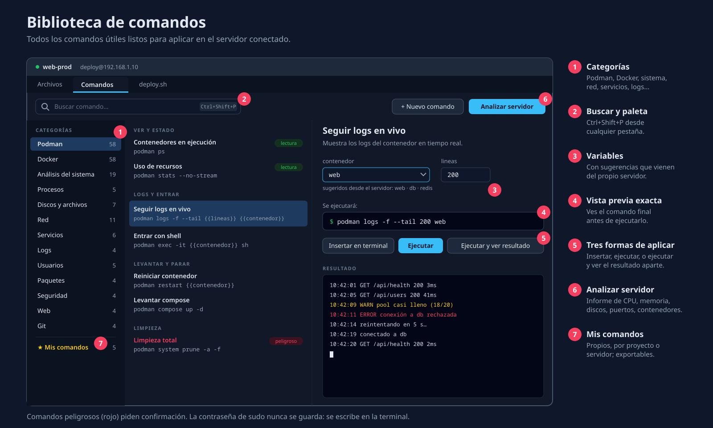
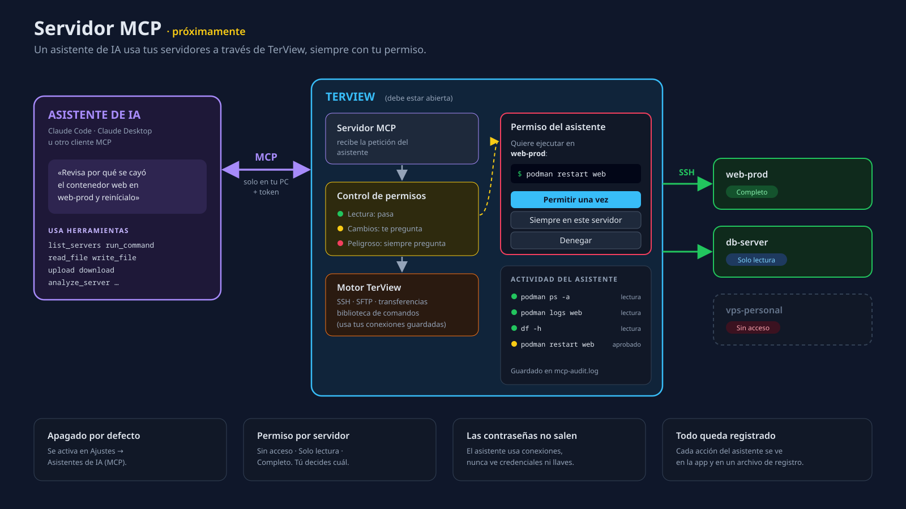

# TerView — Pendientes y próximas funciones

Estado al 11/11/2026 (v0.2.0): fases 0–9 construidas e integradas — conexión, terminal, explorador,
transferencias masivas, servidores/proyectos, editor, ventana, **reconexión automática, 2FA,
biblioteca de comandos, exportar/importar `~/.ssh/config`** y logo. **82/82 pruebas del motor pasan.**
Solo queda pendiente el MCP (opcional) y los detalles de la tabla final.

Este documento guarda lo que falta, **con suficiente detalle para retomarlo más tarde**.

| # | Función | Prioridad | Estado |
|---|---------|-----------|--------|
| 1 | [Biblioteca de comandos](#1-biblioteca-de-comandos) (Podman, análisis del sistema, etc.) | Alta | ✅ Hecho (v0.2.0) |
| 2 | [Reconexión rápida y automática](#2-reconexión-rápida-y-automática) | Alta | ✅ Hecho (v0.2.0) |
| 3 | [Servidor MCP (conectar asistentes de IA)](#3-servidor-mcp-conectar-asistentes-de-ia) | **Opcional** (última fase) | Diseñado, en pausa |
| 5 | [Exportar servidores a `~/.ssh/config`](#5-exportar-servidores-a-sshconfig) | Alta (corta) | ✅ Hecho (v0.2.0) |
| 4 | [Otros pendientes detectados](#4-otros-pendientes-detectados) | Media/Baja | Mayoría hecha; ver tabla |

**Orden sugerido:** 2 (reconexión) → 5 (exportar a `~/.ssh/config`) → 1 (biblioteca de comandos)
→ 3 (MCP, solo si hace falta; reutiliza `exec_capture` y el catálogo de la biblioteca).

---

## 1. Biblioteca de comandos



### Qué es
Un lugar dentro de la app donde están **todos los comandos útiles listos para aplicar** en el
servidor conectado, sin tener que recordarlos ni escribirlos: levantar contenedores con Podman,
ver logs, analizar el sistema, revisar discos, puertos, servicios, etc.

El catálogo inicial (todos los comandos, por categoría) está en
[`comandos/CATALOGO.md`](comandos/CATALOGO.md).

### Cómo se usa
1. **Panel "Comandos"** en cada pestaña de conexión (junto a "Archivos"), con buscador y categorías:
   Podman · Docker · Análisis del sistema · Procesos · Discos · Red · Servicios (systemd) · Logs ·
   Usuarios · Paquetes · Seguridad · Web (nginx/apache) · Git · **Mis comandos**.
2. **Paleta rápida** con `Ctrl+Shift+P`: escribes "podman logs" y lo ejecutas sin tocar el ratón.
3. Cada comando muestra **exactamente lo que se va a ejecutar** antes de correrlo.
4. Tres formas de aplicarlo:
   - **Insertar en terminal**: lo escribe en la terminal activa sin pulsar Enter (para revisarlo).
   - **Ejecutar**: lo escribe y lo ejecuta en la terminal activa.
   - **Ejecutar y ver resultado**: lo corre aparte (canal `exec`) y muestra la salida en el panel
     (tabla o texto), sin ensuciar la terminal. Ideal para análisis.

### Comandos con variables
Ejemplo: `podman logs -f --tail {{lineas:200}} {{contenedor}}`
- `{{contenedor}}` abre un formulario; las opciones **se sugieren desde el servidor**
  (p. ej. lista de contenedores con `podman ps -a --format '{{.Names}}'`).
- `{{lineas:200}}` = variable con valor por defecto.

### Análisis del sistema (un clic)
Botón **"Analizar servidor"** que corre comandos de solo lectura y arma un informe visual:
sistema operativo y kernel, tiempo encendido, CPU y carga, memoria y swap, discos (con alerta
si > 85 %), procesos que más consumen, servicios fallidos, puertos abiertos, contenedores
(Podman/Docker), últimos errores del sistema, actualizaciones pendientes.
Detecta la distribución (Fedora/RHEL → `dnf`, Debian/Ubuntu → `apt`, Alpine → `apk`) para usar
el comando correcto.

### Mis comandos (personalizados)
- Crear, editar, duplicar y borrar comandos propios.
- Alcance: **global**, **por proyecto** o **por servidor**.
- Importar/exportar en JSON para compartir con el equipo.
- Se guardan en `~/.config/terview/commands.json`.

### Seguridad
- Comandos marcados como **peligrosos** (borrar, `prune`, reiniciar, `rm`…) piden confirmación
  y se muestran en rojo.
- Comandos con `sudo` se marcan; la contraseña de sudo **nunca** se guarda ni se envía sola:
  se escribe en la terminal.
- "Ejecutar y ver resultado" tiene límite de tiempo (p. ej. 30 s) y botón para cancelar.

### Cómo se construiría
| Parte | Dónde | Qué hace |
|-------|-------|----------|
| Catálogo base | `src/features/commands/catalog.ts` | Comandos incluidos (desde `CATALOGO.md`) |
| Mis comandos (motor) | `src-tauri/src/snippets/` | Guardar/leer `commands.json` (mismo patrón que `storage/`) |
| Ejecutar y capturar | `src-tauri/src/snippets/exec.rs` | Canal `exec` con tiempo límite; devuelve salida, errores y código |
| Panel | `src/components/Commands/` | Lista, buscador, categorías, formulario de variables, resultados |
| Paleta | `src/components/Commands/Palette.tsx` | `Ctrl+Shift+P` |
| Análisis | `src/components/Commands/Analysis.tsx` | Informe visual del servidor |
| Insertar en terminal | `TerminalArea` | Exponer "escribir en la terminal activa" (hoy no existe) |

Comandos Tauri nuevos: `snippets_load`, `snippets_save`, `snippets_delete`, `exec_capture(sessionId, command, timeoutSecs)`.

---

## 2. Reconexión rápida y automática

### Cómo funciona hoy
- Un vigilante revisa cada **1,5 s** si la conexión sigue viva (`ssh/commands.rs`, `WATCH_INTERVAL`).
- **Si el servidor cierra** la conexión (reinicio, expulsión): se detecta en **1–2 s**.
- **Si se cae la red** (wifi, cable, VPN): se detecta en **90–120 s**, porque la señal de vida
  (`keepalive`) se envía cada 30 s y se da por perdida tras 3 sin respuesta
  (`ssh/connect.rs`: `keepalive_interval: 30s`, `keepalive_max: 3`).
- Al detectarse: punto rojo en la pestaña, aviso **"Conexión perdida"** con **Reconectar** / **Cerrar**,
  terminales muestran "Conexión cerrada", transferencias pasan a error (se pueden reintentar y
  continúan desde donde quedaron).

### Mejora 1 — Detección más rápida
- Bajar `keepalive_interval` a **10 s** (detección en ~30 s).
- Hacerlo configurable en **Ajustes → Conexión** ("Detectar desconexión en: 15 s / 30 s / 60 s / 2 min").
- Archivos: `src-tauri/src/ssh/connect.rs`, `src-tauri/src/types.rs` (`Settings`),
  `src/api/types.ts`, `src/components/Settings/SettingsDialog.tsx`.

### Mejora 2 — Reconexión automática
1. Al caerse, la pestaña muestra **"Reconectando… (intento 2 de 5)"** en vez del error.
2. Reintentos con espera creciente: 1 s, 2 s, 5 s, 10 s, 30 s (configurable, se puede desactivar).
3. Usa la contraseña/frase guardada en el llavero; si no hay, muestra el aviso con **Reconectar**.
4. Al volver:
   - **Mismo `sessionId`** (se reemplaza la conexión dentro de `SessionStore`), así la interfaz
     no tiene que rehacer pestañas.
   - Explorador recarga **la misma carpeta** (requiere que `FileExplorer` informe su ruta actual:
     prop `onPathChange`).
   - Terminales abren una shell nueva (la anterior se pierde). Opción futura: **usar `tmux`/`screen`**
     para que la sesión de la terminal sobreviva a cortes.
   - Transferencias con error se **reanudan solas** (el motor ya sabe continuar desde el último byte).
5. Nuevo evento `session://reconnected` y estado `"reconnecting"` en `SessionTab`.

Archivos: `ssh/commands.rs` (vigilante + bucle de reintentos), `ssh/mod.rs` (`SessionStore::replace`),
`types.rs` + `src/api/types.ts` (evento), `stores/tabs.ts` (estado), `components/Session/SessionView.tsx`
(aviso), `components/Terminal/*` (reabrir shell), `stores/transfers.ts` (reanudar).

---

## 3. Servidor MCP (conectar asistentes de IA)

> **Decisión (11/11/2026): en pausa, opcional.** No es necesario para empezar a usar IA con los
> servidores. Alternativas que ya funcionan hoy:
> 1. **Claude Code + `ssh`**: con los servidores en `~/.ssh/config` (ver [punto 5](#5-exportar-servidores-a-sshconfig))
>    y autenticación por llave, Claude Code ejecuta `ssh web-prod '…'` / `scp` directamente y pide permiso
>    antes de cada comando. Cero código.
> 2. **Servidores MCP de terceros** para SSH (p. ej. `tufantunc/ssh-mcp`, `thebusted/SSH-MCP`) o Podman
>    (`manusa/podman-mcp-server`, local). Revisar el código antes y usar usuarios con pocos permisos.
> 3. **Terminales con IA integrada**: Wave Terminal (código abierto), Termius (pago), Warp.
>
> Construir el MCP propio solo si se quiere que la IA use **las conexiones y contraseñas guardadas en
> TerView**, con permisos por servidor, aprobación visual y registro dentro de la app.



### Qué es
**MCP** (Model Context Protocol) es el estándar para que asistentes de IA (Claude Code,
Claude Desktop, otros clientes MCP) usen herramientas externas. TerView expondría un servidor
MCP para que el asistente pueda **trabajar con tus servidores usando las conexiones que ya
tienes guardadas**, por ejemplo:

> "Revisa por qué se cayó el contenedor web en web-prod y reinícialo"
> → el asistente lista contenedores, lee los logs, te muestra el diagnóstico y pide permiso para `podman restart web`.

### Herramientas que ofrecería (tools)
| Herramienta | Qué hace | Permiso |
|-------------|----------|---------|
| `list_servers` / `list_projects` | Servidores y proyectos guardados (sin contraseñas) | Lectura |
| `list_sessions` | Conexiones abiertas en la app | Lectura |
| `connect` | Abre una conexión a un servidor guardado (aparece como pestaña) | Pide permiso |
| `run_command` | Ejecuta un comando y devuelve salida, errores y código | Pide permiso |
| `run_catalog_command` | Ejecuta un comando de la Biblioteca con sus variables | Pide permiso (salvo 📊 de solo lectura) |
| `analyze_server` | Corre el "Analizar servidor" y devuelve el informe | Lectura |
| `list_dir` / `stat` / `read_file` | Navegar y leer archivos remotos | Lectura |
| `write_file` | Crear/editar archivos (guardado atómico) | Pide permiso, muestra diferencias |
| `upload` / `download` | Transferencias con la cola de la app | Pide permiso |
| `transfer_status` | Progreso de transferencias | Lectura |

Recursos MCP (resources): lista de servidores, catálogo de comandos, informe del último análisis.

### Seguridad (lo más importante)
- **Apagado por defecto.** Se activa en **Ajustes → Asistentes de IA (MCP)**.
- **Permiso por servidor**: *Sin acceso* / *Solo lectura* / *Completo*. Por defecto, *Sin acceso*.
- **Aprobación en TerView** para todo lo que cambie algo: diálogo con el comando exacto
  ("El asistente quiere ejecutar `podman restart web` en web-prod") →
  **Permitir una vez** / **Permitir siempre este comando en este servidor** / **Denegar**.
- Comandos peligrosos (⚠️ del catálogo, `rm -rf`, `prune`, `sudo`…) **siempre** piden permiso.
- **Las contraseñas y llaves nunca salen** por MCP: el asistente solo usa conexiones, no credenciales.
- **Registro de auditoría**: todo lo que hace el asistente queda en
  `~/.config/terview/mcp-audit.log` y visible en un panel de la app ("Actividad del asistente").
- Solo escucha en la propia máquina (`127.0.0.1` / socket local) con **token** que se puede regenerar.

### Cómo se construiría
| Parte | Dónde | Qué hace |
|-------|-------|----------|
| Servidor MCP | `src-tauri/src/mcp/` | SDK oficial de MCP para Rust (crate `rmcp`); reutiliza `SessionStore`, `sftp`, `transfer`, `snippets::exec_capture` |
| Transporte | HTTP local (`127.0.0.1:<puerto>` + token) | Para clientes que hablan HTTP |
| Puente stdio | binario `terview-mcp` | Para clientes que lanzan el servidor por stdio; reenvía a la app abierta por socket local |
| Aprobaciones | `src/features/mcp/ApprovalDialog.tsx` | Diálogo de permiso + recordar decisión |
| Ajustes | `SettingsDialog` → sección "Asistentes de IA" | Activar, permisos por servidor, token, ver configuración |
| Actividad | `src/components/McpActivity/` | Lista de acciones del asistente con resultado |

Configuración en el cliente (ejemplo con Claude Code), que la app mostraría para copiar:
```bash
claude mcp add terview -- terview-mcp
```

Requisito: la app debe estar abierta (las conexiones viven en ella). Si está cerrada, el puente
responde "Abre TerView para usar tus servidores".

---

## 5. Exportar servidores a `~/.ssh/config`

### Para qué
Que los servidores guardados en TerView funcionen también con `ssh web-prod` en cualquier terminal,
con `scp`/`rsync`, con VS Code Remote-SSH y con asistentes como Claude Code — sin configurarlos dos veces.

### Cómo
- Botón **"Exportar a ~/.ssh/config"** (menú de la barra lateral y en Ajustes) y opción
  **"Mantener sincronizado"** (se actualiza al guardar/borrar servidores).
- TerView escribe **solo dentro de un bloque marcado**, sin tocar el resto del archivo:
  ```
  # >>> TerView (no editar a mano) >>>
  Host web-prod
      HostName 192.168.1.10
      Port 22
      User deploy
      IdentityFile ~/.ssh/id_ed25519
  # <<< TerView <<<
  ```
- Alias = nombre del servidor convertido a formato seguro (`Cliente X / web` → `cliente-x-web`), sin duplicados.
- Servidores con contraseña: se exportan igual (ssh la pedirá); se sugiere pasar a llave.
- **Importar** desde `~/.ssh/config`: leer los `Host` existentes y ofrecer agregarlos a TerView.
- Copia de seguridad `~/.ssh/config.bak-terview` antes de la primera escritura; permisos 0600.

Archivos: `src-tauri/src/storage/ssh_config.rs` (leer/escribir bloque), comandos
`profiles_export_ssh_config` / `profiles_import_ssh_config`, botón en `Sidebar` y opción en `SettingsDialog`.

---

## 4. Otros pendientes detectados

| Tema | Estado |
|------|--------|
| 2FA / códigos OTP | ✅ Hecho: diálogo "Código de verificación", varias rondas, llave + código. ⚠️ Sin probar contra un servidor 2FA real. Las sesiones con 2FA no se reconectan solas (el código es de un solo uso). |
| Agente SSH | Implementado, ⚠️ sin probar con un agente real. |
| Conflictos al subir | ✅ Ajustes → Transferencias: Sobrescribir / Omitir / Solo si es más nuevo. Falta preguntar archivo por archivo. |
| Simultáneas por servidor | ✅ Hecho (el límite cuenta por servidor). |
| Symlinks en carpetas | ✅ Se copian como enlaces en ambos sentidos. |
| Buscar en la terminal | ✅ Ctrl+Shift+F. |
| Atajos en la terminal | ✅ Documentados en la bienvenida. |
| Fuente del editor | ✅ Ajuste propio. |
| Duplicar servidor | ✅ Copia también la contraseña guardada. |
| Logo e ícono | ✅ `docs/marca/`, ícono de la app generado. |
| Instaladores | ✅ `.rpm`. ⏳ Falta `.deb` / `.AppImage` y firmar. |
| Arrastrar al sistema | ⏳ Arrastrar archivos **desde** el explorador al escritorio (necesita plugin de arrastre nativo). |
| Exportar "Mis comandos" a archivo | ⏳ Hoy se copia al portapapeles; para guardar en archivo hace falta un comando del motor o `tauri-plugin-fs`. |
| Alias de `~/.ssh/config` | ⏳ No se comprueba que el alias de TerView no choque con un `Host` escrito a mano. |
| Cancelar "ver resultado" | ⏳ Deja de esperar, pero el comando remoto sigue hasta terminar o agotar el tiempo. |
| Pruebas de la interfaz | ⏳ La interfaz se revisó con capturas en navegador; faltan pruebas automáticas dentro de la app real. |

---

## 6. Windows (y macOS)

El código ya es multiplataforma (Tauri + Rust): todo lo específico de Linux (permisos 0600, enlaces
simbólicos, agente por socket) tiene su alternativa en Windows. Llavero: Administrador de credenciales
de Windows. Ventana: WebView2 (ya viene en Windows 10/11). `~/.ssh` = `C:\Users\<usuario>\.ssh`.

Falta:
| Tema | Detalle |
|------|---------|
| Compilar para Windows | No se puede desde Fedora (una librería de cifrado necesita compilar C para Windows). Opciones: compilar en una PC con Windows (`npm run tauri build` → `.msi` / `.exe`) o **GitHub Actions** con `tauri-action` (Linux + Windows + macOS automáticamente en cada versión). |
| Agente SSH en Windows | Hoy da "no soportado". russh ya trae soporte: OpenSSH de Windows (`\\.\pipe\openssh-ssh-agent`) y Pageant (PuTTY). |
| Probar en Windows | Rutas con `\`, arrastrar desde el Explorador de Windows, tema del sistema. |
| Firmar el instalador | Sin firma, Windows SmartScreen muestra un aviso al instalar. |

---

## 7. Ideas recomendadas (siguientes funciones)

Ordenadas por utilidad para el día a día:

| # | Función | Para qué |
|---|---------|----------|
| 1 | **Túneles (port forwarding)** `-L` / `-R` / SOCKS | Abrir en tu PC una base de datos o panel web del servidor (`localhost:5432` → servidor) sin exponer puertos. Panel con túneles guardados por servidor y un clic para activarlos. |
| 2 | **Servidor intermedio (jump host / bastión)** | Llegar a servidores internos pasando por otro (`ProxyJump`). Muy común en empresas. |
| 3 | **Ejecutar en varios servidores a la vez** | Un comando de la biblioteca en todo un proyecto (p. ej. `podman ps` en 5 servidores) con resultados lado a lado. |
| 4 | **Monitoreo en vivo** | Gráficas de CPU, memoria, disco y red en tiempo real (amplía "Analizar servidor"), con alertas. |
| 5 | **Sincronizar carpeta** | Carpeta local ↔ remota: al guardar en tu PC se sube sola (desarrollo web). |
| 6 | **Sesiones persistentes con tmux** | La terminal sobrevive a cortes de red y a cerrar la app. |
| 7 | **Comparar archivos** | Diferencias entre un archivo local y uno remoto, o entre dos servidores. |
| 8 | **Actualizaciones automáticas** | La app se actualiza sola (`tauri-plugin-updater`) + instaladores para Windows/macOS con GitHub Actions. |
| 9 | **Respaldo/sincronización de servidores** | Exportar todo cifrado con contraseña o sincronizar entre tus equipos. |
| 10 | **Historial por servidor** | Comandos usados y grabación opcional de sesiones (auditoría). |

---

## 8. Plan elegido para la siguiente ronda (11/11/2026)

| Orden | Función | Origen |
|-------|---------|--------|
| 1 | [Optimización / rendimiento](#81-optimización--rendimiento) | Se siente lenta |
| 2 | [Gestión del servidor: usuarios y grupos](#82-gestión-del-servidor-usuarios-y-grupos) | Falta para administradores |
| 3 | [Monitoreo en vivo](#83-monitoreo-en-vivo) | Idea 4 |
| 4 | [Túneles (port forwarding)](#84-túneles-port-forwarding) | Idea 1 |
| 5 | [Versiones y actualizaciones](#85-versiones-y-actualizaciones) | Idea 8 |
| 6 | [Ejecutar en varios servidores a la vez](#86-ejecutar-en-varios-servidores-a-la-vez) | Idea 3 (opcional) |
| 7 | [GitHub: Actions + conectar cuenta](#9-github) | Instaladores, versiones, llaves, despliegues |

### 8.1 Optimización / rendimiento

**Primero medir, luego cambiar.** Hay que saber *dónde* se siente lenta:
al abrir la app, al conectar, al navegar carpetas, al escribir en la terminal, al cambiar de pestaña,
al mover divisores o durante transferencias.

Causas probables (por revisar en este orden):
| # | Causa posible | Cómo verificar | Arreglo |
|---|---------------|----------------|---------|
| 1 | **Modo desarrollo** (`npm run tauri dev`): Rust sin optimizar + Vite en vivo | Comparar con el instalador `.rpm` (compilado optimizado) | Usar la versión instalada para el día a día |
| 2 | **WebKitGTK en Linux/Wayland** (motor de la ventana): problemas conocidos de dibujado con ciertas tarjetas gráficas | Probar con `WEBKIT_DISABLE_DMABUF_RENDERER=1` y con `WEBKIT_DISABLE_COMPOSITING_MODE=1` | Detectarlo y aplicar la variable automáticamente al iniciar si mejora |
| 3 | **Carga inicial pesada**: el paquete principal pesa ~780 KB y Monaco ~4 MB | Medir tiempo hasta la primera pantalla | Cargar Sidebar/Comandos/Transferencias bajo demanda; precargar Monaco en segundo plano |
| 4 | **Re-dibujados de React** innecesarios (estado global que redibuja toda la ventana: transferencias cada 200 ms, pestañas, ajustes) | React Profiler / contar renders | Selectores más finos en zustand, `memo`, separar el estado de progreso |
| 5 | **Listas largas** (explorador con miles de archivos, cola con miles de trabajos, catálogo de comandos) | Probar carpeta con 5.000 archivos | Virtualización en todas las listas |
| 6 | **Efectos visuales caros**: sombras, `backdrop-filter`, animaciones, `color-mix` | Desactivarlos y comparar | Simplificar en Linux |
| 7 | **xterm.js** sin aceleración | Probar `@xterm/addon-webgl` | Usar el renderizador WebGL si está disponible |
| 8 | **Llamadas al motor en serie** (p. ej. abrir una carpeta hace varias peticiones seguidas) | Registro de tiempos por comando | Unir peticiones, caché de carpetas visitadas |

Entregable: un pequeño **panel de diagnóstico** (Ajustes → Avanzado) con tiempos de arranque, de
cada comando y FPS al mover paneles, para comparar antes/después.

### 8.2 Gestión del servidor: usuarios y grupos

Nueva pestaña **"Administración"** en cada conexión (para quien entra como root o con sudo):

**Usuarios**
- Lista de usuarios (`getent passwd`), separando personas (UID ≥ 1000) de cuentas del sistema:
  nombre, UID, grupos, shell, carpeta personal, último acceso (`lastlog`/`last`), bloqueado sí/no, con sudo sí/no.
- **Crear usuario**: nombre, nombre completo, contraseña (o generar una segura), shell, crear carpeta
  personal, grupos, dar acceso sudo (`wheel` en Fedora/RHEL, `sudo` en Debian/Ubuntu), añadir llave SSH.
- **Editar**: cambiar contraseña, shell, nombre completo, grupos (añadir/quitar), forzar cambio de
  contraseña en el próximo inicio (`chage -d 0`), fecha de caducidad.
- **Bloquear / desbloquear** (`usermod -L/-U`), **eliminar** (con opción de borrar su carpeta; confirmación fuerte).
- **Llaves SSH del usuario**: ver, añadir y quitar líneas de su `~/.ssh/authorized_keys` (con permisos correctos).
- Ver **quién está conectado ahora** (`who`) y cerrar su sesión.

**Grupos**
- Lista (`getent group`), miembros, crear, renombrar, eliminar, añadir/quitar miembros (`gpasswd -a/-d`).

**Cómo se ejecuta**
- Comandos según la distribución (Fedora/RHEL, Debian/Ubuntu, Alpine: `useradd` vs `adduser`).
- **sudo**: si no eres root, la app pide tu contraseña de sudo **una vez por sesión** (solo en memoria,
  se puede olvidar con un botón) y usa `sudo -S`. Nunca se guarda en disco.
- Antes de cada cambio se muestra el **comando exacto** que se ejecutará.
- Todo cambio queda en un **registro** visible ("Historial de administración").

Siguientes ampliaciones naturales del mismo panel: **servicios** (systemd: iniciar/parar/activar, ver
logs), **firewall** (puertos abiertos), **paquetes** (actualizar, instalar), **tareas programadas** (cron/timers).

### 8.3 Monitoreo en vivo
- Gráficas en tiempo real (cada 2–5 s) de CPU, memoria, disco, red y carga, por servidor.
- Lectura ligera desde `/proc` por un canal `exec` dedicado (sin instalar nada en el servidor).
- Procesos que más consumen (con botón para terminar), contenedores con su consumo.
- **Alertas** configurables (disco > 85 %, memoria > 90 %, servicio caído) con aviso en la app.
- Vista "Proyecto": tarjetas de todos los servidores del proyecto a la vez.

### 8.4 Túneles (port forwarding)
- **Local** (`-L`): `localhost:5432` en tu PC → `db:5432` desde el servidor.
- **Remoto** (`-R`): exponer un puerto de tu PC en el servidor.
- **SOCKS** (`-D`): navegar como si estuvieras en la red del servidor.
- Túneles **guardados por servidor**, activar/desactivar con un clic, arranque automático al conectar,
  estado (activo, conexiones, bytes), aviso si el puerto local está ocupado.
- russh ya soporta `direct-tcpip` y `tcpip-forward`.

### 8.5 Versiones y actualizaciones
- **Acerca de**: versión, novedades de cada versión (changelog) y enlaces.
- **Buscar actualizaciones** y actualizar desde la app (`tauri-plugin-updater` + versiones publicadas en GitHub Releases, firmadas).
- **GitHub Actions** para generar instaladores de Linux (`.rpm`, `.deb`, `.AppImage`), Windows (`.msi`/`.exe`) y macOS en cada versión.
- Ver también la **versión de lo instalado en el servidor** (Podman, Docker, nginx, kernel…) y si hay
  actualizaciones pendientes del sistema (ya se detecta en "Analizar servidor").

### 8.6 Ejecutar en varios servidores a la vez
- Elegir servidores (o un proyecto completo) y ejecutar un comando de la biblioteca en todos.
- Resultados lado a lado o en tabla, con estado por servidor (correcto / error / tiempo agotado).
- Confirmación reforzada para comandos peligrosos.

---

## 9. GitHub

Dos partes independientes: **(A)** usar GitHub para construir y publicar TerView, y
**(B)** conectar una cuenta de GitHub dentro de la app para trabajar con los servidores.

### 9A. El proyecto en GitHub (GitHub Actions)
1. **Subir el proyecto**: `git init`, primer commit, repositorio en GitHub (privado o público),
   `.gitignore` ya existe (excluye `node_modules`, `dist`, `src-tauri/target`).
2. **Integración continua** (en cada cambio): compilar, `cargo clippy`, `cargo test` (los tests sin
   servidor), `tsc` y `vite build`. Opcional: levantar el contenedor SSH de pruebas en el propio
   Actions (`services:` con `linuxserver/openssh-server`) para correr también los tests con servidor.
3. **Publicar versiones** (al crear una etiqueta `v0.3.0`): `tauri-apps/tauri-action` genera
   instaladores de **Linux** (`.rpm`, `.deb`, `.AppImage`), **Windows** (`.msi`, `.exe`) y **macOS**
   (`.dmg`), y los adjunta a un **GitHub Release** con las notas de la versión.
4. **Actualizaciones automáticas**: el `tauri-plugin-updater` de la app consulta ese Release
   (archivo `latest.json` firmado) → "Hay una versión nueva, ¿actualizar?" (ver 8.5).
5. **Firmas**: llave de firma del actualizador (secreto en GitHub), y opcional certificado de
   firma de código para Windows/macOS (evita avisos de seguridad al instalar).

Archivos: `.github/workflows/ci.yml`, `.github/workflows/release.yml`, `CHANGELOG.md`.

### 9B. Conectar tu cuenta de GitHub en la app
Inicio de sesión con **GitHub (OAuth "device flow")**: la app muestra un código, lo pegas en
github.com y listo; el token se guarda en el **llavero del sistema**, nunca en archivos.
Se puede desconectar cuando quieras. Permisos mínimos según lo que se use.

Qué permitiría:
| Función | Para qué |
|---------|----------|
| **Llaves SSH ↔ GitHub** | Ver tus llaves públicas de GitHub y **añadirlas a un servidor** (`authorized_keys`) con un clic; o subir a GitHub una llave de tu PC. Útil junto a "Administración → llaves SSH de usuarios". |
| **Clonar repositorios en el servidor** | Elegir un repo de tu cuenta y clonarlo en una carpeta del servidor (con *deploy key* de solo lectura creada automáticamente). |
| **Desplegar** | Botón "Actualizar desde GitHub" en un proyecto: `git pull` + comandos posteriores (p. ej. `podman compose up -d --build`) en uno o varios servidores. |
| **Ver GitHub Actions** | Estado de los workflows de tus repos (último despliegue correcto/fallido) y lanzar uno manualmente. |
| **Sincronizar configuración** | Guardar servidores, proyectos y "Mis comandos" en un **Gist privado cifrado** para tenerlos en otra PC (las contraseñas **no** se sincronizan). |
| **Compartir comandos** | Publicar/importar colecciones de comandos desde un repo o gist (útil para equipos). |

Orden sugerido: 9A primero (da los instaladores de Windows/macOS y las actualizaciones), luego 9B
empezando por **llaves SSH** y **sincronizar configuración**.
