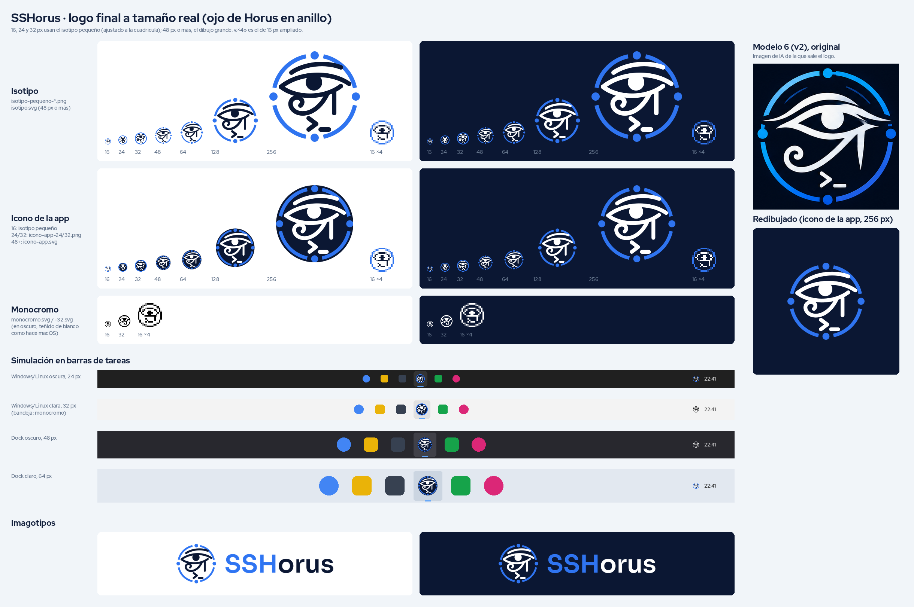

# Marca: SSHorus

A partir de la versión que sigue a la 0.5.0, TerView pasa a llamarse **SSHorus** (SSH + Horus, el dios
halcón egipcio cuyo ojo todo lo ve y protege). El logo elegido es el **ojo de Horus dentro de un anillo con
cuatro nodos y la terminal `>_` debajo del ojo**: es el **modelo 6 de
[`modelos_isotipos_v2.png`](modelos_isotipos_v2.png)** (abajo a la derecha), redibujado en vectores planos,
sin degradados ni brillos. Todo lo listo para usar está en [`sshorus/final/`](sshorus/final/).



`isotipo.svg` e `isotipo-1024.png` en esta carpeta son el **logo viejo** de TerView. Se quitan cuando se
haga el cambio de nombre en la app.

## Qué archivo usar para cada cosa

Todos están en `docs/marca/sshorus/final/`.

| Para qué | Archivo | Notas |
|---|---|---|
| Iconos de la app (Windows, macOS, Linux) | `icono-app-1024.png` | Fuente de `npx tauri icon`. PNG 1024 con transparencia; un disco azul noche de 824 px (80 %) con el anillo casi en su borde |
| Icono de la app editable | `icono-app.svg` | El mismo dibujo en vectores |
| Icono de la app a 24 y 32 px | `icono-app-24.png`, `icono-app-32.png` (y sus `.svg`) | Dibujados a píxel; a ese tamaño el anillo hace de borde del disco. Después de `tauri icon`, conviene poner `icono-app-32.png` en lugar de `32x32.png` y meter el de 24 en el `.ico` |
| Logo suelto a 16, 24 y 32 px | `isotipo-pequeno-16/24/32.png` (fondo claro), `isotipo-pequeno-oscuro-16/24/32.png` (fondo oscuro) | Fuentes: `isotipo-pequeno.svg` (16), `isotipo-pequeno-24.svg`, `isotipo-pequeno-32.svg` y sus `-oscuro` |
| Logo suelto a 48 px o más | `isotipo.svg` / `isotipo-oscuro.svg` (`isotipo-1024.png`, `isotipo-oscuro-1024.png`) | El dibujo con todos los detalles (anillo con 4 nodos, ceja, iris, lágrima, espiral y `>_`) |
| Icono de bandeja en macOS (plantilla) | `monocromo-16.png` y `monocromo-32.png` (@2x) | Negro con transparencia; macOS lo tiñe solo (`iconAsTemplate`) |
| Icono de bandeja en Linux | `monocromo-16.png`, o `isotipo-pequeno-oscuro-16.png` si la barra es oscura | |
| Icono de bandeja en Windows | `isotipo-pequeno-16.png` / `isotipo-pequeno-oscuro-16.png` | Windows no tiñe los iconos de la bandeja: usar el de colores |
| Favicon (web) | `favicon.svg` | El de 16 px; si el navegador está en modo oscuro, el ojo pasa a blanco |
| Logo con el nombre | `imagotipo.svg` / `imagotipo-oscuro.svg` (PNG de 256 px de alto) | Símbolo + «SSHorus» en Sora SemiBold, letras ya pasadas a curvas |
| Revisión | `hoja.png` | Todo a 16, 24, 32, 48, 64, 128 y 256 px en claro y oscuro, simulado en barras de tareas, y el modelo 6 original al lado |

Regla corta: **a 32 px o menos, siempre el «pequeño»**; a 48 px o más, el grande.

## Colores

Tres colores planos, sin degradados ni sombras:

| Nombre | Hex | Dónde va |
|---|---|---|
| Azul anillo | `#2F74F0` | Anillo y nodos (en claro y en oscuro), «SSH» del imagotipo |
| Azul noche | `#0B1733` | Fondo del icono de la app; ojo y `>_` en fondo claro; «orus» del imagotipo claro |
| Blanco | `#FFFFFF` | Ojo y `>_` en fondo oscuro y en el icono de la app; «orus» del imagotipo oscuro |

El azul del anillo se lee bien sobre blanco y sobre azul noche (contraste de unos 4:1 en los dos).

## Tipografía

- Imagotipo: **Sora SemiBold** (Google Fonts). Es geométrica y de trazo parejo, como el símbolo, y su
  forma ancha equilibra el círculo. «SSH» en azul anillo y «orus» en azul noche (o blanco en oscuro). En los
  SVG ya está en curvas.
- Textos de la app y la web: la fuente del sistema o **Inter**.
- Terminal: **JetBrains Mono**.

## El `>_`: debajo del ojo, no en el iris

Se probaron las dos posiciones. Dentro del iris el `>_` tiene que ser muy pequeño y a 48 px ya es una mancha;
debajo del ojo, dentro del anillo, puede ser más grande (casi tan alto como el iris) y se lee desde 32 px. Por
eso va debajo, como en el modelo, pero más grande.

## Qué cambia en el isotipo pequeño

A 16, 24 y 32 px el dibujo grande se vuelve una mancha, así que el pequeño está **dibujado píxel a píxel**
(un SVG por tamaño, todo en cuadrados de 1 px; algunos píxeles a media opacidad para suavizar curvas):

- Sin los nodos ni los huecos del anillo: anillo continuo de 1 px (16) o 2 px (24 y 32).
- **16 px**: anillo, ojo con la pupila en el centro, lágrima y `>_` (un `>` de 3 píxeles). Sin ceja ni
  espiral: lo que tiene que leerse es «ojo en un círculo + terminal».
- **24 px**: se suman la ceja y una espiral de una vuelta; el `>` es de 5 píxeles y 2 de grueso.
- **32 px**: ceja, iris pegado al párpado, lágrima, espiral abierta y un `>` de 7 píxeles y 2 de grueso.

## Cómo se eligió

Las pruebas de nombres están en [NOMBRES.md](NOMBRES.md) y la comparación de las primeras propuestas de logo
en [comparacion.png](comparacion.png). Después se generaron con IA dos hojas de ideas,
[`modelos_isotipos.png`](modelos_isotipos.png) y [`modelos_isotipos_v2.png`](modelos_isotipos_v2.png); de la
segunda se eligió el **modelo 6**. La hoja `sshorus/final/hoja.png` lo muestra al lado del redibujado.

En `sshorus/ojo/` y `sshorus/halcon/` quedan propuestas anteriores (el ojo con el `>_` en el iris y el
halcón de perfil). El logo final anterior (ojo con `>_` en el iris, en azul y oro) queda en el historial de
git.

## Siguiente paso

Cambiar el nombre en la app (migrando los datos, ver `docs/PENDIENTES.md`) y generar los iconos con:

```
npm run tauri icon docs/marca/sshorus/final/icono-app-1024.png
```

Después, cambiar `src-tauri/icons/32x32.png` por `icono-app-32.png`.
