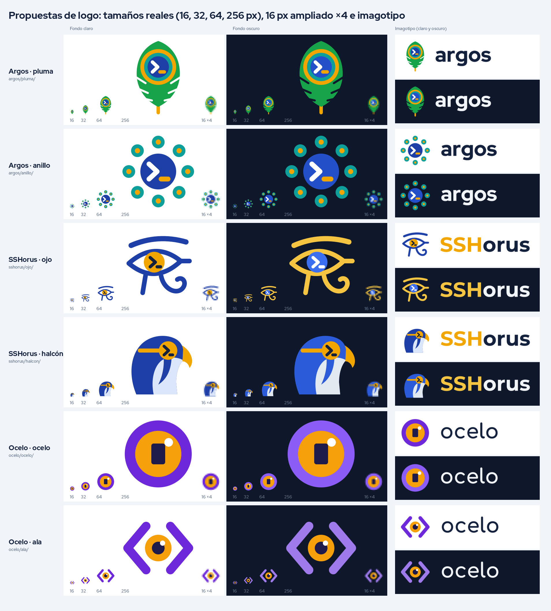

# Marca: propuestas de nombre y logo

Para la versión que sigue a la 0.5.0 se busca un **nombre y un logo nuevos**. Aquí están las pruebas.

- [NOMBRES.md](NOMBRES.md): qué nombres están libres y cuáles chocan con otras marcas.
- [comparacion.png](comparacion.png): todos los logos lado a lado, a 16, 32, 64 y 256 px, en fondo claro y
  oscuro, y con el nombre al lado.
- `isotipo.svg` e `isotipo-1024.png` en esta carpeta son el **logo actual** de TerView (no se tocan hasta
  decidir).



## Qué hay en cada carpeta

```
docs/marca/<nombre>/<propuesta>/
  isotipo.svg            el símbolo solo (fondo claro)
  isotipo-oscuro.svg     el símbolo para fondo oscuro
  imagotipo.svg          símbolo + nombre (fondo claro)
  imagotipo-oscuro.svg   símbolo + nombre (fondo oscuro)
  isotipo-16/32/64/256/1024.png, isotipo-oscuro-*.png, imagotipo*.png
```

Los SVG están hechos a mano, sin degradados. En el imagotipo las letras ya están pasadas a curvas, así que
se ven igual en cualquier PC aunque no tenga la fuente.

## Propuestas

### Argos · pluma (`argos/pluma/`)
Una pluma de pavo real vista de frente. El «ojo» de la pluma tiene tres anillos y en el centro una terminal
`>_`. Los cortes en los bordes son las barbas de la pluma.
Colores: verde `#16A34A`, oro `#F0A500`, turquesa `#0E9F9A`, azul `#1D3FA6` (en oscuro `#2350C8`).

### Argos · anillo (`argos/anillo/`)
Ocho ojos alrededor de una terminal: «muchos ojos vigilando tus servidores». Es la más simple de dibujar,
pero a 16 px los ojos se vuelven puntos y puede recordar a un engranaje o un virus.
Colores: turquesa `#0E9F9A`, oro `#F0A500`, azul `#1D3FA6` (en oscuro `#2350C8`).

### SSHorus · ojo (`sshorus/ojo/`)
El ojo de Horus clásico (ceja, ojo, lágrima y espiral) con el iris convertido en `>_`. Se reconoce
enseguida a 64 px o más; a 16 px queda solo la silueta.
Colores (claro): azul lapislázuli `#1D3FA6`, oro `#F0A500`, tinta `#14213D`.
Colores (oscuro): oro `#F5C542`, azul `#3B6FF0`, blanco.

### SSHorus · halcón (`sshorus/halcon/`)
La cabeza del halcón Horus de perfil. La mancha oscura de la mejilla del halcón peregrino es justo el
origen del dibujo del ojo de Horus; aquí el ojo es la terminal `>_`. A 32 px se reconoce; a 16 px queda una cabeza azul con el ojo dorado.
Colores: azul `#1D3FA6` (en oscuro `#2B5BD8`), oro `#F0A500`, mejilla `#DCE6FB` (en oscuro `#E2E8F0`),
tinta `#14213D`.

### Ocelo · ocelo (`ocelo/ocelo/`)
Una mancha-ojo como las de las mariposas: anillo violeta, iris ámbar y la pupila es el **cursor** de la
terminal (un bloque), con un brillo blanco. La más clara a 16 px.
Colores: violeta `#6D28D9` (en oscuro `#8B5CF6`), ámbar `#F5A00B`, pupila `#1E1B4B`, blanco.

### Ocelo · ala (`ocelo/ala/`)
Los signos `<` y `>` hacen de alas y en el centro va la mancha-ojo: parece una polilla y a la vez un
símbolo de código. Se lee bien en pequeño.
Colores: violeta `#6D28D9` (en oscuro `#9F7AEA`), ámbar `#F5A00B`, pupila `#1E1B4B`, blanco.

## Tipografía sugerida (gratis, de Google Fonts)

| Nombre | Fuente del imagotipo | Por qué |
|---|---|---|
| Argos | **Red Hat Display** ExtraBold, en minúsculas | Redonda y firme, combina con la pluma |
| SSHorus | **Montserrat** Bold, «SSH» en oro y «orus» en tinta | Separa «SSH» y se lee el juego de palabras |
| Ocelo | **Comfortaa** Bold, en minúsculas | Letras redondas como el ojo |

Para el texto de la app y la web basta con la fuente del sistema o **Inter**; para la terminal,
**JetBrains Mono**.

## Siguiente paso

Elegir nombre y propuesta. Después: generar los iconos de la app con `npm run tauri icon <isotipo-1024.png>`
y seguir el punto 4 de `docs/PENDIENTES.md` (renombrar migrando los datos).
